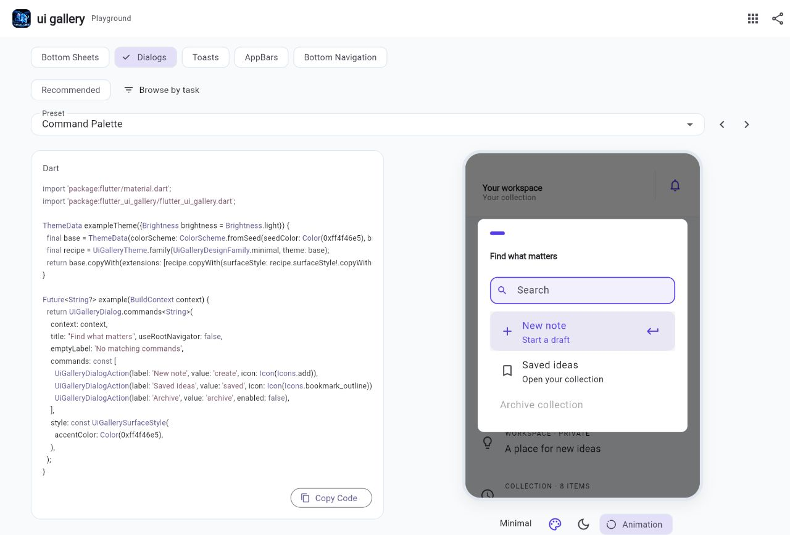
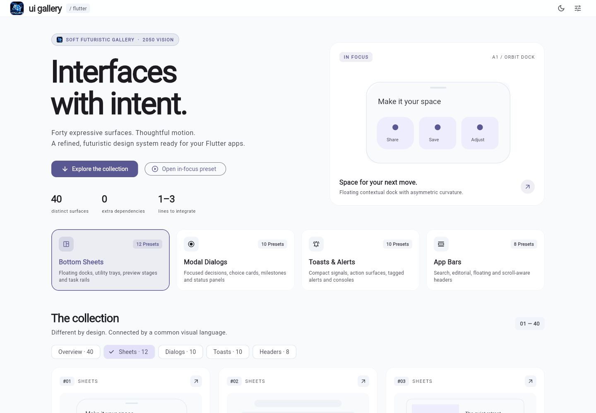
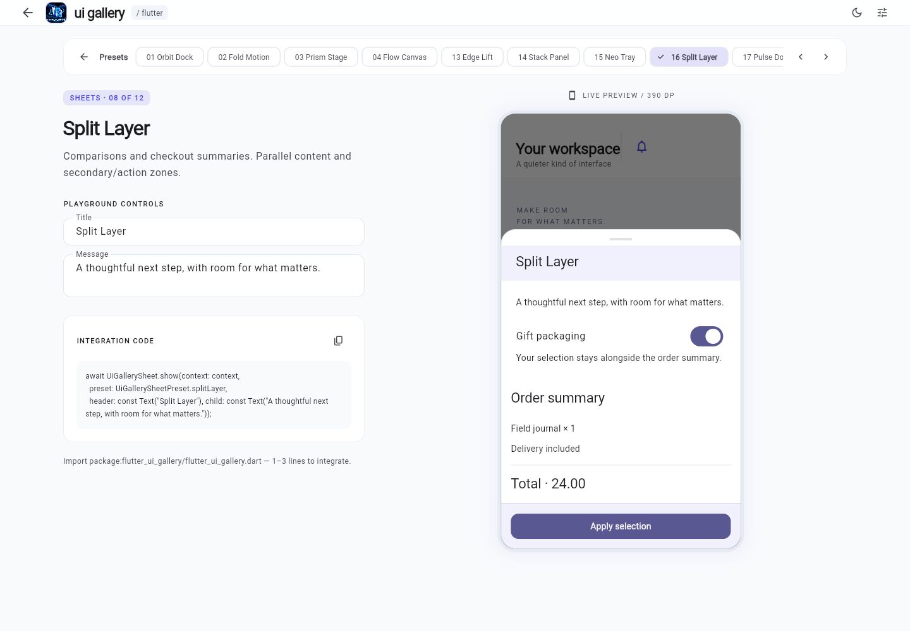

<p align="center">
  
</p>

<h1 align="center">Flutter UI Gallery 🎨</h1>

<p align="center">
  <a href="https://flutter.dev">
    
  </a>
  <a href="https://dart.dev">
    
  </a>
  <a href="https://github.com/Ahmedelsapagh10/flutter_ui_gallery/blob/master/LICENSE">
    
  </a>
  <a href="https://github.com/Ahmedelsapagh10/flutter_ui_gallery/pulls">
    
  </a>
  
</p>

<p align="center">
  <strong>Extraordinary UI. Effortless Flutter.</strong><br>
  A curated collection of creative, futuristic, and production-ready Bottom Sheets, Dialogs, Toasts, AppBars, and Bottom Navigation for Flutter.
</p>


## The collection

**66 presets**: 12 bottom sheets, 11 dialogs, 11 toasts, 17 app bars and 15 bottom navigation bars. Each uses a distinct composition and a finite Flutter-native transition. No external runtime dependencies, replacement MaterialApp, global service registration or state-management adoption is required.

See the [variation matrix](doc/PRESETS.md) for every preset's geometry, motion and intended use. The example app includes a working scenario and copyable code for every preset.

Try the [public playground](https://ahmedelsapagh10.github.io/flutter_ui_gallery/): start with eight recommended presets, browse by task, compare design families, and share a configuration with its matching Dart setup. The toolbar also opens productivity, shopping and dashboard examples.

## Coordinated design families

Minimal, Soft and Spatial coordinate typography, spacing, elevation and finite motion across all five component types. They use your application's colors and fonts; header and navigation silhouettes retain their preset geometry.

```dart
final base = ThemeData(colorScheme: ColorScheme.fromSeed(seedColor: Colors.indigo));
final gallery = UiGalleryTheme.family(UiGalleryDesignFamily.soft, theme: base);
final theme = base.copyWith(extensions: [
  gallery.copyWith(
    dialogStyle: gallery.dialogStyle!.copyWith(maxWidth: 520),
  ),
]);
```

Preserve your other theme extensions when adding this to an existing application. Shared styles are refined by component styles, local `appearance`, then per-call `style` and `motion`. Overrides merge only supplied fields, including partial text styles and motion timings. `copyWith`, `merge` and interpolation are available on surface styles and motion; theme extensions interpolate during theme changes. System reduced motion always takes priority.



See [integration guidance](doc/INTEGRATION.md) for caller-owned state, routing, async operations and the three working application examples.



## Installation

This checkout contains the expansion. Until it is released, use a local path dependency:

```yaml
dependencies:
  flutter_ui_gallery:
    path: /path/to/flutter_ui_gallery
```

Run `flutter pub get`, then import:

```dart
import 'package:flutter_ui_gallery/flutter_ui_gallery.dart';
```

Flutter 3.41+ and Dart 3.11.5+ are required. SDK and package versions have not been upgraded as part of the expansion.

## Quick start

```dart
await UiGallerySheet.show(context: context,
  preset: UiGallerySheetPreset.orbitDock, child: const Text('Choose an option'));

final accepted = await UiGalleryDialog.confirm(context: context,
  preset: UiGalleryDialogPreset.haloFocus, title: 'Continue?');

UiGalleryToast.success(context, message: 'Changes saved.');

Scaffold(appBar: const UiGalleryAppBar(
  preset: UiGalleryAppBarPreset.adaptiveHorizon, title: Text('Explore')));
```

The original `orbit`, `fold`, `prism`, `flow`, `halo`, `split`, `timeline`, `spotlight`, `signal`, `ribbon` and `action` enum values remain valid. Descriptive aliases such as `orbitDock` and `signalPill` point to the same values. The `Nova*` API aliases and `nova_surfaces.dart` import are preserved. Existing enum indices remain unchanged; appending enum cases can require updating exhaustive switches in consuming applications.

## Bottom sheets

Orbit Dock, Fold Motion, Prism Stage, Flow Canvas, Edge Lift, Stack Panel, Neo Tray, Split Layer, Pulse Dock, Horizon Peek, Depth Frame and Task Rail.

All accept arbitrary content, an optional header, leading/trailing slots and a sticky footer. `secondary` adds a preview to Horizon Peek or a second content zone to Split Layer. Wide split layouts stack on narrower screens. Keyboard insets and system safe areas are handled by the modal route. Fold opens its available area while the keyboard is visible.

```dart
final selection = await UiGallerySheet.show<String>(
  context: context,
  preset: UiGallerySheetPreset.splitLayer,
  header: const Text('Delivery options'),
  child: const Text('Standard delivery'),
  secondary: const Text('Total: 24.00'),
  footer: Builder(builder: (sheetContext) => FilledButton(
    onPressed: () => Navigator.of(sheetContext).pop('standard'),
    child: const Text('Confirm'),
  )),
);
```

Content scrolls by default. Set `scrollable: false` for a ListView or another self-scrolling widget. Use a context inside the sheet to dismiss it. `useRootNavigator` defaults to false; typed results, drag and barrier dismissal use Flutter's native route behavior. Barrier dismissal and back navigation are separate framework behaviors.

`UiGalleryFlow(steps: labels, currentStep: index, children: pages)` keeps every page mounted, retaining inputs and scroll state. The caller controls the step index. Avoid putting vertically unbounded scroll views in its children without an explicit height.



## Dialogs

Halo Focus, Split Decision, Timeline Dialog, Spotlight Result, Orbit Confirm, Side-by-Side Choice, Compact Alert Capsule, Milestone Dialog, Panel Decision, Status Beacon and Command Palette.

`confirm` returns true for confirmation, false for cancellation and null for a route pop. It defaults to a non-dismissible barrier and the root navigator. `show<T>` accepts typed action results and arbitrary child content; `builder` receives the dialog's route context. Focus traversal uses the native closed-loop dialog behavior.

```dart
final plan = await UiGalleryDialog.show<String>(
  context: context,
  title: 'Choose your space',
  preset: UiGalleryDialogPreset.sideBySideChoice,
  actions: const [
    UiGalleryDialogAction(label: 'Personal', description: 'Just for you.', value: 'personal'),
    UiGalleryDialogAction(label: 'Team', description: 'Create together.', value: 'team', primary: true),
  ],
);
```

`UiGalleryResult.success`, `.warning` and `.failure` give Spotlight and Status Beacon distinct status marks. Action labels, descriptions, icons, title and message come from the application.

Timeline and Milestone show **actual caller-controlled progress**:

```dart
final progress = ValueNotifier(const UiGalleryTimelineState(
  steps: ['Upload', 'Process'], currentStep: 0,
));
// Update progress.value from your real operation's callbacks.
await UiGalleryDialog.timeline(context: context,
  preset: UiGalleryDialogPreset.milestone, title: 'Processing', progress: progress);
progress.dispose();
```

The caller owns and disposes the notifier. The dialog only listens; it never simulates progress or completes work automatically.

Search application commands and return a typed value:

```dart
final command = await UiGalleryDialog.commands<String>(
  context: context, title: 'Quick actions', emptyLabel: 'No matching commands',
  commands: const [
    UiGalleryDialogAction(label: 'New note', value: 'create', icon: Icon(Icons.add)),
    UiGalleryDialogAction(label: 'Saved ideas', description: 'Open your collection', value: 'saved'),
    UiGalleryDialogAction(label: 'Archive', value: 'archive', enabled: false),
  ],
);
// Dispatch the returned value through your existing application logic.
```

Search matches labels and descriptions. Arrow keys skip disabled commands and wrap; Enter returns the highlighted value, and Escape dismisses. Supply localized `searchHint` and `emptyLabel`. General dialog actions also accept `enabled: false`; `eyebrow` provides optional application context above the title.

## Toasts

Signal Pill, Edge Ribbon, Action Capsule, Stack Tag, Inline Pulse, Beacon Toast, Ribbon Action Bar, Dock Toast, Snap Notice, Mini Console and Progress Card.

```dart
final handle = UiGalleryToast.show(context,
  preset: UiGalleryToastPreset.actionCapsule,
  message: 'Item removed', actionLabel: 'Undo', onAction: restoreItem,
  showProgress: true, maxVisible: 2,
);
// Optional programmatic dismissal; safe after route disposal.
handle.dismiss();
await handle.closed;
```

Queues are FIFO within a route/overlay. Duration starts when an entry becomes visible. `Duration.zero` means manual dismissal. `maxVisible` includes exiting entries; lowering it requeues excess entries. Duplicate identity defaults to message + kind; use `duplicateKey` for event identity. Policies are `ignore`, `replace` and `allow`.

Route scope is the default: notifications are hidden beneath other routes and removed when their owning route pops, is replaced or is removed. `scope: UiGalleryToastScope.overlay` explicitly outlives routes and is cleaned up with the selected overlay. `rootOverlay` selects root placement. The first toast for an owner chooses that queue's overlay. Handles do not retain the caller's BuildContext. The application remains responsible for references captured inside its own callbacks.

Action callbacks run once and dismiss their toast. Under accessible navigation, actionable toasts stay until dismissed; passive toasts with a positive duration have a minimum eight-second timeout. `Duration.zero` still requires manual dismissal. Progress decoration is disabled with reduced motion. Multiple tall notifications remain scrollable within the available overlay area.

For actual task progress, pass your operation's notifier rather than a timeout:

```dart
final progress = ValueNotifier<double>(0);
final handle = UiGalleryToast.progress(context,
  title: 'Uploading', message: 'Your collection', progress: progress,
  actionLabel: 'Cancel', onAction: cancelUpload,
);
// Set progress.value to a fraction from your upload callbacks.
// On completion or failure:
handle.dismiss();
await handle.closed;
progress.dispose();
```

`progress` borrows the notifier and stays visible until explicitly dismissed. Values are bounded to 0–1; non-finite values display zero. `progressLabelBuilder` can show localized percentages or completed item counts. Closing the toast only closes its UI; use the action callback to cancel the underlying task. Keep task state in your existing controller/service and dispose its notifier only after listeners are released.

## App bars

Adaptive Horizon, Floating Arc, Compact Rail, Split Header, Focus Bar, Panorama Bar, Layered Nav, Editorial Topbar, Sculpted Wave, Folded Canopy, Parallax Crest, Orbit Command, Search Switch, Centered Title, Breadcrumb Trail, Section Tabs and Selection Bar.

```dart
Scaffold(
  appBar: UiGalleryAppBar(
    preset: UiGalleryAppBarPreset.focusBar,
    title: const Text('Explore'), onSearchChanged: updateSearch,
  ),
  body: ListView(children: items),
);
```

Focus Bar supplies a real editable search field; use `searchField` for a custom field. `bottom` accepts an optional PreferredSizeWidget. Contextual actions remain horizontally scrollable when space is tight. Leading buttons preserve Scaffold drawer/back behavior. `scrollAware: true` uses Scaffold's scroll notification observer, without a required controller.

`UiGallerySliverAppBar` supports the same presets with native pinning and collapse. In compact states headers retain their essential title and actions; expanded context/search regions move out of view. Horizon uses a constrained single-line title at extreme text scales.

Search Switch toggles an editable field while retaining the query. Section Tabs accepts your `TabBar` through `bottom`; pair it with your existing `TabController` or `DefaultTabController`. Breadcrumb Trail uses a caller-owned breadcrumb widget in `subtitle`.

Selection Bar supports bulk actions without owning application state:

```dart
UiGalleryAppBar(
  preset: UiGalleryAppBarPreset.selectionBar,
  title: const Text('Notes'), selectionCount: selectedIds.length,
  onSelectionCleared: clearSelection,
  actions: [if (selectedIds.isNotEmpty) IconButton(
    tooltip: 'Archive selected', onPressed: archiveSelection,
    icon: const Icon(Icons.archive_outlined),
  )],
);
```

Update `selectedIds` with your existing state management. The header shows a localized count while selection is active and restores the title at zero. If system back should clear selection first, implement that policy in the page's `PopScope`.

## Bottom navigation

There are 15 layouts, including curved docks, center-action notches, adaptive capsules, glass, liquid markers, scroll hiding, flip tiles and overflow. Selection and routing remain caller-owned:

```dart
Scaffold(
  body: IndexedStack(index: selectedIndex, children: pages),
  bottomNavigationBar: UiGalleryBottomNav(
    preset: UiGalleryBottomNavPreset.overflowDock,
    selectedIndex: selectedIndex, onDestinationSelected: selectDestination,
    options: const UiGalleryBottomNavOptions(maxVisibleItems: 5),
    items: const [
      UiGalleryBottomNavItem(icon: Icon(Icons.explore_outlined), label: 'Explore'),
      UiGalleryBottomNavItem(icon: Icon(Icons.bookmark_outline), label: 'Saved'),
      UiGalleryBottomNavItem(icon: Icon(Icons.inbox_outlined), label: 'Inbox'),
      UiGalleryBottomNavItem(icon: Icon(Icons.timeline), label: 'Activity'),
      UiGalleryBottomNavItem(icon: Icon(Icons.collections_bookmark_outlined), label: 'Collections'),
      UiGalleryBottomNavItem(icon: Icon(Icons.settings_outlined), label: 'Settings'),
    ],
  ),
);
```

Keep page state with your existing router or an `IndexedStack`. Overflow Dock reserves its last slot for a native menu when destinations exceed available slots. `maxVisibleItems` includes that slot; width can reduce the count further. Menu choices return original item indexes, preserve disabled states, and mark the selected destination. `overflowLabel` localizes More. The menu does not push a route.

Items support `selectedIcon`, badges, disabled states and `semanticLabel`; `itemBuilder` customizes primary destination content. `UiGalleryBottomNavOptions` controls label visibility, colors, text styles, size, margins, curves and keyboard hiding. Glass Dock works with `extendBody: true`; Scroll Dock observes vertical scrolling through Scaffold. Center actions belong to Concave Notch and Split Island.

## Customization and theming

Components inherit the surrounding ThemeData and ColorScheme. Brand colors are optional. Existing themes need no wrapper. Focused visual overrides keep each preset's structure intact:

```dart
await UiGallerySheet.show(context: context,
  preset: UiGallerySheetPreset.depthFrame, child: const Text('Review details'),
  style: const UiGallerySurfaceStyle(
    maxWidth: 520, elevation: 6, padding: EdgeInsets.all(20),
    shape: RoundedRectangleBorder(borderRadius: BorderRadius.all(Radius.circular(16))),
    titleStyle: TextStyle(fontSize: 24, fontWeight: FontWeight.w600),
  ),
  motion: const UiGalleryMotion(entrance: Duration(milliseconds: 280), curve: Curves.easeOutCubic),
);
```

`UiGallerySurfaceStyle` groups accent/surface/content colors, title/message typography, shape, padding, maximum width, elevation, shadow/border colors and optional gradient. `UiGalleryMotion` groups entrance, exit, change duration, curve and intensity. Per-call values override `UiGalleryTheme.surfaceStyle` / `.motion`, which override preset defaults. Existing `UiGalleryTheme` colors and `motionIntensity` remain supported. Modal calls expose barrier and dismissal options; toasts expose placement, margin, scope, slots and timing; headers expose navigation, actions, bottom and search slots.

```dart
ThemeData(
  colorScheme: yourColorScheme,
  extensions: const [UiGalleryTheme(
    motionIntensity: .8,
    surfaceStyle: UiGallerySurfaceStyle(elevation: 4),
  )],
);
```

## Accessibility and motion

System `disableAnimations` and `accessibleNavigation` take priority over motion settings. All animation is finite. Built-in controls use at least 48 logical pixels; custom user widgets remain the caller's responsibility. Labels use MaterialLocalizations where available; application content and action labels should be localized by the host app. Layout uses directional geometry for RTL, responds to text scaling, and strengthens dividers in high contrast. No bundled fonts, external shaders or extra animation packages are required by the library. Glass Dock uses Flutter’s clipped backdrop filter.

## Interactive gallery

```bash
cd example
flutter pub get
flutter run
```

The gallery groups the collection by category and includes live scenarios, theme and accent editing, custom hex colors, Arabic/RTL, reduced-motion preview, phone/tablet/wide frames, editable titles/messages and copyable snippets. Category views expose every preset; All shows a short overview. Device frames use a local navigator, so modals and toast overlays stay inside the preview.

## Validation and release scope

```bash
dart format .
flutter analyze
flutter test
cd example
flutter test
```

Tests cover opening/dismissal across all sheets/dialogs/toasts, typed results, nested navigation, keyboard insets, retained inputs, real progress, focus traversal, queue/deduplication, route replacement/cleanup, reduced motion, theme overrides, RTL, large text, all header/sliver presets and every live gallery example. Representative visual baselines are in `test/goldens/`; run with Flutter 3.41.9 for consistent comparison. Review visual changes before regenerating them with `flutter test test/visual_test.dart --update-goldens`.

The [CI workflow](.github/workflows/ci.yml) runs package/example tests and analysis on the pinned Flutter 3.41.9 SDK and current stable. It also analyzes all 396 generated family/customization examples, checks formatting and macOS visual baselines, builds Android/iOS releases and runs native emulator/simulator smoke tests. The [Pages workflow](.github/workflows/pages.yml) validates and deploys the web playground on changes to `master`.

For real-device frame timing measurements, use the [profile harness](example/integration_test/README.md). It measures engine build/raster timings after warmup; no device performance results are claimed without running it on physical hardware.

Widget tests and browser inspection do not replace on-device release testing. Before package publication, manually exercise Android/iOS keyboards, system back gestures, VoiceOver/TalkBack, orientation changes and low-end-device animation performance. The example adds Flutter's SDK `integration_test` development dependency and standard CocoaPods configuration for native test execution. The library keeps zero external runtime dependencies; no SDK upgrade, application migration or package publication is included.

## License

MIT; see [LICENSE](LICENSE).

## 👨‍💻 Author

<p align="center">
  
</p>

<p align="center">
  <strong>Eng Ahmed Mohamed Elsapagh</strong>
</p>

- 🌐 **Portfolio**: [elsapagh.octopusteam.net](https://elsapagh.octopusteam.net/)
- 💼 **Role**: Co-founder & Mobile Lead at [Octopus Team](https://octopusteam.net)
- 📧 **Email**: [ahmedelsapagh@gmail.com](mailto:ahmedelsapagh@gmail.com)
- 💬 **WhatsApp**: [+201201709414](https://wa.me/201201709414)
