<!-- Generated by tool/build_showcase.py. Edit the generator or exported examples. -->
# Flutter UI Gallery

**Beautiful Flutter components. Ready to use.**

66 ready-to-use Flutter UI presets across five component categories.
Bring your app's theme and state; choose the surfaces that fit.

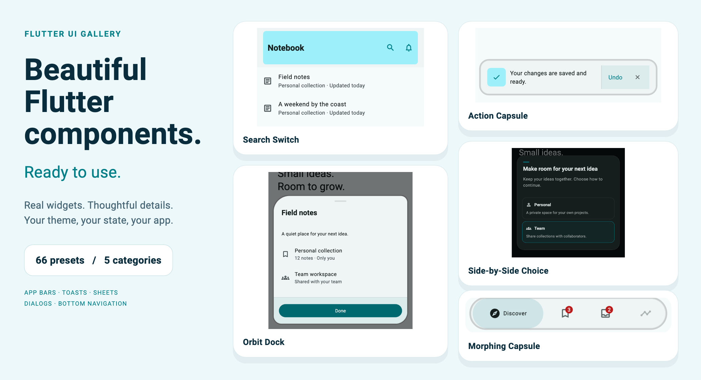

## Explore components

[App Bars (17)](#app-bars) · [Toasts (11)](#toasts) · [Bottom Sheets (12)](#bottom-sheets) · [Dialogs (11)](#dialogs) · [Bottom Navigation (15)](#bottom-navigation)

<p>
<a href="#app-bars">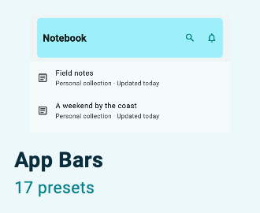</a>
<a href="#toasts">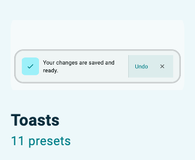</a>
<a href="#bottom-sheets">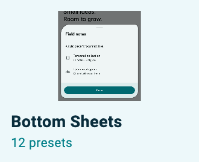</a>
<a href="#dialogs">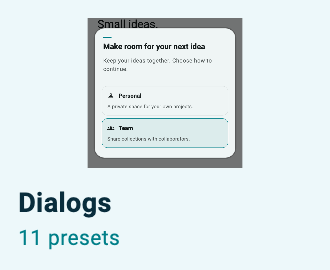</a>
<a href="#bottom-navigation">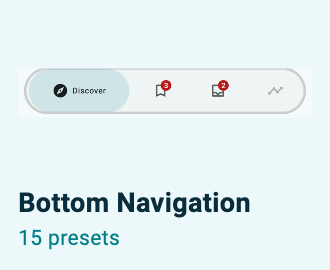</a>
</p>

## Quick installation

```sh
flutter pub add flutter_ui_gallery
```

[SDK requirements and full runnable setup](https://github.com/Ahmedelsapagh10/flutter_ui_gallery/blob/design-overhaul/doc/QUICK_START.md).

## App Bars

Give each screen a clear identity, with headers for search, focused work, and navigation.

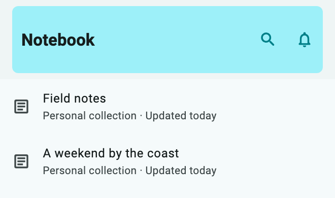

**Copy & Use — Search Switch**

```dart
import 'package:flutter/material.dart';
import 'package:flutter_ui_gallery/flutter_ui_gallery.dart';

Widget showHeaderSearchSwitch(
  VoidCallback onNotifications,
  ValueChanged<String> onSearchChanged,
) {
  return Scaffold(
    appBar: UiGalleryAppBar(
      preset: UiGalleryAppBarPreset.searchSwitch,
      title: const Text("Notebook"),
      subtitle: const Text("Ideas worth keeping"),
      scrollAware: true,
      onSearchChanged: onSearchChanged,
      actions: [
        IconButton(
          onPressed: onNotifications,
          icon: const Icon(Icons.notifications_none_rounded),
        ),
      ],
      style: const UiGallerySurfaceStyle(accentColor: Color(0xff007f88)),
    ),
  );
}
```

**Customize:** `title`, `subtitle`, `leading`, `actions`, `bottom`, `scrollAware`, and `style`.

[Category overview](https://raw.githubusercontent.com/Ahmedelsapagh10/flutter_ui_gallery/design-overhaul/doc/assets/showcase-v021/app-bars.png) ·
[Complete stateful example](https://github.com/Ahmedelsapagh10/flutter_ui_gallery/blob/design-overhaul/example/lib/showcase.dart) ·
[Inspect Search Switch](https://github.com/Ahmedelsapagh10/flutter_ui_gallery/blob/design-overhaul/doc/catalog/app-bars.md#searchswitch) ·
[Explore all 17 presets →](https://github.com/Ahmedelsapagh10/flutter_ui_gallery/blob/design-overhaul/doc/catalog/app-bars.md)

## Toasts

Keep people informed with compact feedback, recovery actions, and live progress.

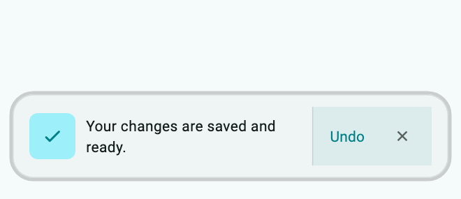

**Copy & Use — Action Capsule**

```dart
import 'package:flutter/material.dart';
import 'package:flutter_ui_gallery/flutter_ui_gallery.dart';

void showToastsAction(BuildContext context, VoidCallback onUndo) {
  UiGalleryToast.show(
    context,
    preset: UiGalleryToastPreset.action,
    message: "Your changes are saved and ready.",
    kind: UiGalleryToastKind.success,
    actionLabel: 'Undo',
    onAction: onUndo,
    showProgress: true,
    style: const UiGallerySurfaceStyle(accentColor: Color(0xff007f88)),
  );
}
```

**Customize:** `kind`, `position`, `duration`, `actionLabel` / `onAction`, `style`, and `motion`.

[Category overview](https://raw.githubusercontent.com/Ahmedelsapagh10/flutter_ui_gallery/design-overhaul/doc/assets/showcase-v021/toasts.png) ·
[Complete stateful example](https://github.com/Ahmedelsapagh10/flutter_ui_gallery/blob/design-overhaul/example/lib/showcase.dart) ·
[Inspect Action Capsule](https://github.com/Ahmedelsapagh10/flutter_ui_gallery/blob/design-overhaul/doc/catalog/toasts.md#action) ·
[Explore all 11 presets →](https://github.com/Ahmedelsapagh10/flutter_ui_gallery/blob/design-overhaul/doc/catalog/toasts.md)

## Bottom Sheets

Bring contextual actions, forms, and useful details into reach without leaving the screen.

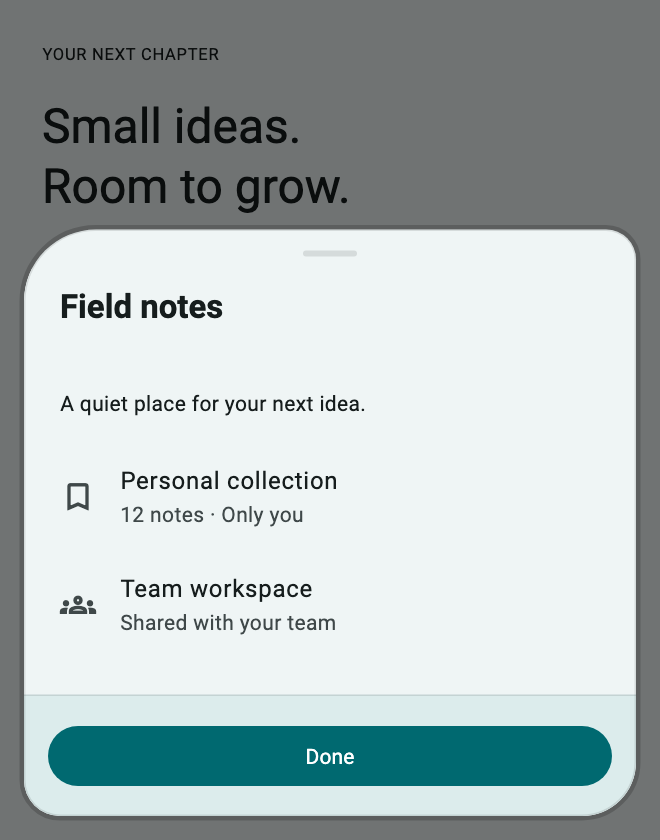

**Copy & Use — Orbit Dock**

```dart
import 'package:flutter/material.dart';
import 'package:flutter_ui_gallery/flutter_ui_gallery.dart';

Future<void> showSheetsOrbit(BuildContext context) async {
  await UiGallerySheet.show<void>(
    context: context,
    preset: UiGallerySheetPreset.orbit,
    header: const Text("Field notes"),
    child: const Column(
      mainAxisSize: MainAxisSize.min,
      crossAxisAlignment: CrossAxisAlignment.start,
      children: [
        Text('A quiet place for your next idea.'),
        SizedBox(height: 16),
        ListTile(
          contentPadding: EdgeInsets.zero,
          leading: Icon(Icons.bookmark_outline),
          title: Text('Personal collection'),
          subtitle: Text('12 notes · Only you'),
        ),
        ListTile(
          contentPadding: EdgeInsets.zero,
          leading: Icon(Icons.groups_outlined),
          title: Text('Team workspace'),
          subtitle: Text('Shared with your team'),
        ),
      ],
    ),
    footer: Builder(
      builder: (sheetContext) => FilledButton(
        onPressed: () => Navigator.of(sheetContext).pop(),
        child: const Text('Done'),
      ),
    ),
    style: const UiGallerySurfaceStyle(accentColor: Color(0xff007f88)),
  );
}
```

**Customize:** `header`, `child`, `footer`, `style`, `appearance`, and `motion`.

[Category overview](https://raw.githubusercontent.com/Ahmedelsapagh10/flutter_ui_gallery/design-overhaul/doc/assets/showcase-v021/bottom-sheets.png) ·
[Complete stateful example](https://github.com/Ahmedelsapagh10/flutter_ui_gallery/blob/design-overhaul/example/lib/showcase.dart) ·
[Inspect Orbit Dock](https://github.com/Ahmedelsapagh10/flutter_ui_gallery/blob/design-overhaul/doc/catalog/bottom-sheets.md#orbit) ·
[Explore all 12 presets →](https://github.com/Ahmedelsapagh10/flutter_ui_gallery/blob/design-overhaul/doc/catalog/bottom-sheets.md)

## Dialogs

Make decisions easier with clear choices, searchable commands, and focused results.

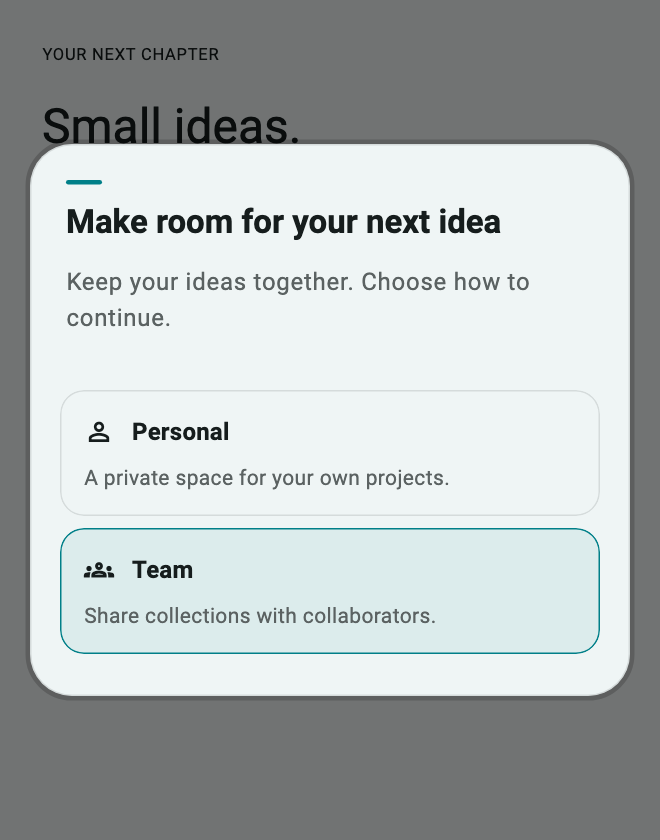

**Copy & Use — Side-by-Side Choice**

```dart
import 'package:flutter/material.dart';
import 'package:flutter_ui_gallery/flutter_ui_gallery.dart';

Future<String?> showDialogsSideBySideChoice(BuildContext context) {
  return UiGalleryDialog.show<String>(
    context: context,
    useRootNavigator: false,
    preset: UiGalleryDialogPreset.sideBySideChoice,
    title: "Make room for your next idea",
    message: "Keep your ideas together. Choose how to continue.",
    actions: const [
      UiGalleryDialogAction(
        label: 'Personal',
        value: 'Personal',
        description: 'A private space for your own projects.',
        icon: Icon(Icons.person_outline),
      ),
      UiGalleryDialogAction(
        label: 'Team',
        value: 'Team',
        primary: true,
        description: 'Share collections with collaborators.',
        icon: Icon(Icons.groups_outlined),
      ),
    ],
    style: const UiGallerySurfaceStyle(accentColor: Color(0xff007f88)),
  );
}
```

**Customize:** `title`, `message`, `actions`, `child`, `result`, `style`, and `motion`.

[Category overview](https://raw.githubusercontent.com/Ahmedelsapagh10/flutter_ui_gallery/design-overhaul/doc/assets/showcase-v021/dialogs.png) ·
[Complete stateful example](https://github.com/Ahmedelsapagh10/flutter_ui_gallery/blob/design-overhaul/example/lib/showcase.dart) ·
[Inspect Side-by-Side Choice](https://github.com/Ahmedelsapagh10/flutter_ui_gallery/blob/design-overhaul/doc/catalog/dialogs.md#sidebysidechoice) ·
[Explore all 11 presets →](https://github.com/Ahmedelsapagh10/flutter_ui_gallery/blob/design-overhaul/doc/catalog/dialogs.md)

## Bottom Navigation

Keep primary destinations visible with selection-aware bars, docks, and shelves.

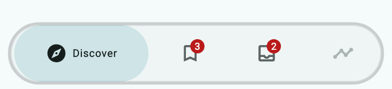

**Copy & Use — Morphing Capsule**

```dart
import 'package:flutter/material.dart';
import 'package:flutter_ui_gallery/flutter_ui_gallery.dart';

Widget showBottomNavMorphingCapsule(int index, ValueChanged<int> onSelected) {
  return UiGalleryBottomNav(
    preset: UiGalleryBottomNavPreset.morphingCapsule,
    selectedIndex: index,
    onDestinationSelected: onSelected,
    items: const [
      UiGalleryBottomNavItem(
        icon: Icon(Icons.explore_outlined),
        selectedIcon: Icon(Icons.explore),
        label: 'Discover',
      ),
      UiGalleryBottomNavItem(
        icon: Icon(Icons.bookmark_border),
        selectedIcon: Icon(Icons.bookmark),
        label: 'Saved',
        badge: Text('3'),
      ),
      UiGalleryBottomNavItem(
        icon: Icon(Icons.inbox_outlined),
        selectedIcon: Icon(Icons.inbox),
        label: 'Inbox',
        badge: Text('2'),
      ),
      UiGalleryBottomNavItem(
        icon: Icon(Icons.timeline),
        label: 'Activity',
        enabled: false,
      ),
    ],
    style: const UiGallerySurfaceStyle(accentColor: Color(0xff007f88)),
  );
}
```

**Customize:** `items`, `selectedIndex`, `onDestinationSelected`, `centerAction`, `options`, and `style`.

[Category overview](https://raw.githubusercontent.com/Ahmedelsapagh10/flutter_ui_gallery/design-overhaul/doc/assets/showcase-v021/bottom-navigation.png) ·
[Complete stateful example](https://github.com/Ahmedelsapagh10/flutter_ui_gallery/blob/design-overhaul/example/lib/showcase.dart) ·
[Inspect Morphing Capsule](https://github.com/Ahmedelsapagh10/flutter_ui_gallery/blob/design-overhaul/doc/catalog/bottom-navigation.md#morphingcapsule) ·
[Explore all 15 presets →](https://github.com/Ahmedelsapagh10/flutter_ui_gallery/blob/design-overhaul/doc/catalog/bottom-navigation.md)

## Customization

**Minimal** keeps surfaces precise. **Soft** adds comfortable geometry.
**Spatial** adds restrained depth. Each family uses the host `ColorScheme` and
`TextTheme`. Optional signatures add the family treatment; choosing a family
alone leaves signatures off. These screenshots use Soft with signatures on.

```dart
ThemeData galleryTheme() {
  final base = ThemeData(colorSchemeSeed: const Color(0xff007f88));
  return base.copyWith(
    extensions: [
      UiGalleryTheme.family(
        UiGalleryDesignFamily.soft,
        theme: base,
        useSignature: true,
      ),
    ],
  );
}
```

Apply it to `MaterialApp(theme: galleryTheme())`. Configure `darkTheme` from a dark
base theme too. Per-call `style` and `motion` override inherited defaults;
reduced-motion preferences still apply.

[Theme, style, and motion options](https://github.com/Ahmedelsapagh10/flutter_ui_gallery/blob/design-overhaul/doc/USAGE.md) ·
[Signatures and override precedence](https://github.com/Ahmedelsapagh10/flutter_ui_gallery/blob/design-overhaul/doc/FAMILY_SIGNATURES.md)

## Resources

- [Complete visual catalog — all 66 presets](https://github.com/Ahmedelsapagh10/flutter_ui_gallery/blob/design-overhaul/doc/catalog/README.md)
- [Full runnable example and setup](https://github.com/Ahmedelsapagh10/flutter_ui_gallery/blob/design-overhaul/doc/QUICK_START.md)
- [API reference](https://pub.dev/documentation/flutter_ui_gallery/latest/)
- [Advanced customization](https://github.com/Ahmedelsapagh10/flutter_ui_gallery/blob/design-overhaul/doc/USAGE.md)
- [Migration guide](https://github.com/Ahmedelsapagh10/flutter_ui_gallery/blob/design-overhaul/doc/MIGRATION.md)
- [GitHub repository](https://github.com/Ahmedelsapagh10/flutter_ui_gallery)

MIT · [Ahmed Mohamed Elsapagh](https://github.com/Ahmedelsapagh10) ·
[License](https://github.com/Ahmedelsapagh10/flutter_ui_gallery/blob/design-overhaul/LICENSE)
