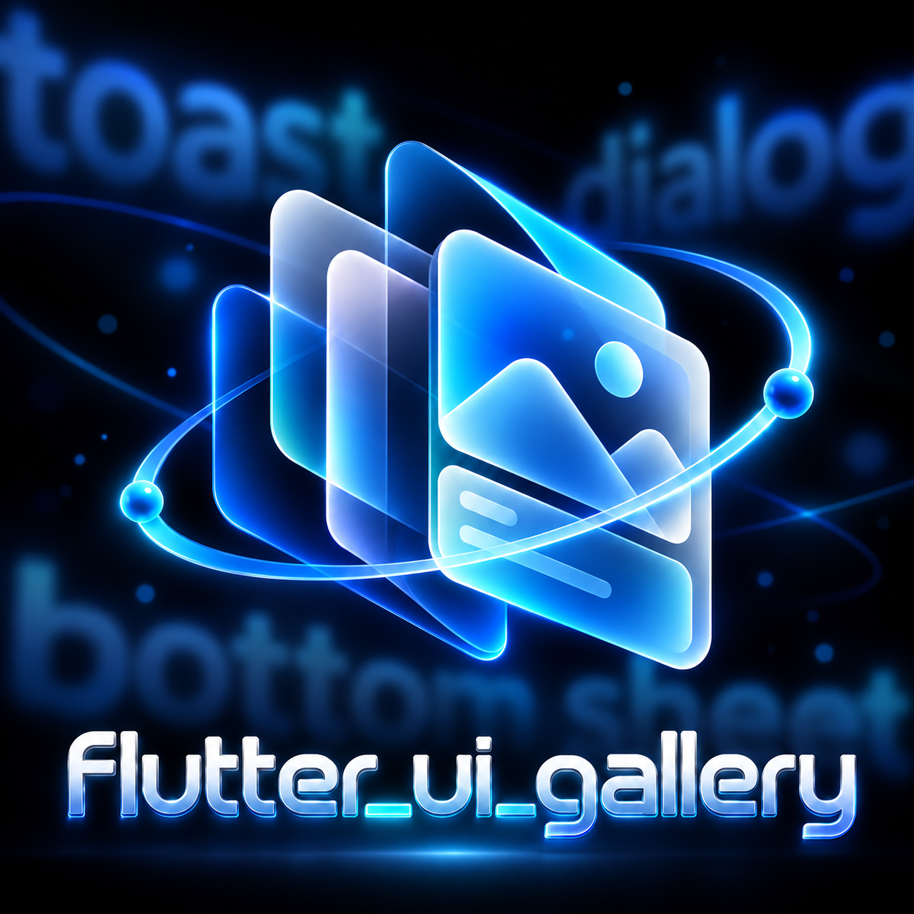

<p align="center">
  
</p>

<h1 align="center">Flutter UI Gallery</h1>

<p align="center">
  <strong>66 modern, production-ready UI presets for Flutter.</strong><br>
  Toasts · Bottom Sheets · Dialogs · AppBars · Bottom Navigation
</p>

<p align="center">
  <a href="https://pub.dev/packages/flutter_ui_gallery"></a>
  <a href="https://flutter.dev"></a>
  <a href="https://dart.dev"></a>
  <a href="https://github.com/Ahmedelsapagh10/flutter_ui_gallery/blob/master/LICENSE"></a>
  
</p>

An independent Flutter UI component package, not affiliated with the Flutter team’s Gallery demo.

[Open the live playground](https://ahmedelsapagh10.github.io/flutter_ui_gallery/) to compare all 66 presets.

---

## 📸 Final Results & Previews

### 🍞 Toasts & Feedback
Signal Pill, Action Capsule, Progress Card, Edge Ribbon, Stack Tag, and Mini Console in light and dark mode.


### 📄 Bottom Sheets
Orbit Dock (light mode) and Depth Frame (dark mode) with custom actions and responsive content.


### 💬 Dialogs & Modals
Side-by-Side Choice cards and Spotlight Result confirmation with animated states.


### 🧭 AppBars & Bottom Navigation
Focus Bar and Sculpted Wave headers paired with Floating Cove and Glass Dock navigation.


---

## ⚡ Installation

```sh
flutter pub add flutter_ui_gallery
```

Requires Flutter **3.41+** and Dart **3.11.5+**. Zero external dependencies.

---

## 🚀 Quick Usage

### 1. Show a Toast (1 line)
```dart
UiGalleryToast.success(context, message: 'All changes saved.');
```

### 2. Show a Bottom Sheet
```dart
await UiGallerySheet.show(
  context: context,
  preset: UiGallerySheetPreset.orbitDock,
  header: const Text('Workspace options'),
  child: const YourContentWidget(),
);
```

### 3. Show a Dialog
```dart
final result = await UiGalleryDialog.show<String>(
  context: context,
  preset: UiGalleryDialogPreset.sideBySideChoice,
  title: 'Choose workspace type',
  message: 'Start a personal collection or invite your team.',
  actions: const [
    UiGalleryDialogAction(label: 'Personal', value: 'personal', icon: Icon(Icons.person_outline)),
    UiGalleryDialogAction(label: 'Team', value: 'team', primary: true, icon: Icon(Icons.people_outline)),
  ],
);
```

### 4. AppBar & Bottom Navigation
```dart
Scaffold(
  appBar: UiGalleryAppBar(
    preset: UiGalleryAppBarPreset.focusBar,
    title: const Text('Discover'),
  ),
  bottomNavigationBar: UiGalleryBottomNav(
    preset: UiGalleryBottomNavPreset.floatingCove,
    selectedIndex: currentIndex,
    onDestinationSelected: (i) => setState(() => currentIndex = i),
    items: const [
      UiGalleryBottomNavItem(icon: Icon(Icons.explore_outlined), label: 'Discover'),
      UiGalleryBottomNavItem(icon: Icon(Icons.bookmark_border_rounded), label: 'Saved'),
      UiGalleryBottomNavItem(icon: Icon(Icons.person_outline_rounded), label: 'Profile'),
    ],
  ),
  body: pages[currentIndex],
);
```

---

## Coordinated design families

Families refine each preset’s geometry and typography: asymmetric corners stay asymmetric, tags keep their bevel, pills stay pill-shaped, and consoles keep square edges and monospace text. Explicit caller `shape` and typography overrides still take priority.

- **Minimal**: tighter corners, medium-weight headings, no added elevation and short, precise ease-out motion. Editorial headings remain lighter than utility headings.
- **Soft**: comfortable corners, semibold headings, gentle elevation and a finite critically damped spring. Surfaces settle without bouncing past their destination.
- **Spatial**: broader corners, bold headings, stronger depth and a finite damped spring with a restrained overshoot. Decorative depth never changes control hit bounds.

```dart
final base = ThemeData(colorScheme: yourColorScheme);
final family = UiGalleryTheme.family(
  UiGalleryDesignFamily.soft,
  theme: base,
  effects: UiGalleryEffects.cheap, // Opaque surfaces, no backdrop blur.
);
final theme = base.copyWith(extensions: [...base.extensions.values, family]);
```

Add `useSignature: true` to the existing `UiGalleryTheme.family(...)` call to opt into Minimal structural rules, Soft connected tonal wells, or Spatial registered depth edges. Preset planes, frames, curves and type roles always win. The recipe defaults to off. See [precedence exceptions and visual baseline procedure](doc/FAMILY_SIGNATURES.md).

**Margin · Notes Pass A** is available under **Real app examples**: eight presets, real Arabic copy, light/dark, 2.0 text, reduced motion and a wide reading layout. Its Navigation style setting is explicitly a showcase control; notes remain local to the current session. [Read the eight preset briefs](doc/NOTES_PASS_A.md).

`UiGalleryEffects.full` is the default. Cheap effects cap surface elevation and omit decorative shadows and backdrop blur; the opt-in Spatial recipe retains flat structural depth cues. System reduced-motion settings take priority in both modes. See the [usage guide](doc/USAGE.md) for token and per-call overrides.

**Glass Dock** needs `Scaffold(extendBody: true, ...)` to reveal page content beneath its blur. Cheap effects use an opaque surface and no backdrop filter, while retaining the same destinations and caller-owned selection.

## 🎨 66 Ready-to-Use Presets

| Category | Presets | Highlights |
|---|:---:|---|
| **Bottom Sheets** | 12 | Orbit Dock, Depth Frame, Split Layer, Fold Motion, Flow Canvas, Prism Stage |
| **Dialogs** | 11 | Halo Focus, Side-by-Side Choice, Spotlight Result, Command Palette, Milestone |
| **Toasts** | 11 | Signal Pill, Action Capsule, Progress Card, Edge Ribbon, Stack Tag, Mini Console |
| **AppBars** | 17 | Focus Bar, Sculpted Wave, Adaptive Horizon, Search Switch, Selection Bar |
| **Bottom Nav** | 15 | Floating Cove, Glass Dock, Concave Notch, Adaptive Minimal, Overflow Dock |

👉 [Browse the full presets matrix with parameters & guidelines →](doc/PRESETS.md)

---

## 📚 Documentation

- [Preset Variations Matrix](doc/PRESETS.md) — complete catalog of all 66 presets.
- [Usage & Code Examples](doc/USAGE.md) — advanced styling, custom tokens, and progress toasts.
- [Integration Guide](doc/INTEGRATION.md) — routing, architecture, and state management.
- [Example App](example/) — runnable Flutter demo application.

---

## 👨‍💻 Author

<p align="center">
  
</p>

<p align="center">
  <strong>Eng. Ahmed Mohamed Elsapagh</strong><br>
  Co-founder & Mobile Lead at <a href="https://octopusteam.net">Octopus Team</a>
</p>

<p align="center">
  <a href="https://elsapagh.octopusteam.net/">🌐 Portfolio</a> ·
  <a href="mailto:ahmedelsapagh@gmail.com">📧 Email</a> ·
  <a href="https://wa.me/201201709414">💬 WhatsApp</a>
</p>

---

## 📄 License

MIT License © 2026 [Ahmed Mohamed Elsapagh](https://github.com/Ahmedelsapagh10)


Margin **Notes Pass B** is a separate entry under Real app examples, retaining Pass A for comparison. It adds an Edge Lift note-action shelf (move/save/archive), a Split Decision guard for unsaved drafts, local-save Inline Pulse feedback, persistent Focus Bar search and Layered Shelf/Scroll Dock navigation choices. Header and navigation style settings are explicitly showcase controls. [Read the six briefs and direction choices](doc/NOTES_PASS_B.md). Data remains local to the session.

The approved Spatial recipe is now edge-only, with the same flat structural cue in cheap mode and no extra content plane. [Precedence exceptions and revised budget](doc/FAMILY_SIGNATURES.md) record Minimal 3/66, Soft 3/66 and Spatial 10/66 (14 distinct presets). Existing opt-out family behavior is unchanged.


**Wallet · Still (Pass A)** is available under Real app examples: local single-currency accounts, same-currency transfer drafts, editable ledger categories and cancellable in-memory statement previews. Sample money only; no bank API, FX total, executed payment or file-save claim. Light/dark, Arabic with the example-only Alexandria font, 2.0 text, reduced motion and tablet layouts are included. [Seven briefs and Pass B boundary](doc/WALLET_PASS_A.md). [Per-preset redesign default/migration proposal and CI evidence](doc/REDESIGN_RELEASE_POLICY.md).
