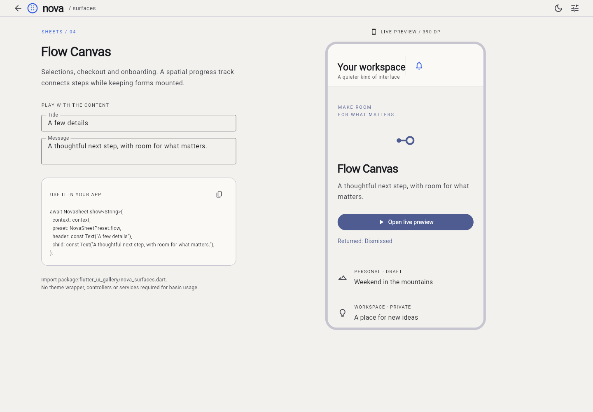

# Flutter UI Gallery 🎨

<p align="center">
  <a href="https://flutter.dev">
    
  </a>
  <a href="https://dart.dev">
    
  </a>
  <a href="https://github.com/Ahmedelsapagh10/flutter_ui_gallery/blob/master/LICENSE">
    
  </a>
  <a href="https://github.com/Ahmedelsapagh10/flutter_ui_gallery/pulls">
    
  </a>
  
</p>

<p align="center">
  <strong>Extraordinary UI. Effortless Flutter.</strong><br>
  A curated collection of creative, futuristic, and production-ready Bottom Sheets, Dialogs, Toasts, and AppBars for Flutter.
</p>

---

## ✦ Live Showcase Above the Fold

Zero architecture rewrites. Zero required theme wrappers. Display any component in **1–3 lines**:

<p align="center">
  
</p>

```dart
// 1 line bottom sheet
await UiGallerySheet.show(context: context, preset: UiGallerySheetPreset.orbit, child: const FilterDock());

// 1 line confirmation dialog
final confirmed = await UiGalleryDialog.confirm(context: context, title: 'Discard draft?');

// 1 line status toast
UiGalleryToast.success(context, message: 'Settings synchronized');

// 1 line adaptive app bar
Scaffold(appBar: const UiGalleryAppBar(title: Text('Workspace'), scrollAware: true));
```

---

## ⚡ Key Highlights

- 🎨 **Futuristic Visual Silhouettes**: Spatial composition, asymmetric corner geometry, and fluid physics-driven transitions without heavy 3D assets or GPU-heavy shaders.
- 🔌 **Frictionless Integration**: No replacement of `MaterialApp`, no controllers required for basic use, and zero state management lock-in (`Bloc`/`Provider`/`GetIt` not required).
- 🌓 **Ambient Theme Harmony**: Seamlessly inherits your ambient `ThemeData` and `ColorScheme` (Material 3).
- ♿ **Accessibility First**: Built-in support for system reduced motion (`MediaQuery.disableAnimations`), dynamic text scaling (2x+), RTL (Arabic/Hebrew), screen reader semantics, and closed keyboard focus traps.
- 📦 **Zero External Dependencies**: Pure Flutter framework rendering (`showModalBottomSheet`, `DialogRoute`, `OverlayPortal`, `ScrollNotificationObserver`).

---

## 🛠️ Quick Start

### Installation

Add `flutter_ui_gallery` to your `pubspec.yaml`:

```yaml
dependencies:
  flutter_ui_gallery:
    git:
      url: https://github.com/Ahmedelsapagh10/flutter_ui_gallery.git
```

Or install via terminal:

```bash
flutter pub add flutter_ui_gallery
```

### Import

```dart
import 'package:flutter_ui_gallery/flutter_ui_gallery.dart';
```

---

## 💎 The 12-Preset Component Gallery

### 1. Bottom Sheets (4 Presets)

| Preset | Silhouette & Motion | Best Use Case | 1-Line Usage |
| :--- | :--- | :--- | :--- |
| **Orbit Dock** | Floating surface separated from screen edges with asymmetric silhouette (`topStart: 48, topEnd: 20`). | Quick actions, contextual tools, sharing trays | `UiGallerySheet.show(context: context, preset: UiGallerySheetPreset.orbit, child: widget)` |
| **Fold Motion** | Compact peek sheet that expands progressively via `AnimatedSize` while retaining form and text state. | Item details, expandable forms, filter drawers | `UiGallerySheet.show(context: context, preset: UiGallerySheetPreset.fold, child: widget)` |
| **Prism Stage** | Structured showcase with distinct tinted showcase header, content stage, and sticky action tray. | Booking previews, product details, media modals | `UiGallerySheet.show(context: context, preset: UiGallerySheetPreset.prism, header: header, child: widget)` |
| **Flow Canvas** | Multi-step interactive flow with spatial step bar (`UiGalleryFlow`) and smooth directional page slides. | Multi-step checkout, onboarding, guided setups | `UiGallerySheet.show(context: context, preset: UiGallerySheetPreset.flow, child: UiGalleryFlow(...))` |

<details>
<summary><strong>View Bottom Sheet Recipes</strong></summary>

#### Orbit Dock (Quick Actions)
```dart
final action = await UiGallerySheet.show<String>(
  context: context,
  preset: UiGallerySheetPreset.orbit,
  header: const Text('Quick actions'),
  child: Wrap(
    spacing: 12,
    children: [
      ActionChip(label: const Text('Share'), onPressed: () => Navigator.pop(context, 'share')),
      ActionChip(label: const Text('Copy link'), onPressed: () => Navigator.pop(context, 'copy')),
    ],
  ),
);
```

#### Fold Motion (Retains Text Input Across Expansion)
```dart
await UiGallerySheet.show(
  context: context,
  preset: UiGallerySheetPreset.fold,
  child: Column(
    children: [
      const TextField(decoration: InputDecoration(labelText: 'Space name')),
      // Expand toggle expands sheet height smoothly without remounting text fields
    ],
  ),
);
```

#### Flow Canvas (Multi-step Flow)
```dart
await UiGallerySheet.show(
  context: context,
  preset: UiGallerySheetPreset.flow,
  child: UiGalleryFlow(
    steps: const ['Account', 'Payment', 'Review'],
    currentStep: 0,
    children: const [
      StepOneForm(),
      StepTwoForm(),
      StepThreeReview(),
    ],
  ),
);
```
</details>

---

### 2. Dialogs (4 Presets)

| Preset | Visual Identity | Best Use Case | 1-Line Usage |
| :--- | :--- | :--- | :--- |
| **Halo Focus** | Focused central composition with a subtle halo emphasis ring surrounding the primary decision target. | Confirmations, critical decisions, deletions | `UiGalleryDialog.confirm(context: context, title: 'Delete?', preset: UiGalleryDialogPreset.halo)` |
| **Split Decision** | Two distinct regions (context vs actions) that intelligently stack on mobile viewports. | Account deletion, destructive actions, reviews | `UiGalleryDialog.confirm(context: context, title: 'Discard?', preset: UiGalleryDialogPreset.split, destructive: true)` |
| **Timeline Dialog** | Sequential visual progress steps driven by a live `ValueListenable<UiGalleryTimelineState>`. | Identity verification, processing, upload status | `UiGalleryDialog.timeline(context: context, title: 'Verifying', progress: progressNotifier)` |
| **Spotlight Result** | Orbital canvas mark with dedicated states for `success`, `warning`, and `failure`. | Payment confirmed, task completed, error review | `UiGalleryDialog.show(context: context, title: 'Saved', preset: UiGalleryDialogPreset.spotlight, result: UiGalleryResult.success)` |

<details>
<summary><strong>View Dialog Recipes</strong></summary>

#### Halo Focus Confirmation
```dart
final confirmed = await UiGalleryDialog.confirm(
  context: context,
  preset: UiGalleryDialogPreset.halo,
  title: 'Apply changes?',
  message: 'This will update your workspace configuration.',
  confirmLabel: 'Apply',
  cancelLabel: 'Cancel',
);
```

#### Timeline Dialog (Reactive External Progress)
```dart
final progress = ValueNotifier(UiGalleryTimelineState(
  steps: const ['Uploading payload', 'Validating schema', 'Ready'],
  currentStep: 1,
));

await UiGalleryDialog.timeline(
  context: context,
  title: 'Cloud Sync',
  progress: progress,
);

progress.dispose();
```

#### Spotlight Result
```dart
await UiGalleryDialog.show(
  context: context,
  preset: UiGalleryDialogPreset.spotlight,
  result: UiGalleryResult.success, // or UiGalleryResult.warning, UiGalleryResult.failure
  title: 'Payment Received',
  message: 'Your receipt #48920 has been emailed to you.',
  actions: [
    UiGalleryDialogAction(label: 'Done', value: true, primary: true),
  ],
);
```
</details>

---

### 3. Toasts (3 Presets)

| Preset | Silhouette & Position | Features | 1-Line Usage |
| :--- | :--- | :--- | :--- |
| **Signal Pill** | Floating compact pill capsule at bottom or top. | Minimal status indicator, adaptive width, non-intrusive. | `UiGalleryToast.success(context, message: 'Saved')` |
| **Edge Ribbon** | Screen edge-anchored directional notification banner. | Directional accent bar, distinct hierarchy for warnings. | `UiGalleryToast.warning(context, message: 'Connection unstable')` |
| **Action Capsule** | Segmented surface pairing status message with interactive button. | Undo / Retry callback, optional timeout progress bar. | `UiGalleryToast.show(context, preset: UiGalleryToastPreset.action, actionLabel: 'Undo', onAction: undo)` |

<details>
<summary><strong>View Toast Recipes</strong></summary>

#### Queue Management & Action Capsule
```dart
UiGalleryToast.show(
  context,
  preset: UiGalleryToastPreset.action,
  message: 'File moved to archive',
  actionLabel: 'Undo',
  onAction: () => restoreFile(),
  showProgress: true, // Displays real-time timeout progress bar
  duration: const Duration(seconds: 5),
  duplicates: UiGalleryToastDuplicates.replace, // ignore | replace | allow
);
```

#### Programmatic Dismissal Handle
```dart
final handle = UiGalleryToast.show(
  context,
  message: 'Uploading photo...',
  duration: const Duration(seconds: 30),
);

// Dismiss programmatically when background task finishes:
handle.dismiss();
```
</details>

---

### 4. AppBars (1 Preset)

| Component | Behavior | Highlights | Basic Usage |
| :--- | :--- | :--- | :--- |
| **Adaptive Horizon** | PreferredSizeWidget with optional scroll-aware transition. | Uses Scaffold's `ScrollNotificationObserver` without requiring a manual `ScrollController`. | `Scaffold(appBar: UiGalleryAppBar(title: Text('Horizon'), scrollAware: true))` |
| **UiGallerySliverAppBar** | Sliver counterpart for `CustomScrollView`. | Shared futuristic geometry, responsive title repositioning, pinned behavior. | `CustomScrollView(slivers: [UiGallerySliverAppBar(title: Text('Explore'))])` |

<details>
<summary><strong>View AppBar Recipes</strong></summary>

```dart
Scaffold(
  appBar: UiGalleryAppBar(
    title: const Text('Workspace'),
    subtitle: const Text('Active projects'),
    scrollAware: true,
    actions: [
      IconButton(
        icon: const Icon(Icons.tune_rounded),
        onPressed: () {},
      ),
    ],
  ),
  body: ListView.builder(
    itemCount: 50,
    itemBuilder: (context, index) => ListTile(title: Text('Item $index')),
  ),
);
```
</details>

---

## 🎨 Design System & Customization

### Automatic Ambient Theme Inheritance
Components automatically read your ambient `ThemeData`, using `colorScheme.primary` for accents, `colorScheme.surface` for backgrounds, and `colorScheme.onSurface` for typography.

### Optional Global Overrides via `UiGalleryTheme`
Add `UiGalleryTheme` to your `ThemeData.extensions` for granular brand control:

```dart
MaterialApp(
  theme: ThemeData(
    colorSchemeSeed: const Color(0xFF315EE8),
    extensions: const [
      UiGalleryTheme(
        accentColor: Color(0xFF315EE8),
        surfaceColor: Color(0xFF15181D),
        contentColor: Color(0xFFFAF9F6),
        motionIntensity: 1.0, // Set to 0.0 to disable decorative animations
      ),
    ],
  ),
);
```

### Shared Design Tokens (`UiGalleryTokens`)
```dart
abstract final class UiGalleryTokens {
  static const double space = 8;
  static const double touchTarget = 48;       // WCAG / Material minimum
  static const double sheetWidth = 640;       // Max width on desktop / tablet
  static const double dialogWidth = 560;      // Max width on desktop / tablet
  static const Duration entrance = Duration(milliseconds: 340);
  static const Duration exit = Duration(milliseconds: 220);
  static const Duration change = Duration(milliseconds: 240);
  static const Curve curve = Curves.easeOutCubic;
}
```

---

## 📱 Live Interactive Example Gallery

An interactive showcase application is included in `example/`. It features:
- Interactive live previews in responsive device frames (Phone 390dp, Tablet 768dp, Desktop 1200dp).
- Live Dark / Light mode toggle.
- Live Arabic (RTL) / English (LTR) language switcher.
- Reduced Motion simulation.
- Editable title and message inputs that update the live component.
- Copyable 1–3 line code generator for every preset.

### Run the Gallery Locally:

```bash
cd example
flutter run -d chrome  # or macos, ios, android
```

---

## 🧪 Automated Testing & Reliability

The package includes **43 automated tests** covering:
- Repeated opening and typed results for all 4 sheets and 4 dialogs.
- Back navigation (Android system pop & barrier dismiss).
- Sheet drag-to-dismiss and nested `ListView` scrolling.
- Toast FIFO queue, deduplication policies (`ignore`, `replace`, `allow`), and route disposal cleanup.
- Closed keyboard focus loops and screen reader accessibility semantics.
- RTL layouts and large text scaling (2x+).
- System reduced motion (`MediaQuery.disableAnimations`).

Run test suite:
```bash
flutter test
```

---

## 🤝 Contributing

Contributions are welcome! Please open an issue or pull request on GitHub:
- Issues: [github.com/Ahmedelsapagh10/flutter_ui_gallery/issues](https://github.com/Ahmedelsapagh10/flutter_ui_gallery/issues)
- Pull Requests: [github.com/Ahmedelsapagh10/flutter_ui_gallery/pulls](https://github.com/Ahmedelsapagh10/flutter_ui_gallery/pulls)

---

## 📄 License

This project is licensed under the MIT License — see the [LICENSE](LICENSE) file for details.

---

## 👨‍💻 Author

<p align="center">
  
</p>

<p align="center">
  <strong>Eng Ahmed Mohamed Elsapagh</strong>
</p>

- 🌐 **Portfolio**: [elsapagh.octopusteam.net](https://elsapagh.octopusteam.net/)
- 💼 **Role**: Co-founder & Mobile Lead at [Octopus Team](https://octopusteam.net)
- 📧 **Email**: [ahmedelsapagh@gmail.com](mailto:ahmedelsapagh@gmail.com)
- 💬 **WhatsApp**: [+201201709414](https://wa.me/201201709414)
