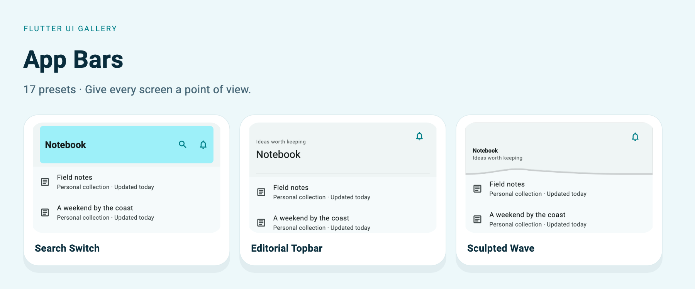
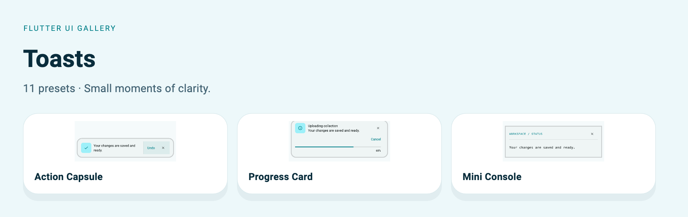
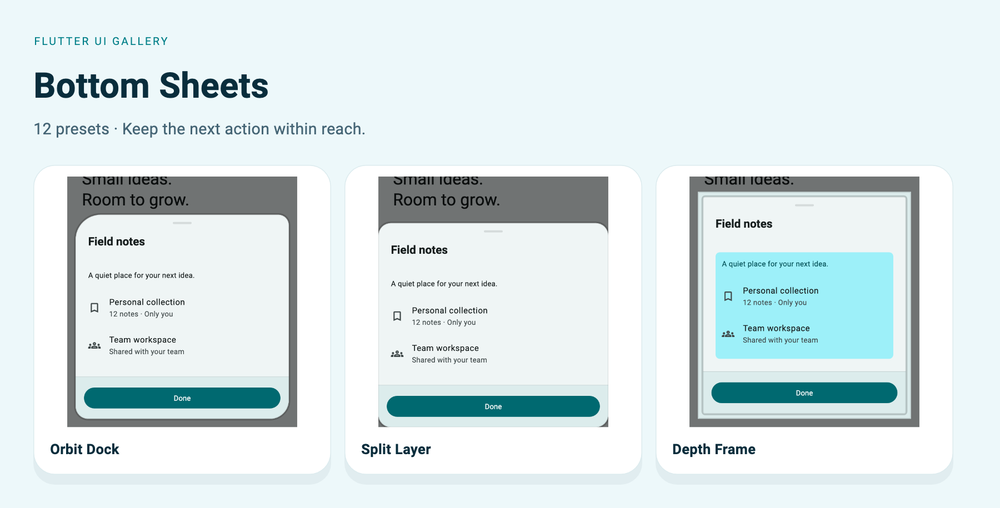
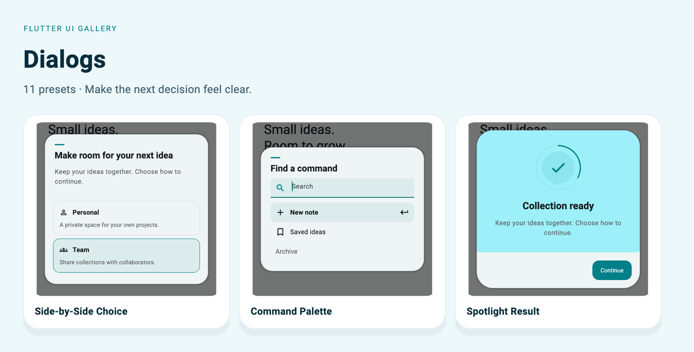
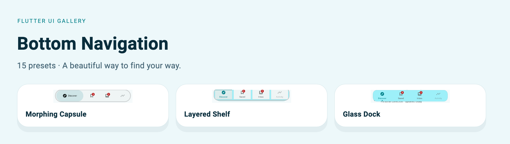

# Visual preset catalog

66 real Flutter presets. Choose a category, inspect the design, and copy the public-API example.

[Package introduction](../../README.md) · [Runnable example](../QUICK_START.md) · [Customization](../USAGE.md)

## [App Bars — 17 presets](app-bars.md)

Give each screen a clear identity, with headers for search, focused work, and navigation.

## [Toasts — 11 presets](toasts.md)

Keep people informed with compact feedback, recovery actions, and live progress.

## [Bottom Sheets — 12 presets](bottom-sheets.md)

Bring contextual actions, forms, and useful details into reach without leaving the screen.

## [Dialogs — 11 presets](dialogs.md)

Make decisions easier with clear choices, searchable commands, and focused results.

## [Bottom Navigation — 15 presets](bottom-navigation.md)

Keep primary destinations visible with selection-aware bars, docks, and shelves.

