<!-- Generated by tool/build_showcase.py. -->
# App Bars

17 canonical presets. Give each screen a clear identity, with headers for search, focused work, and navigation.

[All categories](README.md) · [Package introduction](../../README.md) · [Theme and setup](../QUICK_START.md)

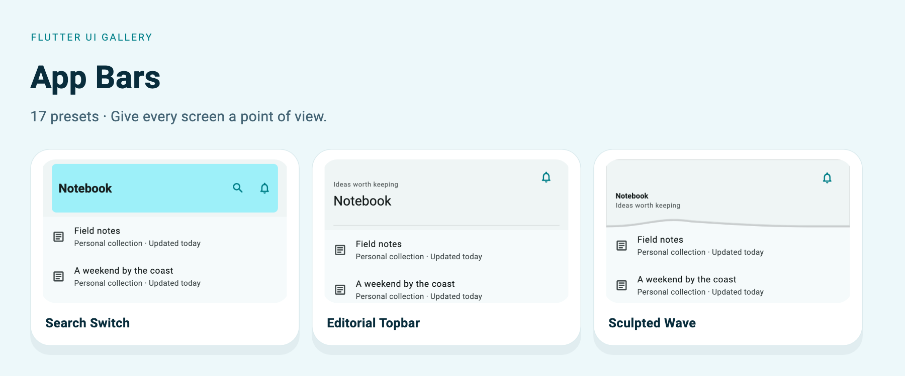

[Adaptive Horizon](#adaptivehorizon) · [Floating Arc](#floatingarc) · [Compact Rail](#compactrail) · [Split Header](#splitheader) · [Focus Bar](#focusbar) · [Panorama Bar](#panoramabar) · [Layered Nav](#layerednav) · [Editorial Topbar](#editorialtopbar) · [Sculpted Wave](#sculptedwave) · [Folded Canopy](#foldedcanopy) · [Parallax Crest](#parallaxcrest) · [Orbit Command](#orbitcommand) · [Search Switch](#searchswitch) · [Centered Title](#centeredtitle) · [Breadcrumb Trail](#breadcrumbtrail) · [Section Tabs](#sectiontabs) · [Selection Bar](#selectionbar)

The captures below use the included Soft theme with signatures enabled, at a
440 × 560 logical-pixel viewport and 1.5× export resolution. The light preview
matches the example's default theme. Each full example includes its imports and
theme helper. Apply that helper to `MaterialApp.theme` before invoking the widget.

For a complete app with owned state, callbacks, and disposal, use
[`example/lib/showcase.dart`](../../example/lib/showcase.dart):

```sh
cd example
flutter run -t lib/showcase.dart --dart-define=PRESET=header.searchSwitch
```

Change `PRESET` to the exact ID beside any entry. Helper parameters are supplied
by your screen; the runnable app shows their ownership. Copy uses ordinary Dart
code fences and your Markdown viewer's native copy control where available.

<a id="adaptivehorizon"></a>

## Adaptive Horizon

`UiGalleryAppBarPreset.adaptiveHorizon` · `PRESET=header.adaptiveHorizon`

Explore and content screens. Title settles beside contextual actions.

[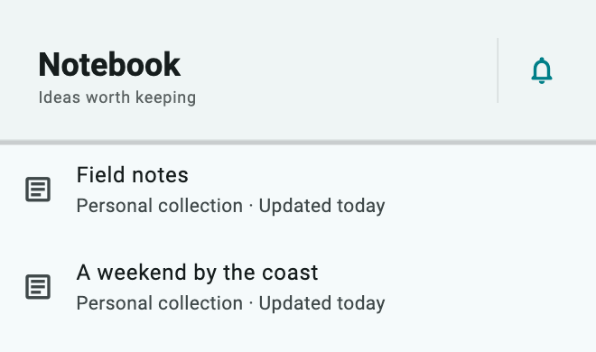](../assets/showcase-v021/header.adaptiveHorizon.png)


**Copy & Use**

```dart
import 'package:flutter/material.dart';
import 'package:flutter_ui_gallery/flutter_ui_gallery.dart';

// Apply this theme to MaterialApp(theme: showHeaderAdaptiveHorizonTheme()).
ThemeData showHeaderAdaptiveHorizonTheme({
  Brightness brightness = Brightness.light,
}) {
  final base = ThemeData(
    colorScheme: ColorScheme.fromSeed(
      seedColor: Color(0xff007f88),
      brightness: brightness,
    ),
  );
  final recipe = UiGalleryTheme.family(
    UiGalleryDesignFamily.soft,
    theme: base,
    useSignature: true,
  );
  return base.copyWith(
    extensions: [
      recipe.copyWith(
        surfaceStyle: recipe.surfaceStyle!.copyWith(
          accentColor: Color(0xff007f88),
        ),
        motionIntensity: 1,
      ),
    ],
  );
}

Widget showHeaderAdaptiveHorizon(VoidCallback onNotifications) {
  return Scaffold(
    appBar: UiGalleryAppBar(
      preset: UiGalleryAppBarPreset.adaptiveHorizon,
      title: const Text("Notebook"),
      subtitle: const Text("Ideas worth keeping"),
      scrollAware: true,
      actions: [
        IconButton(
          onPressed: onNotifications,
          icon: const Icon(Icons.notifications_none_rounded),
        ),
      ],
      style: const UiGallerySurfaceStyle(accentColor: Color(0xff007f88)),
    ),
    body: ListView(
      children: List.generate(
        16,
        (i) => ListTile(
          leading: const Icon(Icons.article_outlined),
          title: Text(
            const [
              'Field notes',
              'A weekend by the coast',
              'The next good idea',
              'Spaces worth saving',
            ][i % 4],
          ),
          subtitle: const Text('Personal collection · Updated today'),
        ),
      ),
    ),
  );
}
```

**Customize:** `title`, `subtitle`, `leading`, `actions`, `bottom`, `scrollAware`, and `style`.

**Interaction:** Search callbacks belong to your screen. Section Tabs needs a `DefaultTabController`; the snippet includes it. Selection Bar receives caller-owned selection.

[Complete runnable owner](../../example/lib/showcase.dart) · [Dart source](code/header.adaptiveHorizon.dart) · [Back to category](#app-bars)

<a id="floatingarc"></a>

## Floating Arc

`UiGalleryAppBarPreset.floatingArc` · `PRESET=header.floatingArc`

Lightweight creative navigation. Inset navigation island separated from the page.

[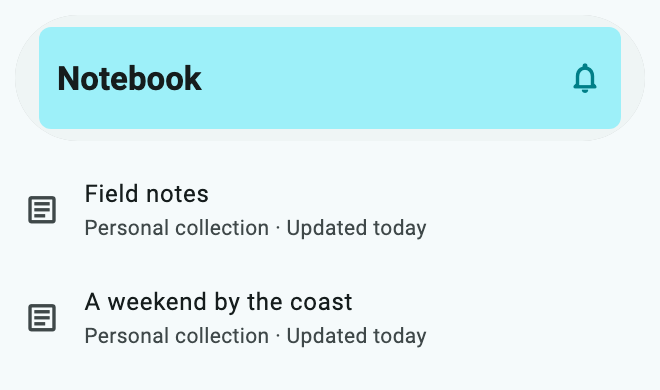](../assets/showcase-v021/header.floatingArc.png)


**Copy & Use**

```dart
import 'package:flutter/material.dart';
import 'package:flutter_ui_gallery/flutter_ui_gallery.dart';

// Apply this theme to MaterialApp(theme: showHeaderFloatingArcTheme()).
ThemeData showHeaderFloatingArcTheme({
  Brightness brightness = Brightness.light,
}) {
  final base = ThemeData(
    colorScheme: ColorScheme.fromSeed(
      seedColor: Color(0xff007f88),
      brightness: brightness,
    ),
  );
  final recipe = UiGalleryTheme.family(
    UiGalleryDesignFamily.soft,
    theme: base,
    useSignature: true,
  );
  return base.copyWith(
    extensions: [
      recipe.copyWith(
        surfaceStyle: recipe.surfaceStyle!.copyWith(
          accentColor: Color(0xff007f88),
        ),
        motionIntensity: 1,
      ),
    ],
  );
}

Widget showHeaderFloatingArc(VoidCallback onNotifications) {
  return Scaffold(
    appBar: UiGalleryAppBar(
      preset: UiGalleryAppBarPreset.floatingArc,
      title: const Text("Notebook"),
      subtitle: const Text("Ideas worth keeping"),
      scrollAware: true,
      actions: [
        IconButton(
          onPressed: onNotifications,
          icon: const Icon(Icons.notifications_none_rounded),
        ),
      ],
      style: const UiGallerySurfaceStyle(accentColor: Color(0xff007f88)),
    ),
    body: ListView(
      children: List.generate(
        16,
        (i) => ListTile(
          leading: const Icon(Icons.article_outlined),
          title: Text(
            const [
              'Field notes',
              'A weekend by the coast',
              'The next good idea',
              'Spaces worth saving',
            ][i % 4],
          ),
          subtitle: const Text('Personal collection · Updated today'),
        ),
      ),
    ),
  );
}
```

**Customize:** `title`, `subtitle`, `leading`, `actions`, `bottom`, `scrollAware`, and `style`.

**Interaction:** Search callbacks belong to your screen. Section Tabs needs a `DefaultTabController`; the snippet includes it. Selection Bar receives caller-owned selection.

[Complete runnable owner](../../example/lib/showcase.dart) · [Dart source](code/header.floatingArc.dart) · [Back to category](#app-bars)

<a id="compactrail"></a>

## Compact Rail

`UiGalleryAppBarPreset.compactRail` · `PRESET=header.compactRail`

Utility screens with many actions. Dense toolbar ending in a structural context rail.

[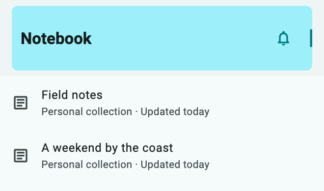](../assets/showcase-v021/header.compactRail.png)


**Copy & Use**

```dart
import 'package:flutter/material.dart';
import 'package:flutter_ui_gallery/flutter_ui_gallery.dart';

// Apply this theme to MaterialApp(theme: showHeaderCompactRailTheme()).
ThemeData showHeaderCompactRailTheme({
  Brightness brightness = Brightness.light,
}) {
  final base = ThemeData(
    colorScheme: ColorScheme.fromSeed(
      seedColor: Color(0xff007f88),
      brightness: brightness,
    ),
  );
  final recipe = UiGalleryTheme.family(
    UiGalleryDesignFamily.soft,
    theme: base,
    useSignature: true,
  );
  return base.copyWith(
    extensions: [
      recipe.copyWith(
        surfaceStyle: recipe.surfaceStyle!.copyWith(
          accentColor: Color(0xff007f88),
        ),
        motionIntensity: 1,
      ),
    ],
  );
}

Widget showHeaderCompactRail(VoidCallback onNotifications) {
  return Scaffold(
    appBar: UiGalleryAppBar(
      preset: UiGalleryAppBarPreset.compactRail,
      title: const Text("Notebook"),
      subtitle: const Text("Ideas worth keeping"),
      scrollAware: true,
      actions: [
        IconButton(
          onPressed: onNotifications,
          icon: const Icon(Icons.notifications_none_rounded),
        ),
      ],
      style: const UiGallerySurfaceStyle(accentColor: Color(0xff007f88)),
    ),
    body: ListView(
      children: List.generate(
        16,
        (i) => ListTile(
          leading: const Icon(Icons.article_outlined),
          title: Text(
            const [
              'Field notes',
              'A weekend by the coast',
              'The next good idea',
              'Spaces worth saving',
            ][i % 4],
          ),
          subtitle: const Text('Personal collection · Updated today'),
        ),
      ),
    ),
  );
}
```

**Customize:** `title`, `subtitle`, `leading`, `actions`, `bottom`, `scrollAware`, and `style`.

**Interaction:** Search callbacks belong to your screen. Section Tabs needs a `DefaultTabController`; the snippet includes it. Selection Bar receives caller-owned selection.

[Complete runnable owner](../../example/lib/showcase.dart) · [Dart source](code/header.compactRail.dart) · [Back to category](#app-bars)

<a id="splitheader"></a>

## Split Header

`UiGalleryAppBarPreset.splitHeader` · `PRESET=header.splitHeader`

Dashboards and account workspaces. Title/subtitle region beside an independent action zone.

[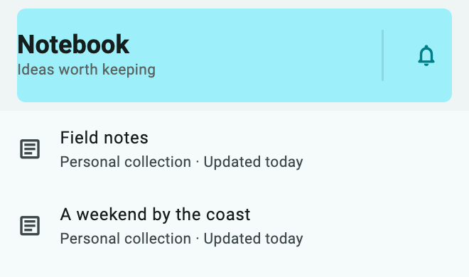](../assets/showcase-v021/header.splitHeader.png)


**Copy & Use**

```dart
import 'package:flutter/material.dart';
import 'package:flutter_ui_gallery/flutter_ui_gallery.dart';

// Apply this theme to MaterialApp(theme: showHeaderSplitHeaderTheme()).
ThemeData showHeaderSplitHeaderTheme({
  Brightness brightness = Brightness.light,
}) {
  final base = ThemeData(
    colorScheme: ColorScheme.fromSeed(
      seedColor: Color(0xff007f88),
      brightness: brightness,
    ),
  );
  final recipe = UiGalleryTheme.family(
    UiGalleryDesignFamily.soft,
    theme: base,
    useSignature: true,
  );
  return base.copyWith(
    extensions: [
      recipe.copyWith(
        surfaceStyle: recipe.surfaceStyle!.copyWith(
          accentColor: Color(0xff007f88),
        ),
        motionIntensity: 1,
      ),
    ],
  );
}

Widget showHeaderSplitHeader(VoidCallback onNotifications) {
  return Scaffold(
    appBar: UiGalleryAppBar(
      preset: UiGalleryAppBarPreset.splitHeader,
      title: const Text("Notebook"),
      subtitle: const Text("Ideas worth keeping"),
      scrollAware: true,
      actions: [
        IconButton(
          onPressed: onNotifications,
          icon: const Icon(Icons.notifications_none_rounded),
        ),
      ],
      style: const UiGallerySurfaceStyle(accentColor: Color(0xff007f88)),
    ),
    body: ListView(
      children: List.generate(
        16,
        (i) => ListTile(
          leading: const Icon(Icons.article_outlined),
          title: Text(
            const [
              'Field notes',
              'A weekend by the coast',
              'The next good idea',
              'Spaces worth saving',
            ][i % 4],
          ),
          subtitle: const Text('Personal collection · Updated today'),
        ),
      ),
    ),
  );
}
```

**Customize:** `title`, `subtitle`, `leading`, `actions`, `bottom`, `scrollAware`, and `style`.

**Interaction:** Search callbacks belong to your screen. Section Tabs needs a `DefaultTabController`; the snippet includes it. Selection Bar receives caller-owned selection.

[Complete runnable owner](../../example/lib/showcase.dart) · [Dart source](code/header.splitHeader.dart) · [Back to category](#app-bars)

<a id="focusbar"></a>

## Focus Bar

`UiGalleryAppBarPreset.focusBar` · `PRESET=header.focusBar`

Search-driven content discovery. Context toolbar above an actual editable search field.

[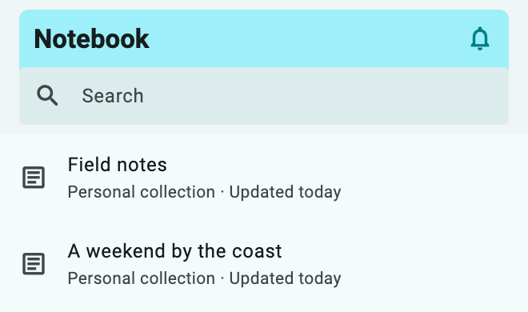](../assets/showcase-v021/header.focusBar.png)


**Copy & Use**

```dart
import 'package:flutter/material.dart';
import 'package:flutter_ui_gallery/flutter_ui_gallery.dart';

// Apply this theme to MaterialApp(theme: showHeaderFocusBarTheme()).
ThemeData showHeaderFocusBarTheme({Brightness brightness = Brightness.light}) {
  final base = ThemeData(
    colorScheme: ColorScheme.fromSeed(
      seedColor: Color(0xff007f88),
      brightness: brightness,
    ),
  );
  final recipe = UiGalleryTheme.family(
    UiGalleryDesignFamily.soft,
    theme: base,
    useSignature: true,
  );
  return base.copyWith(
    extensions: [
      recipe.copyWith(
        surfaceStyle: recipe.surfaceStyle!.copyWith(
          accentColor: Color(0xff007f88),
        ),
        motionIntensity: 1,
      ),
    ],
  );
}

Widget showHeaderFocusBar(VoidCallback onNotifications) {
  return Scaffold(
    appBar: UiGalleryAppBar(
      preset: UiGalleryAppBarPreset.focusBar,
      title: const Text("Notebook"),
      subtitle: const Text("Ideas worth keeping"),
      scrollAware: true,
      actions: [
        IconButton(
          onPressed: onNotifications,
          icon: const Icon(Icons.notifications_none_rounded),
        ),
      ],
      style: const UiGallerySurfaceStyle(accentColor: Color(0xff007f88)),
    ),
    body: ListView(
      children: List.generate(
        16,
        (i) => ListTile(
          leading: const Icon(Icons.article_outlined),
          title: Text(
            const [
              'Field notes',
              'A weekend by the coast',
              'The next good idea',
              'Spaces worth saving',
            ][i % 4],
          ),
          subtitle: const Text('Personal collection · Updated today'),
        ),
      ),
    ),
  );
}
```

**Customize:** `title`, `subtitle`, `leading`, `actions`, `bottom`, `scrollAware`, and `style`.

**Interaction:** Search callbacks belong to your screen. Section Tabs needs a `DefaultTabController`; the snippet includes it. Selection Bar receives caller-owned selection.

[Complete runnable owner](../../example/lib/showcase.dart) · [Dart source](code/header.focusBar.dart) · [Back to category](#app-bars)

<a id="panoramabar"></a>

## Panorama Bar

`UiGalleryAppBarPreset.panoramaBar` · `PRESET=header.panoramaBar`

Media and immersive collections. Wide background plane with a low title horizon.

[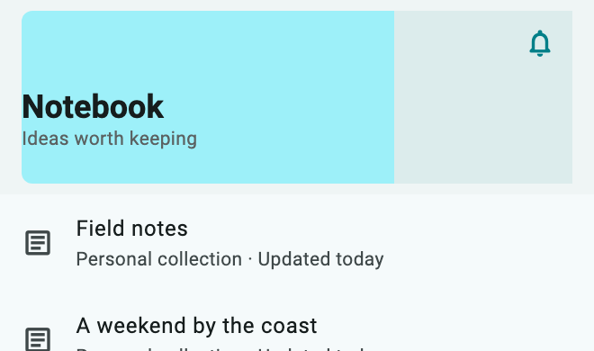](../assets/showcase-v021/header.panoramaBar.png)


**Copy & Use**

```dart
import 'package:flutter/material.dart';
import 'package:flutter_ui_gallery/flutter_ui_gallery.dart';

// Apply this theme to MaterialApp(theme: showHeaderPanoramaBarTheme()).
ThemeData showHeaderPanoramaBarTheme({
  Brightness brightness = Brightness.light,
}) {
  final base = ThemeData(
    colorScheme: ColorScheme.fromSeed(
      seedColor: Color(0xff007f88),
      brightness: brightness,
    ),
  );
  final recipe = UiGalleryTheme.family(
    UiGalleryDesignFamily.soft,
    theme: base,
    useSignature: true,
  );
  return base.copyWith(
    extensions: [
      recipe.copyWith(
        surfaceStyle: recipe.surfaceStyle!.copyWith(
          accentColor: Color(0xff007f88),
        ),
        motionIntensity: 1,
      ),
    ],
  );
}

Widget showHeaderPanoramaBar(VoidCallback onNotifications) {
  return Scaffold(
    appBar: UiGalleryAppBar(
      preset: UiGalleryAppBarPreset.panoramaBar,
      title: const Text("Notebook"),
      subtitle: const Text("Ideas worth keeping"),
      scrollAware: true,
      actions: [
        IconButton(
          onPressed: onNotifications,
          icon: const Icon(Icons.notifications_none_rounded),
        ),
      ],
      style: const UiGallerySurfaceStyle(accentColor: Color(0xff007f88)),
    ),
    body: ListView(
      children: List.generate(
        16,
        (i) => ListTile(
          leading: const Icon(Icons.article_outlined),
          title: Text(
            const [
              'Field notes',
              'A weekend by the coast',
              'The next good idea',
              'Spaces worth saving',
            ][i % 4],
          ),
          subtitle: const Text('Personal collection · Updated today'),
        ),
      ),
    ),
  );
}
```

**Customize:** `title`, `subtitle`, `leading`, `actions`, `bottom`, `scrollAware`, and `style`.

**Interaction:** Search callbacks belong to your screen. Section Tabs needs a `DefaultTabController`; the snippet includes it. Selection Bar receives caller-owned selection.

[Complete runnable owner](../../example/lib/showcase.dart) · [Dart source](code/header.panoramaBar.dart) · [Back to category](#app-bars)

<a id="layerednav"></a>

## Layered Nav

`UiGalleryAppBarPreset.layeredNav` · `PRESET=header.layeredNav`

Nested content and collections. Navigation context above an offset title deck.

[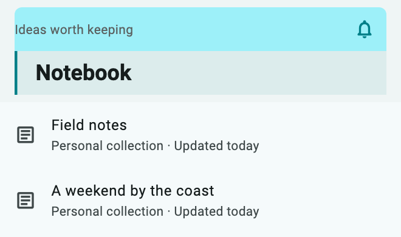](../assets/showcase-v021/header.layeredNav.png)


**Copy & Use**

```dart
import 'package:flutter/material.dart';
import 'package:flutter_ui_gallery/flutter_ui_gallery.dart';

// Apply this theme to MaterialApp(theme: showHeaderLayeredNavTheme()).
ThemeData showHeaderLayeredNavTheme({
  Brightness brightness = Brightness.light,
}) {
  final base = ThemeData(
    colorScheme: ColorScheme.fromSeed(
      seedColor: Color(0xff007f88),
      brightness: brightness,
    ),
  );
  final recipe = UiGalleryTheme.family(
    UiGalleryDesignFamily.soft,
    theme: base,
    useSignature: true,
  );
  return base.copyWith(
    extensions: [
      recipe.copyWith(
        surfaceStyle: recipe.surfaceStyle!.copyWith(
          accentColor: Color(0xff007f88),
        ),
        motionIntensity: 1,
      ),
    ],
  );
}

Widget showHeaderLayeredNav(VoidCallback onNotifications) {
  return Scaffold(
    appBar: UiGalleryAppBar(
      preset: UiGalleryAppBarPreset.layeredNav,
      title: const Text("Notebook"),
      subtitle: const Text("Ideas worth keeping"),
      scrollAware: true,
      actions: [
        IconButton(
          onPressed: onNotifications,
          icon: const Icon(Icons.notifications_none_rounded),
        ),
      ],
      style: const UiGallerySurfaceStyle(accentColor: Color(0xff007f88)),
    ),
    body: ListView(
      children: List.generate(
        16,
        (i) => ListTile(
          leading: const Icon(Icons.article_outlined),
          title: Text(
            const [
              'Field notes',
              'A weekend by the coast',
              'The next good idea',
              'Spaces worth saving',
            ][i % 4],
          ),
          subtitle: const Text('Personal collection · Updated today'),
        ),
      ),
    ),
  );
}
```

**Customize:** `title`, `subtitle`, `leading`, `actions`, `bottom`, `scrollAware`, and `style`.

**Interaction:** Search callbacks belong to your screen. Section Tabs needs a `DefaultTabController`; the snippet includes it. Selection Bar receives caller-owned selection.

[Complete runnable owner](../../example/lib/showcase.dart) · [Dart source](code/header.layeredNav.dart) · [Back to category](#app-bars)

<a id="editorialtopbar"></a>

## Editorial Topbar

`UiGalleryAppBarPreset.editorialTopbar` · `PRESET=header.editorialTopbar`

Articles and content-first pages. Eyebrow/navigation row, large heading and strong rule.

[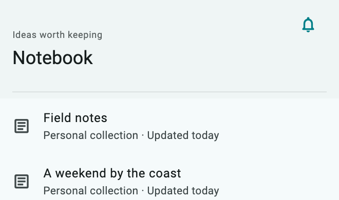](../assets/showcase-v021/header.editorialTopbar.png)


**Copy & Use**

```dart
import 'package:flutter/material.dart';
import 'package:flutter_ui_gallery/flutter_ui_gallery.dart';

// Apply this theme to MaterialApp(theme: showHeaderEditorialTopbarTheme()).
ThemeData showHeaderEditorialTopbarTheme({
  Brightness brightness = Brightness.light,
}) {
  final base = ThemeData(
    colorScheme: ColorScheme.fromSeed(
      seedColor: Color(0xff007f88),
      brightness: brightness,
    ),
  );
  final recipe = UiGalleryTheme.family(
    UiGalleryDesignFamily.soft,
    theme: base,
    useSignature: true,
  );
  return base.copyWith(
    extensions: [
      recipe.copyWith(
        surfaceStyle: recipe.surfaceStyle!.copyWith(
          accentColor: Color(0xff007f88),
        ),
        motionIntensity: 1,
      ),
    ],
  );
}

Widget showHeaderEditorialTopbar(VoidCallback onNotifications) {
  return Scaffold(
    appBar: UiGalleryAppBar(
      preset: UiGalleryAppBarPreset.editorialTopbar,
      title: const Text("Notebook"),
      subtitle: const Text("Ideas worth keeping"),
      scrollAware: true,
      actions: [
        IconButton(
          onPressed: onNotifications,
          icon: const Icon(Icons.notifications_none_rounded),
        ),
      ],
      style: const UiGallerySurfaceStyle(accentColor: Color(0xff007f88)),
    ),
    body: ListView(
      children: List.generate(
        16,
        (i) => ListTile(
          leading: const Icon(Icons.article_outlined),
          title: Text(
            const [
              'Field notes',
              'A weekend by the coast',
              'The next good idea',
              'Spaces worth saving',
            ][i % 4],
          ),
          subtitle: const Text('Personal collection · Updated today'),
        ),
      ),
    ),
  );
}
```

**Customize:** `title`, `subtitle`, `leading`, `actions`, `bottom`, `scrollAware`, and `style`.

**Interaction:** The preferred height stays fixed. At extreme text scales the heading and supporting copy may need reading gestures; see the compatibility notes.

[Complete runnable owner](../../example/lib/showcase.dart) · [Dart source](code/header.editorialTopbar.dart) · [Back to category](#app-bars)

<a id="sculptedwave"></a>

## Sculpted Wave

`UiGalleryAppBarPreset.sculptedWave` · `PRESET=header.sculptedWave`

Discovery and browsing. A curved lower edge follows the scroll transition.

[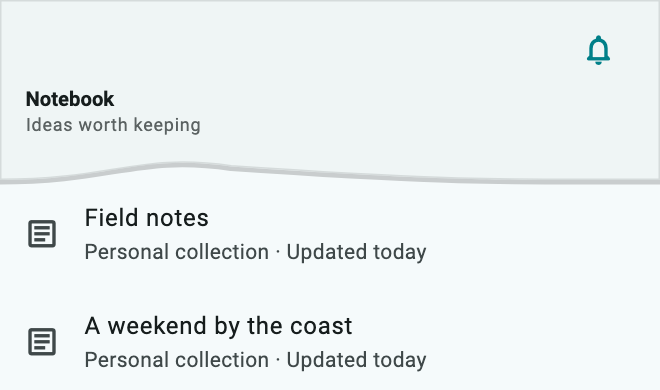](../assets/showcase-v021/header.sculptedWave.png)


**Copy & Use**

```dart
import 'package:flutter/material.dart';
import 'package:flutter_ui_gallery/flutter_ui_gallery.dart';

// Apply this theme to MaterialApp(theme: showHeaderSculptedWaveTheme()).
ThemeData showHeaderSculptedWaveTheme({
  Brightness brightness = Brightness.light,
}) {
  final base = ThemeData(
    colorScheme: ColorScheme.fromSeed(
      seedColor: Color(0xff007f88),
      brightness: brightness,
    ),
  );
  final recipe = UiGalleryTheme.family(
    UiGalleryDesignFamily.soft,
    theme: base,
    useSignature: true,
  );
  return base.copyWith(
    extensions: [
      recipe.copyWith(
        surfaceStyle: recipe.surfaceStyle!.copyWith(
          accentColor: Color(0xff007f88),
        ),
        motionIntensity: 1,
      ),
    ],
  );
}

Widget showHeaderSculptedWave(VoidCallback onNotifications) {
  return Scaffold(
    appBar: UiGalleryAppBar(
      preset: UiGalleryAppBarPreset.sculptedWave,
      title: const Text("Notebook"),
      subtitle: const Text("Ideas worth keeping"),
      scrollAware: true,
      actions: [
        IconButton(
          onPressed: onNotifications,
          icon: const Icon(Icons.notifications_none_rounded),
        ),
      ],
      style: const UiGallerySurfaceStyle(accentColor: Color(0xff007f88)),
    ),
    body: ListView(
      children: List.generate(
        16,
        (i) => ListTile(
          leading: const Icon(Icons.article_outlined),
          title: Text(
            const [
              'Field notes',
              'A weekend by the coast',
              'The next good idea',
              'Spaces worth saving',
            ][i % 4],
          ),
          subtitle: const Text('Personal collection · Updated today'),
        ),
      ),
    ),
  );
}
```

**Customize:** `title`, `subtitle`, `leading`, `actions`, `bottom`, `scrollAware`, and `style`.

**Interaction:** Search callbacks belong to your screen. Section Tabs needs a `DefaultTabController`; the snippet includes it. Selection Bar receives caller-owned selection.

[Complete runnable owner](../../example/lib/showcase.dart) · [Dart source](code/header.sculptedWave.dart) · [Back to category](#app-bars)

<a id="foldedcanopy"></a>

## Folded Canopy

`UiGalleryAppBarPreset.foldedCanopy` · `PRESET=header.foldedCanopy`

Collections and rich content. Folded planes reveal the title without hiding controls.

[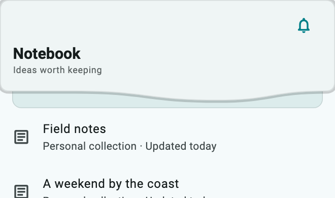](../assets/showcase-v021/header.foldedCanopy.png)


**Copy & Use**

```dart
import 'package:flutter/material.dart';
import 'package:flutter_ui_gallery/flutter_ui_gallery.dart';

// Apply this theme to MaterialApp(theme: showHeaderFoldedCanopyTheme()).
ThemeData showHeaderFoldedCanopyTheme({
  Brightness brightness = Brightness.light,
}) {
  final base = ThemeData(
    colorScheme: ColorScheme.fromSeed(
      seedColor: Color(0xff007f88),
      brightness: brightness,
    ),
  );
  final recipe = UiGalleryTheme.family(
    UiGalleryDesignFamily.soft,
    theme: base,
    useSignature: true,
  );
  return base.copyWith(
    extensions: [
      recipe.copyWith(
        surfaceStyle: recipe.surfaceStyle!.copyWith(
          accentColor: Color(0xff007f88),
        ),
        motionIntensity: 1,
      ),
    ],
  );
}

Widget showHeaderFoldedCanopy(VoidCallback onNotifications) {
  return Scaffold(
    appBar: UiGalleryAppBar(
      preset: UiGalleryAppBarPreset.foldedCanopy,
      title: const Text("Notebook"),
      subtitle: const Text("Ideas worth keeping"),
      scrollAware: true,
      actions: [
        IconButton(
          onPressed: onNotifications,
          icon: const Icon(Icons.notifications_none_rounded),
        ),
      ],
      style: const UiGallerySurfaceStyle(accentColor: Color(0xff007f88)),
    ),
    body: ListView(
      children: List.generate(
        16,
        (i) => ListTile(
          leading: const Icon(Icons.article_outlined),
          title: Text(
            const [
              'Field notes',
              'A weekend by the coast',
              'The next good idea',
              'Spaces worth saving',
            ][i % 4],
          ),
          subtitle: const Text('Personal collection · Updated today'),
        ),
      ),
    ),
  );
}
```

**Customize:** `title`, `subtitle`, `leading`, `actions`, `bottom`, `scrollAware`, and `style`.

**Interaction:** Search callbacks belong to your screen. Section Tabs needs a `DefaultTabController`; the snippet includes it. Selection Bar receives caller-owned selection.

[Complete runnable owner](../../example/lib/showcase.dart) · [Dart source](code/header.foldedCanopy.dart) · [Back to category](#app-bars)

<a id="parallaxcrest"></a>

## Parallax Crest

`UiGalleryAppBarPreset.parallaxCrest` · `PRESET=header.parallaxCrest`

Immersive collections. Separate visual planes respond to the same scroll position.

[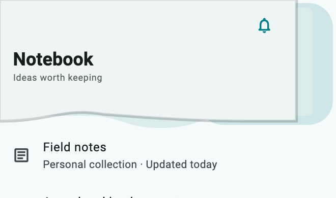](../assets/showcase-v021/header.parallaxCrest.png)


**Copy & Use**

```dart
import 'package:flutter/material.dart';
import 'package:flutter_ui_gallery/flutter_ui_gallery.dart';

// Apply this theme to MaterialApp(theme: showHeaderParallaxCrestTheme()).
ThemeData showHeaderParallaxCrestTheme({
  Brightness brightness = Brightness.light,
}) {
  final base = ThemeData(
    colorScheme: ColorScheme.fromSeed(
      seedColor: Color(0xff007f88),
      brightness: brightness,
    ),
  );
  final recipe = UiGalleryTheme.family(
    UiGalleryDesignFamily.soft,
    theme: base,
    useSignature: true,
  );
  return base.copyWith(
    extensions: [
      recipe.copyWith(
        surfaceStyle: recipe.surfaceStyle!.copyWith(
          accentColor: Color(0xff007f88),
        ),
        motionIntensity: 1,
      ),
    ],
  );
}

Widget showHeaderParallaxCrest(VoidCallback onNotifications) {
  return Scaffold(
    appBar: UiGalleryAppBar(
      preset: UiGalleryAppBarPreset.parallaxCrest,
      title: const Text("Notebook"),
      subtitle: const Text("Ideas worth keeping"),
      scrollAware: true,
      actions: [
        IconButton(
          onPressed: onNotifications,
          icon: const Icon(Icons.notifications_none_rounded),
        ),
      ],
      style: const UiGallerySurfaceStyle(accentColor: Color(0xff007f88)),
    ),
    body: ListView(
      children: List.generate(
        16,
        (i) => ListTile(
          leading: const Icon(Icons.article_outlined),
          title: Text(
            const [
              'Field notes',
              'A weekend by the coast',
              'The next good idea',
              'Spaces worth saving',
            ][i % 4],
          ),
          subtitle: const Text('Personal collection · Updated today'),
        ),
      ),
    ),
  );
}
```

**Customize:** `title`, `subtitle`, `leading`, `actions`, `bottom`, `scrollAware`, and `style`.

**Interaction:** Search callbacks belong to your screen. Section Tabs needs a `DefaultTabController`; the snippet includes it. Selection Bar receives caller-owned selection.

[Complete runnable owner](../../example/lib/showcase.dart) · [Dart source](code/header.parallaxCrest.dart) · [Back to category](#app-bars)

<a id="orbitcommand"></a>

## Orbit Command

`UiGalleryAppBarPreset.orbitCommand` · `PRESET=header.orbitCommand`

Creative workspaces. Title and command clusters occupy distinct spatial regions.

[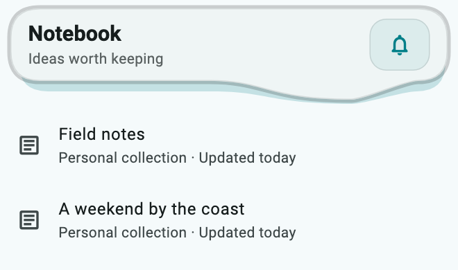](../assets/showcase-v021/header.orbitCommand.png)


**Copy & Use**

```dart
import 'package:flutter/material.dart';
import 'package:flutter_ui_gallery/flutter_ui_gallery.dart';

// Apply this theme to MaterialApp(theme: showHeaderOrbitCommandTheme()).
ThemeData showHeaderOrbitCommandTheme({
  Brightness brightness = Brightness.light,
}) {
  final base = ThemeData(
    colorScheme: ColorScheme.fromSeed(
      seedColor: Color(0xff007f88),
      brightness: brightness,
    ),
  );
  final recipe = UiGalleryTheme.family(
    UiGalleryDesignFamily.soft,
    theme: base,
    useSignature: true,
  );
  return base.copyWith(
    extensions: [
      recipe.copyWith(
        surfaceStyle: recipe.surfaceStyle!.copyWith(
          accentColor: Color(0xff007f88),
        ),
        motionIntensity: 1,
      ),
    ],
  );
}

Widget showHeaderOrbitCommand(VoidCallback onNotifications) {
  return Scaffold(
    appBar: UiGalleryAppBar(
      preset: UiGalleryAppBarPreset.orbitCommand,
      title: const Text("Notebook"),
      subtitle: const Text("Ideas worth keeping"),
      scrollAware: true,
      actions: [
        IconButton(
          onPressed: onNotifications,
          icon: const Icon(Icons.notifications_none_rounded),
        ),
      ],
      style: const UiGallerySurfaceStyle(accentColor: Color(0xff007f88)),
    ),
    body: ListView(
      children: List.generate(
        16,
        (i) => ListTile(
          leading: const Icon(Icons.article_outlined),
          title: Text(
            const [
              'Field notes',
              'A weekend by the coast',
              'The next good idea',
              'Spaces worth saving',
            ][i % 4],
          ),
          subtitle: const Text('Personal collection · Updated today'),
        ),
      ),
    ),
  );
}
```

**Customize:** `title`, `subtitle`, `leading`, `actions`, `bottom`, `scrollAware`, and `style`.

**Interaction:** Search callbacks belong to your screen. Section Tabs needs a `DefaultTabController`; the snippet includes it. Selection Bar receives caller-owned selection.

[Complete runnable owner](../../example/lib/showcase.dart) · [Dart source](code/header.orbitCommand.dart) · [Back to category](#app-bars)

<a id="searchswitch"></a>

## Search Switch

`UiGalleryAppBarPreset.searchSwitch` · `PRESET=header.searchSwitch`

Inline search for collections and content discovery.

[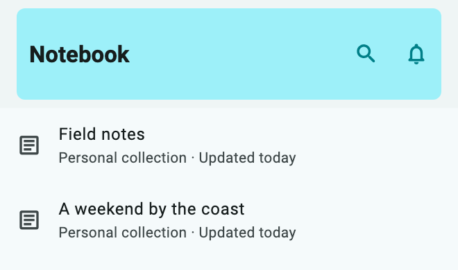](../assets/showcase-v021/header.searchSwitch.png)

[Dark theme](../assets/showcase-v021/header.searchSwitch-dark.png) · [Search open](../assets/showcase-v021/header.searchSwitch-expanded.png)

**Copy & Use**

```dart
import 'package:flutter/material.dart';
import 'package:flutter_ui_gallery/flutter_ui_gallery.dart';

// Apply this theme to MaterialApp(theme: showHeaderSearchSwitchTheme()).
ThemeData showHeaderSearchSwitchTheme({
  Brightness brightness = Brightness.light,
}) {
  final base = ThemeData(
    colorScheme: ColorScheme.fromSeed(
      seedColor: Color(0xff007f88),
      brightness: brightness,
    ),
  );
  final recipe = UiGalleryTheme.family(
    UiGalleryDesignFamily.soft,
    theme: base,
    useSignature: true,
  );
  return base.copyWith(
    extensions: [
      recipe.copyWith(
        surfaceStyle: recipe.surfaceStyle!.copyWith(
          accentColor: Color(0xff007f88),
        ),
        motionIntensity: 1,
      ),
    ],
  );
}

Widget showHeaderSearchSwitch(
  VoidCallback onNotifications,
  ValueChanged<String> onSearchChanged,
) {
  return Scaffold(
    appBar: UiGalleryAppBar(
      preset: UiGalleryAppBarPreset.searchSwitch,
      title: const Text("Notebook"),
      subtitle: const Text("Ideas worth keeping"),
      scrollAware: true,
      onSearchChanged: onSearchChanged,
      actions: [
        IconButton(
          onPressed: onNotifications,
          icon: const Icon(Icons.notifications_none_rounded),
        ),
      ],
      style: const UiGallerySurfaceStyle(accentColor: Color(0xff007f88)),
    ),
    body: ListView(
      children: List.generate(
        16,
        (i) => ListTile(
          leading: const Icon(Icons.article_outlined),
          title: Text(
            const [
              'Field notes',
              'A weekend by the coast',
              'The next good idea',
              'Spaces worth saving',
            ][i % 4],
          ),
          subtitle: const Text('Personal collection · Updated today'),
        ),
      ),
    ),
  );
}
```

**Customize:** `title`, `subtitle`, `leading`, `actions`, `bottom`, `scrollAware`, and `style`.

**Interaction:** Search callbacks belong to your screen. Section Tabs needs a `DefaultTabController`; the snippet includes it. Selection Bar receives caller-owned selection.

[Complete runnable owner](../../example/lib/showcase.dart) · [Dart source](code/header.searchSwitch.dart) · [Back to category](#app-bars)

<a id="centeredtitle"></a>

## Centered Title

`UiGalleryAppBarPreset.centeredTitle` · `PRESET=header.centeredTitle`

Product screens and focused detail pages with centered navigation.

[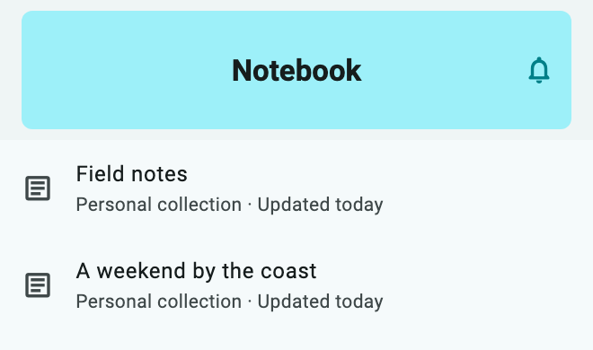](../assets/showcase-v021/header.centeredTitle.png)


**Copy & Use**

```dart
import 'package:flutter/material.dart';
import 'package:flutter_ui_gallery/flutter_ui_gallery.dart';

// Apply this theme to MaterialApp(theme: showHeaderCenteredTitleTheme()).
ThemeData showHeaderCenteredTitleTheme({
  Brightness brightness = Brightness.light,
}) {
  final base = ThemeData(
    colorScheme: ColorScheme.fromSeed(
      seedColor: Color(0xff007f88),
      brightness: brightness,
    ),
  );
  final recipe = UiGalleryTheme.family(
    UiGalleryDesignFamily.soft,
    theme: base,
    useSignature: true,
  );
  return base.copyWith(
    extensions: [
      recipe.copyWith(
        surfaceStyle: recipe.surfaceStyle!.copyWith(
          accentColor: Color(0xff007f88),
        ),
        motionIntensity: 1,
      ),
    ],
  );
}

Widget showHeaderCenteredTitle(VoidCallback onNotifications) {
  return Scaffold(
    appBar: UiGalleryAppBar(
      preset: UiGalleryAppBarPreset.centeredTitle,
      title: const Text("Notebook"),
      subtitle: const Text("Ideas worth keeping"),
      scrollAware: true,
      actions: [
        IconButton(
          onPressed: onNotifications,
          icon: const Icon(Icons.notifications_none_rounded),
        ),
      ],
      style: const UiGallerySurfaceStyle(accentColor: Color(0xff007f88)),
    ),
    body: ListView(
      children: List.generate(
        16,
        (i) => ListTile(
          leading: const Icon(Icons.article_outlined),
          title: Text(
            const [
              'Field notes',
              'A weekend by the coast',
              'The next good idea',
              'Spaces worth saving',
            ][i % 4],
          ),
          subtitle: const Text('Personal collection · Updated today'),
        ),
      ),
    ),
  );
}
```

**Customize:** `title`, `subtitle`, `leading`, `actions`, `bottom`, `scrollAware`, and `style`.

**Interaction:** Search callbacks belong to your screen. Section Tabs needs a `DefaultTabController`; the snippet includes it. Selection Bar receives caller-owned selection.

[Complete runnable owner](../../example/lib/showcase.dart) · [Dart source](code/header.centeredTitle.dart) · [Back to category](#app-bars)

<a id="breadcrumbtrail"></a>

## Breadcrumb Trail

`UiGalleryAppBarPreset.breadcrumbTrail` · `PRESET=header.breadcrumbTrail`

Nested workspaces and collection navigation.

[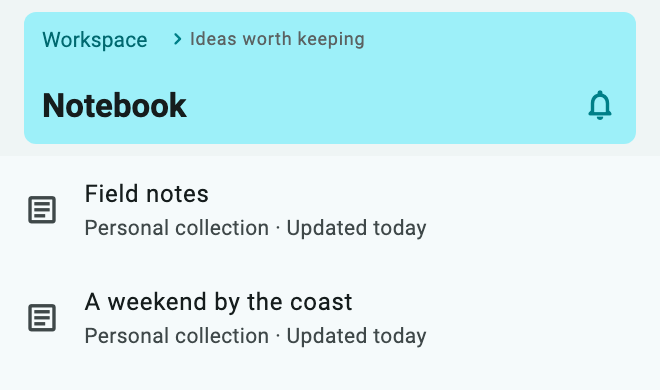](../assets/showcase-v021/header.breadcrumbTrail.png)


**Copy & Use**

```dart
import 'package:flutter/material.dart';
import 'package:flutter_ui_gallery/flutter_ui_gallery.dart';

// Apply this theme to MaterialApp(theme: showHeaderBreadcrumbTrailTheme()).
ThemeData showHeaderBreadcrumbTrailTheme({
  Brightness brightness = Brightness.light,
}) {
  final base = ThemeData(
    colorScheme: ColorScheme.fromSeed(
      seedColor: Color(0xff007f88),
      brightness: brightness,
    ),
  );
  final recipe = UiGalleryTheme.family(
    UiGalleryDesignFamily.soft,
    theme: base,
    useSignature: true,
  );
  return base.copyWith(
    extensions: [
      recipe.copyWith(
        surfaceStyle: recipe.surfaceStyle!.copyWith(
          accentColor: Color(0xff007f88),
        ),
        motionIntensity: 1,
      ),
    ],
  );
}

Widget showHeaderBreadcrumbTrail(
  VoidCallback onNotifications,
  VoidCallback onOpenWorkspace,
) {
  return Scaffold(
    appBar: UiGalleryAppBar(
      preset: UiGalleryAppBarPreset.breadcrumbTrail,
      title: const Text("Notebook"),
      subtitle: Row(
        mainAxisSize: MainAxisSize.min,
        children: [
          TextButton(
            onPressed: onOpenWorkspace,
            child: const Text('Workspace'),
          ),
          const Icon(Icons.chevron_right_rounded, size: 16),
          const Text("Ideas worth keeping"),
        ],
      ),
      scrollAware: true,
      actions: [
        IconButton(
          onPressed: onNotifications,
          icon: const Icon(Icons.notifications_none_rounded),
        ),
      ],
      style: const UiGallerySurfaceStyle(accentColor: Color(0xff007f88)),
    ),
    body: ListView(
      children: List.generate(
        16,
        (i) => ListTile(
          leading: const Icon(Icons.article_outlined),
          title: Text(
            const [
              'Field notes',
              'A weekend by the coast',
              'The next good idea',
              'Spaces worth saving',
            ][i % 4],
          ),
          subtitle: const Text('Personal collection · Updated today'),
        ),
      ),
    ),
  );
}
```

**Customize:** `title`, `subtitle`, `leading`, `actions`, `bottom`, `scrollAware`, and `style`.

**Interaction:** Search callbacks belong to your screen. Section Tabs needs a `DefaultTabController`; the snippet includes it. Selection Bar receives caller-owned selection.

[Complete runnable owner](../../example/lib/showcase.dart) · [Dart source](code/header.breadcrumbTrail.dart) · [Back to category](#app-bars)

<a id="sectiontabs"></a>

## Section Tabs

`UiGalleryAppBarPreset.sectionTabs` · `PRESET=header.sectionTabs`

Collections with overview, saved and shared sections.

[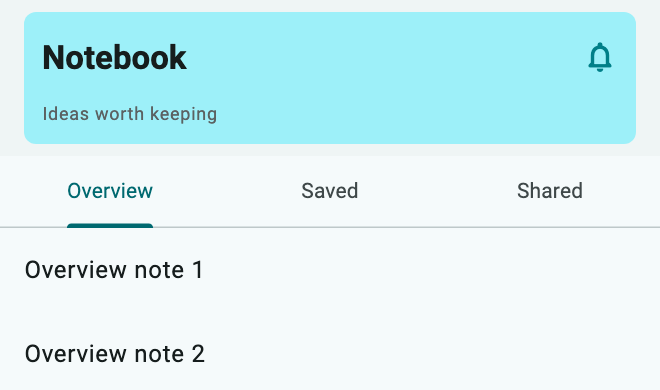](../assets/showcase-v021/header.sectionTabs.png)


**Copy & Use**

```dart
import 'package:flutter/material.dart';
import 'package:flutter_ui_gallery/flutter_ui_gallery.dart';

// Apply this theme to MaterialApp(theme: showHeaderSectionTabsTheme()).
ThemeData showHeaderSectionTabsTheme({
  Brightness brightness = Brightness.light,
}) {
  final base = ThemeData(
    colorScheme: ColorScheme.fromSeed(
      seedColor: Color(0xff007f88),
      brightness: brightness,
    ),
  );
  final recipe = UiGalleryTheme.family(
    UiGalleryDesignFamily.soft,
    theme: base,
    useSignature: true,
  );
  return base.copyWith(
    extensions: [
      recipe.copyWith(
        surfaceStyle: recipe.surfaceStyle!.copyWith(
          accentColor: Color(0xff007f88),
        ),
        motionIntensity: 1,
      ),
    ],
  );
}

Widget showHeaderSectionTabs(VoidCallback onNotifications) {
  return DefaultTabController(
    length: 3,
    child: Scaffold(
      appBar: UiGalleryAppBar(
        preset: UiGalleryAppBarPreset.sectionTabs,
        title: const Text("Notebook"),
        subtitle: const Text("Ideas worth keeping"),
        scrollAware: true,
        bottom: const TabBar(
          tabs: [
            Tab(text: 'Overview'),
            Tab(text: 'Saved'),
            Tab(text: 'Shared'),
          ],
        ),
        actions: [
          IconButton(
            onPressed: onNotifications,
            icon: const Icon(Icons.notifications_none_rounded),
          ),
        ],
        style: const UiGallerySurfaceStyle(accentColor: Color(0xff007f88)),
      ),
      body: TabBarView(
        children: [
          for (final section in ['Overview', 'Saved', 'Shared'])
            ListView(
              children: List.generate(
                16,
                (i) => ListTile(title: Text('$section note ${i + 1}')),
              ),
            ),
        ],
      ),
    ),
  );
}
```

**Customize:** `title`, `subtitle`, `leading`, `actions`, `bottom`, `scrollAware`, and `style`.

**Interaction:** The included `DefaultTabController` owns tab state and pairs three tabs with three pages.

[Complete runnable owner](../../example/lib/showcase.dart) · [Dart source](code/header.sectionTabs.dart) · [Back to category](#app-bars)

<a id="selectionbar"></a>

## Selection Bar

`UiGalleryAppBarPreset.selectionBar` · `PRESET=header.selectionBar`

Caller-controlled selection counts with clear and bulk actions.

[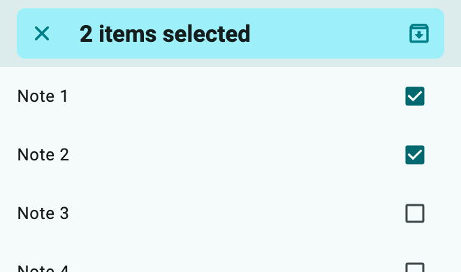](../assets/showcase-v021/header.selectionBar.png)


**Copy & Use**

```dart
import 'package:flutter/material.dart';
import 'package:flutter_ui_gallery/flutter_ui_gallery.dart';

// Apply this theme to MaterialApp(theme: showHeaderSelectionBarTheme()).
ThemeData showHeaderSelectionBarTheme({
  Brightness brightness = Brightness.light,
}) {
  final base = ThemeData(
    colorScheme: ColorScheme.fromSeed(
      seedColor: Color(0xff007f88),
      brightness: brightness,
    ),
  );
  final recipe = UiGalleryTheme.family(
    UiGalleryDesignFamily.soft,
    theme: base,
    useSignature: true,
  );
  return base.copyWith(
    extensions: [
      recipe.copyWith(
        surfaceStyle: recipe.surfaceStyle!.copyWith(
          accentColor: Color(0xff007f88),
        ),
        motionIntensity: 1,
      ),
    ],
  );
}

Widget showHeaderSelectionBar(
  Set<int> selected,
  ValueChanged<int> onToggle,
  VoidCallback onClear,
  VoidCallback onArchive,
) {
  return Scaffold(
    appBar: UiGalleryAppBar(
      preset: UiGalleryAppBarPreset.selectionBar,
      title: const Text("Notebook"),
      selectionCount: selected.length,
      onSelectionCleared: onClear,
      actions: [
        if (selected.isNotEmpty)
          IconButton(
            onPressed: onArchive,
            tooltip: 'Archive selected',
            icon: const Icon(Icons.archive_outlined),
          ),
      ],
      style: const UiGallerySurfaceStyle(accentColor: Color(0xff007f88)),
    ),
    body: ListView(
      children: [
        for (var i = 0; i < 8; i++)
          CheckboxListTile(
            title: Text('Note ${i + 1}'),
            value: selected.contains(i),
            onChanged: (_) => onToggle(i),
          ),
      ],
    ),
  );
}
```

**Customize:** `title`, `subtitle`, `leading`, `actions`, `bottom`, `scrollAware`, and `style`.

**Interaction:** Own the `Set<int>` in your screen. Toggle, clear, and archive callbacks must update that same selection.

[Complete runnable owner](../../example/lib/showcase.dart) · [Dart source](code/header.selectionBar.dart) · [Back to category](#app-bars)
