<!-- Generated by tool/build_showcase.py. -->
# Bottom Navigation

15 canonical presets. Keep primary destinations visible with selection-aware bars, docks, and shelves.

[All categories](README.md) · [Package introduction](../../README.md) · [Theme and setup](../QUICK_START.md)

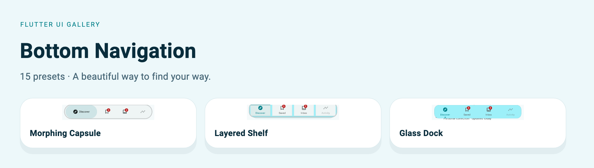

[Floating Cove](#floatingcove) · [Concave Notch](#concavenotch) · [Convex Wave](#convexwave) · [Orbit Dock](#orbitdock) · [Ribbon Curve](#ribboncurve) · [Layered Shelf](#layeredshelf) · [Split Island](#splitisland) · [Perspective Dock](#perspectivedock) · [Morphing Capsule](#morphingcapsule) · [Adaptive Minimal](#adaptiveminimal) · [Glass Dock](#glassdock) · [Liquid Drop](#liquiddrop) · [Scroll Dock](#scrolldock) · [Flip Tiles](#fliptiles) · [Overflow Dock](#overflowdock)

The captures below use the included Soft theme with signatures enabled, at a
440 × 560 logical-pixel viewport and 1.5× export resolution. The light preview
matches the example's default theme. Each full example includes its imports and
theme helper. Apply that helper to `MaterialApp.theme` before invoking the widget.

For a complete app with owned state, callbacks, and disposal, use
[`example/lib/showcase.dart`](../../example/lib/showcase.dart):

```sh
cd example
flutter run -t lib/showcase.dart --dart-define=PRESET=bottomNav.morphingCapsule
```

Change `PRESET` to the exact ID beside any entry. Helper parameters are supplied
by your screen; the runnable app shows their ownership. Copy uses ordinary Dart
code fences and your Markdown viewer's native copy control where available.

<a id="floatingcove"></a>

## Floating Cove

`UiGalleryBottomNavPreset.floatingCove` · `PRESET=bottomNav.floatingCove`

Primary app navigation. A floating curved outline holds a sliding active indicator.

[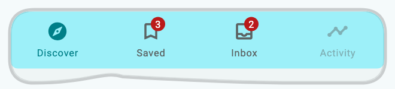](../assets/showcase-v021/bottomNav.floatingCove.png)


**Copy & Use**

```dart
import 'package:flutter/material.dart';
import 'package:flutter_ui_gallery/flutter_ui_gallery.dart';

// Apply this theme to MaterialApp(theme: showBottomNavFloatingCoveTheme()).
ThemeData showBottomNavFloatingCoveTheme({
  Brightness brightness = Brightness.light,
}) {
  final base = ThemeData(
    colorScheme: ColorScheme.fromSeed(
      seedColor: Color(0xff007f88),
      brightness: brightness,
    ),
  );
  final recipe = UiGalleryTheme.family(
    UiGalleryDesignFamily.soft,
    theme: base,
    useSignature: true,
  );
  return base.copyWith(
    extensions: [
      recipe.copyWith(
        surfaceStyle: recipe.surfaceStyle!.copyWith(
          accentColor: Color(0xff007f88),
        ),
        motionIntensity: 1,
      ),
    ],
  );
}

Widget showBottomNavFloatingCove(int index, ValueChanged<int> onSelected) {
  return UiGalleryBottomNav(
    preset: UiGalleryBottomNavPreset.floatingCove,
    selectedIndex: index,
    onDestinationSelected: onSelected,
    items: const [
      UiGalleryBottomNavItem(
        icon: Icon(Icons.explore_outlined),
        selectedIcon: Icon(Icons.explore),
        label: 'Discover',
      ),
      UiGalleryBottomNavItem(
        icon: Icon(Icons.bookmark_border),
        selectedIcon: Icon(Icons.bookmark),
        label: 'Saved',
        badge: Text('3'),
      ),
      UiGalleryBottomNavItem(
        icon: Icon(Icons.inbox_outlined),
        selectedIcon: Icon(Icons.inbox),
        label: 'Inbox',
        badge: Text('2'),
      ),
      UiGalleryBottomNavItem(
        icon: Icon(Icons.timeline),
        label: 'Activity',
        enabled: false,
      ),
    ],
    style: const UiGallerySurfaceStyle(accentColor: Color(0xff007f88)),
  );
}
```

**Customize:** `items`, `selectedIndex`, `onDestinationSelected`, `centerAction`, `options`, and `style`.

**Interaction:** The caller owns selection and destination content. Disabled items do not navigate. Some labels appear only for the selected destination.

[Complete runnable owner](../../example/lib/showcase.dart) · [Dart source](code/bottomNav.floatingCove.dart) · [Back to category](#bottom-navigation)

<a id="concavenotch"></a>

## Concave Notch

`UiGalleryBottomNavPreset.concaveNotch` · `PRESET=bottomNav.concaveNotch`

Creation and capture flows. Destinations sit around a calculated center notch.

[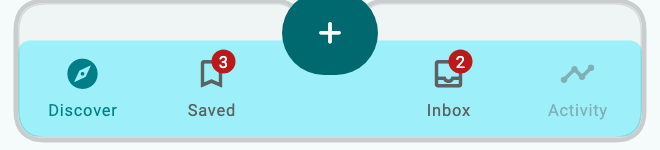](../assets/showcase-v021/bottomNav.concaveNotch.png)


**Copy & Use**

```dart
import 'package:flutter/material.dart';
import 'package:flutter_ui_gallery/flutter_ui_gallery.dart';

// Apply this theme to MaterialApp(theme: showBottomNavConcaveNotchTheme()).
ThemeData showBottomNavConcaveNotchTheme({
  Brightness brightness = Brightness.light,
}) {
  final base = ThemeData(
    colorScheme: ColorScheme.fromSeed(
      seedColor: Color(0xff007f88),
      brightness: brightness,
    ),
  );
  final recipe = UiGalleryTheme.family(
    UiGalleryDesignFamily.soft,
    theme: base,
    useSignature: true,
  );
  return base.copyWith(
    extensions: [
      recipe.copyWith(
        surfaceStyle: recipe.surfaceStyle!.copyWith(
          accentColor: Color(0xff007f88),
        ),
        motionIntensity: 1,
      ),
    ],
  );
}

Widget showBottomNavConcaveNotch(
  int index,
  ValueChanged<int> onSelected,
  VoidCallback onCreate,
) {
  return UiGalleryBottomNav(
    preset: UiGalleryBottomNavPreset.concaveNotch,
    selectedIndex: index,
    onDestinationSelected: onSelected,
    items: const [
      UiGalleryBottomNavItem(
        icon: Icon(Icons.explore_outlined),
        selectedIcon: Icon(Icons.explore),
        label: 'Discover',
      ),
      UiGalleryBottomNavItem(
        icon: Icon(Icons.bookmark_border),
        selectedIcon: Icon(Icons.bookmark),
        label: 'Saved',
        badge: Text('3'),
      ),
      UiGalleryBottomNavItem(
        icon: Icon(Icons.inbox_outlined),
        selectedIcon: Icon(Icons.inbox),
        label: 'Inbox',
        badge: Text('2'),
      ),
      UiGalleryBottomNavItem(
        icon: Icon(Icons.timeline),
        label: 'Activity',
        enabled: false,
      ),
    ],
    centerAction: IconButton.filled(
      onPressed: onCreate,
      tooltip: 'Create a note',
      icon: const Icon(Icons.add_rounded),
    ),
    style: const UiGallerySurfaceStyle(accentColor: Color(0xff007f88)),
  );
}
```

**Customize:** `items`, `selectedIndex`, `onDestinationSelected`, `centerAction`, `options`, and `style`.

**Interaction:** Supply a real center action callback. The sample creates an action surface; it does not navigate automatically.

[Complete runnable owner](../../example/lib/showcase.dart) · [Dart source](code/bottomNav.concaveNotch.dart) · [Back to category](#bottom-navigation)

<a id="convexwave"></a>

## Convex Wave

`UiGalleryBottomNavPreset.convexWave` · `PRESET=bottomNav.convexWave`

Content exploration. A continuous Bezier crest travels beneath the selected item.

[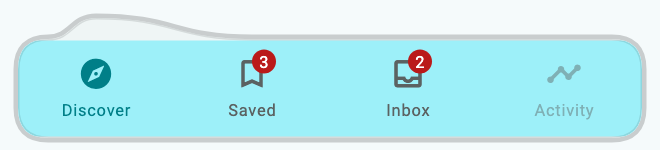](../assets/showcase-v021/bottomNav.convexWave.png)


**Copy & Use**

```dart
import 'package:flutter/material.dart';
import 'package:flutter_ui_gallery/flutter_ui_gallery.dart';

// Apply this theme to MaterialApp(theme: showBottomNavConvexWaveTheme()).
ThemeData showBottomNavConvexWaveTheme({
  Brightness brightness = Brightness.light,
}) {
  final base = ThemeData(
    colorScheme: ColorScheme.fromSeed(
      seedColor: Color(0xff007f88),
      brightness: brightness,
    ),
  );
  final recipe = UiGalleryTheme.family(
    UiGalleryDesignFamily.soft,
    theme: base,
    useSignature: true,
  );
  return base.copyWith(
    extensions: [
      recipe.copyWith(
        surfaceStyle: recipe.surfaceStyle!.copyWith(
          accentColor: Color(0xff007f88),
        ),
        motionIntensity: 1,
      ),
    ],
  );
}

Widget showBottomNavConvexWave(int index, ValueChanged<int> onSelected) {
  return UiGalleryBottomNav(
    preset: UiGalleryBottomNavPreset.convexWave,
    selectedIndex: index,
    onDestinationSelected: onSelected,
    items: const [
      UiGalleryBottomNavItem(
        icon: Icon(Icons.explore_outlined),
        selectedIcon: Icon(Icons.explore),
        label: 'Discover',
      ),
      UiGalleryBottomNavItem(
        icon: Icon(Icons.bookmark_border),
        selectedIcon: Icon(Icons.bookmark),
        label: 'Saved',
        badge: Text('3'),
      ),
      UiGalleryBottomNavItem(
        icon: Icon(Icons.inbox_outlined),
        selectedIcon: Icon(Icons.inbox),
        label: 'Inbox',
        badge: Text('2'),
      ),
      UiGalleryBottomNavItem(
        icon: Icon(Icons.timeline),
        label: 'Activity',
        enabled: false,
      ),
    ],
    style: const UiGallerySurfaceStyle(accentColor: Color(0xff007f88)),
  );
}
```

**Customize:** `items`, `selectedIndex`, `onDestinationSelected`, `centerAction`, `options`, and `style`.

**Interaction:** The caller owns selection and destination content. Disabled items do not navigate. Some labels appear only for the selected destination.

[Complete runnable owner](../../example/lib/showcase.dart) · [Dart source](code/bottomNav.convexWave.dart) · [Back to category](#bottom-navigation)

<a id="orbitdock"></a>

## Orbit Dock

`UiGalleryBottomNavPreset.orbitDock` · `PRESET=bottomNav.orbitDock`

Spatial workspaces. Restrained depth gives the active destination clear hierarchy.

[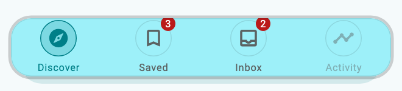](../assets/showcase-v021/bottomNav.orbitDock.png)


**Copy & Use**

```dart
import 'package:flutter/material.dart';
import 'package:flutter_ui_gallery/flutter_ui_gallery.dart';

// Apply this theme to MaterialApp(theme: showBottomNavOrbitDockTheme()).
ThemeData showBottomNavOrbitDockTheme({
  Brightness brightness = Brightness.light,
}) {
  final base = ThemeData(
    colorScheme: ColorScheme.fromSeed(
      seedColor: Color(0xff007f88),
      brightness: brightness,
    ),
  );
  final recipe = UiGalleryTheme.family(
    UiGalleryDesignFamily.soft,
    theme: base,
    useSignature: true,
  );
  return base.copyWith(
    extensions: [
      recipe.copyWith(
        surfaceStyle: recipe.surfaceStyle!.copyWith(
          accentColor: Color(0xff007f88),
        ),
        motionIntensity: 1,
      ),
    ],
  );
}

Widget showBottomNavOrbitDock(int index, ValueChanged<int> onSelected) {
  return UiGalleryBottomNav(
    preset: UiGalleryBottomNavPreset.orbitDock,
    selectedIndex: index,
    onDestinationSelected: onSelected,
    items: const [
      UiGalleryBottomNavItem(
        icon: Icon(Icons.explore_outlined),
        selectedIcon: Icon(Icons.explore),
        label: 'Discover',
      ),
      UiGalleryBottomNavItem(
        icon: Icon(Icons.bookmark_border),
        selectedIcon: Icon(Icons.bookmark),
        label: 'Saved',
        badge: Text('3'),
      ),
      UiGalleryBottomNavItem(
        icon: Icon(Icons.inbox_outlined),
        selectedIcon: Icon(Icons.inbox),
        label: 'Inbox',
        badge: Text('2'),
      ),
      UiGalleryBottomNavItem(
        icon: Icon(Icons.timeline),
        label: 'Activity',
        enabled: false,
      ),
    ],
    style: const UiGallerySurfaceStyle(accentColor: Color(0xff007f88)),
  );
}
```

**Customize:** `items`, `selectedIndex`, `onDestinationSelected`, `centerAction`, `options`, and `style`.

**Interaction:** The caller owns selection and destination content. Disabled items do not navigate. Some labels appear only for the selected destination.

[Complete runnable owner](../../example/lib/showcase.dart) · [Dart source](code/bottomNav.orbitDock.dart) · [Back to category](#bottom-navigation)

<a id="ribboncurve"></a>

## Ribbon Curve

`UiGalleryBottomNavPreset.ribbonCurve` · `PRESET=bottomNav.ribbonCurve`

Media and editorial apps. A ribbon silhouette joins each destination into one surface.

[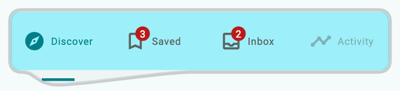](../assets/showcase-v021/bottomNav.ribbonCurve.png)


**Copy & Use**

```dart
import 'package:flutter/material.dart';
import 'package:flutter_ui_gallery/flutter_ui_gallery.dart';

// Apply this theme to MaterialApp(theme: showBottomNavRibbonCurveTheme()).
ThemeData showBottomNavRibbonCurveTheme({
  Brightness brightness = Brightness.light,
}) {
  final base = ThemeData(
    colorScheme: ColorScheme.fromSeed(
      seedColor: Color(0xff007f88),
      brightness: brightness,
    ),
  );
  final recipe = UiGalleryTheme.family(
    UiGalleryDesignFamily.soft,
    theme: base,
    useSignature: true,
  );
  return base.copyWith(
    extensions: [
      recipe.copyWith(
        surfaceStyle: recipe.surfaceStyle!.copyWith(
          accentColor: Color(0xff007f88),
        ),
        motionIntensity: 1,
      ),
    ],
  );
}

Widget showBottomNavRibbonCurve(int index, ValueChanged<int> onSelected) {
  return UiGalleryBottomNav(
    preset: UiGalleryBottomNavPreset.ribbonCurve,
    selectedIndex: index,
    onDestinationSelected: onSelected,
    items: const [
      UiGalleryBottomNavItem(
        icon: Icon(Icons.explore_outlined),
        selectedIcon: Icon(Icons.explore),
        label: 'Discover',
      ),
      UiGalleryBottomNavItem(
        icon: Icon(Icons.bookmark_border),
        selectedIcon: Icon(Icons.bookmark),
        label: 'Saved',
        badge: Text('3'),
      ),
      UiGalleryBottomNavItem(
        icon: Icon(Icons.inbox_outlined),
        selectedIcon: Icon(Icons.inbox),
        label: 'Inbox',
        badge: Text('2'),
      ),
      UiGalleryBottomNavItem(
        icon: Icon(Icons.timeline),
        label: 'Activity',
        enabled: false,
      ),
    ],
    style: const UiGallerySurfaceStyle(accentColor: Color(0xff007f88)),
  );
}
```

**Customize:** `items`, `selectedIndex`, `onDestinationSelected`, `centerAction`, `options`, and `style`.

**Interaction:** The caller owns selection and destination content. Disabled items do not navigate. Some labels appear only for the selected destination.

[Complete runnable owner](../../example/lib/showcase.dart) · [Dart source](code/bottomNav.ribbonCurve.dart) · [Back to category](#bottom-navigation)

<a id="layeredshelf"></a>

## Layered Shelf

`UiGalleryBottomNavPreset.layeredShelf` · `PRESET=bottomNav.layeredShelf`

Productivity apps. A moving active panel sits above stacked structural layers.

[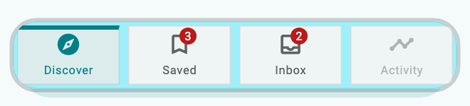](../assets/showcase-v021/bottomNav.layeredShelf.png)


**Copy & Use**

```dart
import 'package:flutter/material.dart';
import 'package:flutter_ui_gallery/flutter_ui_gallery.dart';

// Apply this theme to MaterialApp(theme: showBottomNavLayeredShelfTheme()).
ThemeData showBottomNavLayeredShelfTheme({
  Brightness brightness = Brightness.light,
}) {
  final base = ThemeData(
    colorScheme: ColorScheme.fromSeed(
      seedColor: Color(0xff007f88),
      brightness: brightness,
    ),
  );
  final recipe = UiGalleryTheme.family(
    UiGalleryDesignFamily.soft,
    theme: base,
    useSignature: true,
  );
  return base.copyWith(
    extensions: [
      recipe.copyWith(
        surfaceStyle: recipe.surfaceStyle!.copyWith(
          accentColor: Color(0xff007f88),
        ),
        motionIntensity: 1,
      ),
    ],
  );
}

Widget showBottomNavLayeredShelf(int index, ValueChanged<int> onSelected) {
  return UiGalleryBottomNav(
    preset: UiGalleryBottomNavPreset.layeredShelf,
    selectedIndex: index,
    onDestinationSelected: onSelected,
    items: const [
      UiGalleryBottomNavItem(
        icon: Icon(Icons.explore_outlined),
        selectedIcon: Icon(Icons.explore),
        label: 'Discover',
      ),
      UiGalleryBottomNavItem(
        icon: Icon(Icons.bookmark_border),
        selectedIcon: Icon(Icons.bookmark),
        label: 'Saved',
        badge: Text('3'),
      ),
      UiGalleryBottomNavItem(
        icon: Icon(Icons.inbox_outlined),
        selectedIcon: Icon(Icons.inbox),
        label: 'Inbox',
        badge: Text('2'),
      ),
      UiGalleryBottomNavItem(
        icon: Icon(Icons.timeline),
        label: 'Activity',
        enabled: false,
      ),
    ],
    style: const UiGallerySurfaceStyle(accentColor: Color(0xff007f88)),
  );
}
```

**Customize:** `items`, `selectedIndex`, `onDestinationSelected`, `centerAction`, `options`, and `style`.

**Interaction:** The caller owns selection and destination content. Disabled items do not navigate. Some labels appear only for the selected destination.

[Complete runnable owner](../../example/lib/showcase.dart) · [Dart source](code/bottomNav.layeredShelf.dart) · [Back to category](#bottom-navigation)

<a id="splitisland"></a>

## Split Island

`UiGalleryBottomNavPreset.splitIsland` · `PRESET=bottomNav.splitIsland`

Multi-purpose workspaces. Two floating destination zones frame a central action island.

[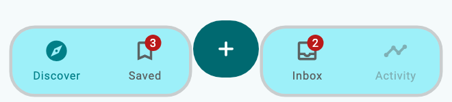](../assets/showcase-v021/bottomNav.splitIsland.png)


**Copy & Use**

```dart
import 'package:flutter/material.dart';
import 'package:flutter_ui_gallery/flutter_ui_gallery.dart';

// Apply this theme to MaterialApp(theme: showBottomNavSplitIslandTheme()).
ThemeData showBottomNavSplitIslandTheme({
  Brightness brightness = Brightness.light,
}) {
  final base = ThemeData(
    colorScheme: ColorScheme.fromSeed(
      seedColor: Color(0xff007f88),
      brightness: brightness,
    ),
  );
  final recipe = UiGalleryTheme.family(
    UiGalleryDesignFamily.soft,
    theme: base,
    useSignature: true,
  );
  return base.copyWith(
    extensions: [
      recipe.copyWith(
        surfaceStyle: recipe.surfaceStyle!.copyWith(
          accentColor: Color(0xff007f88),
        ),
        motionIntensity: 1,
      ),
    ],
  );
}

Widget showBottomNavSplitIsland(
  int index,
  ValueChanged<int> onSelected,
  VoidCallback onCreate,
) {
  return UiGalleryBottomNav(
    preset: UiGalleryBottomNavPreset.splitIsland,
    selectedIndex: index,
    onDestinationSelected: onSelected,
    items: const [
      UiGalleryBottomNavItem(
        icon: Icon(Icons.explore_outlined),
        selectedIcon: Icon(Icons.explore),
        label: 'Discover',
      ),
      UiGalleryBottomNavItem(
        icon: Icon(Icons.bookmark_border),
        selectedIcon: Icon(Icons.bookmark),
        label: 'Saved',
        badge: Text('3'),
      ),
      UiGalleryBottomNavItem(
        icon: Icon(Icons.inbox_outlined),
        selectedIcon: Icon(Icons.inbox),
        label: 'Inbox',
        badge: Text('2'),
      ),
      UiGalleryBottomNavItem(
        icon: Icon(Icons.timeline),
        label: 'Activity',
        enabled: false,
      ),
    ],
    centerAction: IconButton.filled(
      onPressed: onCreate,
      tooltip: 'Create a note',
      icon: const Icon(Icons.add_rounded),
    ),
    style: const UiGallerySurfaceStyle(accentColor: Color(0xff007f88)),
  );
}
```

**Customize:** `items`, `selectedIndex`, `onDestinationSelected`, `centerAction`, `options`, and `style`.

**Interaction:** Supply a real center action callback independently of destination selection.

[Complete runnable owner](../../example/lib/showcase.dart) · [Dart source](code/bottomNav.splitIsland.dart) · [Back to category](#bottom-navigation)

<a id="perspectivedock"></a>

## Perspective Dock

`UiGalleryBottomNavPreset.perspectiveDock` · `PRESET=bottomNav.perspectiveDock`

Creative tools. Controlled tilt and depth keep every label and target readable.

[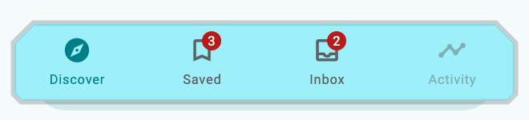](../assets/showcase-v021/bottomNav.perspectiveDock.png)


**Copy & Use**

```dart
import 'package:flutter/material.dart';
import 'package:flutter_ui_gallery/flutter_ui_gallery.dart';

// Apply this theme to MaterialApp(theme: showBottomNavPerspectiveDockTheme()).
ThemeData showBottomNavPerspectiveDockTheme({
  Brightness brightness = Brightness.light,
}) {
  final base = ThemeData(
    colorScheme: ColorScheme.fromSeed(
      seedColor: Color(0xff007f88),
      brightness: brightness,
    ),
  );
  final recipe = UiGalleryTheme.family(
    UiGalleryDesignFamily.soft,
    theme: base,
    useSignature: true,
  );
  return base.copyWith(
    extensions: [
      recipe.copyWith(
        surfaceStyle: recipe.surfaceStyle!.copyWith(
          accentColor: Color(0xff007f88),
        ),
        motionIntensity: 1,
      ),
    ],
  );
}

Widget showBottomNavPerspectiveDock(int index, ValueChanged<int> onSelected) {
  return UiGalleryBottomNav(
    preset: UiGalleryBottomNavPreset.perspectiveDock,
    selectedIndex: index,
    onDestinationSelected: onSelected,
    items: const [
      UiGalleryBottomNavItem(
        icon: Icon(Icons.explore_outlined),
        selectedIcon: Icon(Icons.explore),
        label: 'Discover',
      ),
      UiGalleryBottomNavItem(
        icon: Icon(Icons.bookmark_border),
        selectedIcon: Icon(Icons.bookmark),
        label: 'Saved',
        badge: Text('3'),
      ),
      UiGalleryBottomNavItem(
        icon: Icon(Icons.inbox_outlined),
        selectedIcon: Icon(Icons.inbox),
        label: 'Inbox',
        badge: Text('2'),
      ),
      UiGalleryBottomNavItem(
        icon: Icon(Icons.timeline),
        label: 'Activity',
        enabled: false,
      ),
    ],
    style: const UiGallerySurfaceStyle(accentColor: Color(0xff007f88)),
  );
}
```

**Customize:** `items`, `selectedIndex`, `onDestinationSelected`, `centerAction`, `options`, and `style`.

**Interaction:** The caller owns selection and destination content. Disabled items do not navigate. Some labels appear only for the selected destination.

[Complete runnable owner](../../example/lib/showcase.dart) · [Dart source](code/bottomNav.perspectiveDock.dart) · [Back to category](#bottom-navigation)

<a id="morphingcapsule"></a>

## Morphing Capsule

`UiGalleryBottomNavPreset.morphingCapsule` · `PRESET=bottomNav.morphingCapsule`

Compact app navigation. Icon and label share an expanding capsule with stable redistribution.

[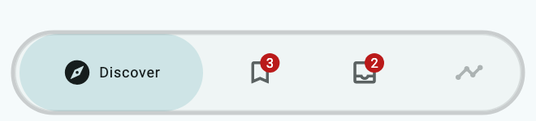](../assets/showcase-v021/bottomNav.morphingCapsule.png)

[Dark theme](../assets/showcase-v021/bottomNav.morphingCapsule-dark.png) · [Saved selected](../assets/showcase-v021/bottomNav.morphingCapsule-selected.png)

**Copy & Use**

```dart
import 'package:flutter/material.dart';
import 'package:flutter_ui_gallery/flutter_ui_gallery.dart';

// Apply this theme to MaterialApp(theme: showBottomNavMorphingCapsuleTheme()).
ThemeData showBottomNavMorphingCapsuleTheme({
  Brightness brightness = Brightness.light,
}) {
  final base = ThemeData(
    colorScheme: ColorScheme.fromSeed(
      seedColor: Color(0xff007f88),
      brightness: brightness,
    ),
  );
  final recipe = UiGalleryTheme.family(
    UiGalleryDesignFamily.soft,
    theme: base,
    useSignature: true,
  );
  return base.copyWith(
    extensions: [
      recipe.copyWith(
        surfaceStyle: recipe.surfaceStyle!.copyWith(
          accentColor: Color(0xff007f88),
        ),
        motionIntensity: 1,
      ),
    ],
  );
}

Widget showBottomNavMorphingCapsule(int index, ValueChanged<int> onSelected) {
  return UiGalleryBottomNav(
    preset: UiGalleryBottomNavPreset.morphingCapsule,
    selectedIndex: index,
    onDestinationSelected: onSelected,
    items: const [
      UiGalleryBottomNavItem(
        icon: Icon(Icons.explore_outlined),
        selectedIcon: Icon(Icons.explore),
        label: 'Discover',
      ),
      UiGalleryBottomNavItem(
        icon: Icon(Icons.bookmark_border),
        selectedIcon: Icon(Icons.bookmark),
        label: 'Saved',
        badge: Text('3'),
      ),
      UiGalleryBottomNavItem(
        icon: Icon(Icons.inbox_outlined),
        selectedIcon: Icon(Icons.inbox),
        label: 'Inbox',
        badge: Text('2'),
      ),
      UiGalleryBottomNavItem(
        icon: Icon(Icons.timeline),
        label: 'Activity',
        enabled: false,
      ),
    ],
    style: const UiGallerySurfaceStyle(accentColor: Color(0xff007f88)),
  );
}
```

**Customize:** `items`, `selectedIndex`, `onDestinationSelected`, `centerAction`, `options`, and `style`.

**Interaction:** The caller owns selection and destination content. Disabled items do not navigate. Some labels appear only for the selected destination.

[Complete runnable owner](../../example/lib/showcase.dart) · [Dart source](code/bottomNav.morphingCapsule.dart) · [Back to category](#bottom-navigation)

<a id="adaptiveminimal"></a>

## Adaptive Minimal

`UiGalleryBottomNavPreset.adaptiveMinimal` · `PRESET=bottomNav.adaptiveMinimal`

Everyday apps. Adaptive labels and clear contrast scale from phone to wide layouts.

[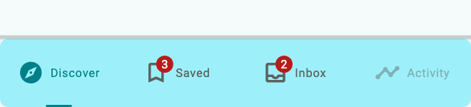](../assets/showcase-v021/bottomNav.adaptiveMinimal.png)


**Copy & Use**

```dart
import 'package:flutter/material.dart';
import 'package:flutter_ui_gallery/flutter_ui_gallery.dart';

// Apply this theme to MaterialApp(theme: showBottomNavAdaptiveMinimalTheme()).
ThemeData showBottomNavAdaptiveMinimalTheme({
  Brightness brightness = Brightness.light,
}) {
  final base = ThemeData(
    colorScheme: ColorScheme.fromSeed(
      seedColor: Color(0xff007f88),
      brightness: brightness,
    ),
  );
  final recipe = UiGalleryTheme.family(
    UiGalleryDesignFamily.soft,
    theme: base,
    useSignature: true,
  );
  return base.copyWith(
    extensions: [
      recipe.copyWith(
        surfaceStyle: recipe.surfaceStyle!.copyWith(
          accentColor: Color(0xff007f88),
        ),
        motionIntensity: 1,
      ),
    ],
  );
}

Widget showBottomNavAdaptiveMinimal(int index, ValueChanged<int> onSelected) {
  return UiGalleryBottomNav(
    preset: UiGalleryBottomNavPreset.adaptiveMinimal,
    selectedIndex: index,
    onDestinationSelected: onSelected,
    items: const [
      UiGalleryBottomNavItem(
        icon: Icon(Icons.explore_outlined),
        selectedIcon: Icon(Icons.explore),
        label: 'Discover',
      ),
      UiGalleryBottomNavItem(
        icon: Icon(Icons.bookmark_border),
        selectedIcon: Icon(Icons.bookmark),
        label: 'Saved',
        badge: Text('3'),
      ),
      UiGalleryBottomNavItem(
        icon: Icon(Icons.inbox_outlined),
        selectedIcon: Icon(Icons.inbox),
        label: 'Inbox',
        badge: Text('2'),
      ),
      UiGalleryBottomNavItem(
        icon: Icon(Icons.timeline),
        label: 'Activity',
        enabled: false,
      ),
    ],
    style: const UiGallerySurfaceStyle(accentColor: Color(0xff007f88)),
  );
}
```

**Customize:** `items`, `selectedIndex`, `onDestinationSelected`, `centerAction`, `options`, and `style`.

**Interaction:** The caller owns selection and destination content. Disabled items do not navigate. Some labels appear only for the selected destination.

[Complete runnable owner](../../example/lib/showcase.dart) · [Dart source](code/bottomNav.adaptiveMinimal.dart) · [Back to category](#bottom-navigation)

<a id="glassdock"></a>

## Glass Dock

`UiGalleryBottomNavPreset.glassDock` · `PRESET=bottomNav.glassDock`

Content-first apps with a translucent dock and moving indicator.

[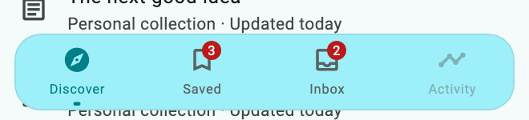](../assets/showcase-v021/bottomNav.glassDock.png)


**Copy & Use**

```dart
import 'package:flutter/material.dart';
import 'package:flutter_ui_gallery/flutter_ui_gallery.dart';

// Apply this theme to MaterialApp(theme: showBottomNavGlassDockTheme()).
ThemeData showBottomNavGlassDockTheme({
  Brightness brightness = Brightness.light,
}) {
  final base = ThemeData(
    colorScheme: ColorScheme.fromSeed(
      seedColor: Color(0xff007f88),
      brightness: brightness,
    ),
  );
  final recipe = UiGalleryTheme.family(
    UiGalleryDesignFamily.soft,
    theme: base,
    useSignature: true,
  );
  return base.copyWith(
    extensions: [
      recipe.copyWith(
        surfaceStyle: recipe.surfaceStyle!.copyWith(
          accentColor: Color(0xff007f88),
        ),
        motionIntensity: 1,
      ),
    ],
  );
}

Widget showBottomNavGlassDock(int index, ValueChanged<int> onSelected) {
  return Scaffold(
    extendBody: true,
    body: ListView(
      children: List.generate(
        16,
        (i) => ListTile(
          leading: const Icon(Icons.article_outlined),
          title: Text(
            const [
              'Field notes',
              'A weekend by the coast',
              'The next good idea',
              'Spaces worth saving',
            ][i % 4],
          ),
          subtitle: const Text('Personal collection · Updated today'),
        ),
      ),
    ),
    bottomNavigationBar: UiGalleryBottomNav(
      preset: UiGalleryBottomNavPreset.glassDock,
      selectedIndex: index,
      onDestinationSelected: onSelected,
      items: const [
        UiGalleryBottomNavItem(
          icon: Icon(Icons.explore_outlined),
          selectedIcon: Icon(Icons.explore),
          label: 'Discover',
        ),
        UiGalleryBottomNavItem(
          icon: Icon(Icons.bookmark_border),
          selectedIcon: Icon(Icons.bookmark),
          label: 'Saved',
          badge: Text('3'),
        ),
        UiGalleryBottomNavItem(
          icon: Icon(Icons.inbox_outlined),
          selectedIcon: Icon(Icons.inbox),
          label: 'Inbox',
          badge: Text('2'),
        ),
        UiGalleryBottomNavItem(
          icon: Icon(Icons.timeline),
          label: 'Activity',
          enabled: false,
        ),
      ],
      style: const UiGallerySurfaceStyle(accentColor: Color(0xff007f88)),
    ),
  );
}
```

**Customize:** `items`, `selectedIndex`, `onDestinationSelected`, `centerAction`, `options`, and `style`.

**Interaction:** The included Scaffold uses `extendBody: true` so body content can appear behind the glass. Blur visibility depends on the content behind it.

[Complete runnable owner](../../example/lib/showcase.dart) · [Dart source](code/bottomNav.glassDock.dart) · [Back to category](#bottom-navigation)

<a id="liquiddrop"></a>

## Liquid Drop

`UiGalleryBottomNavPreset.liquidDrop` · `PRESET=bottomNav.liquidDrop`

Expressive apps with a connected droplet selection indicator.

[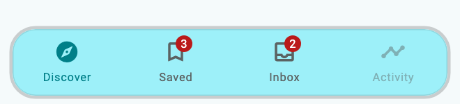](../assets/showcase-v021/bottomNav.liquidDrop.png)


**Copy & Use**

```dart
import 'package:flutter/material.dart';
import 'package:flutter_ui_gallery/flutter_ui_gallery.dart';

// Apply this theme to MaterialApp(theme: showBottomNavLiquidDropTheme()).
ThemeData showBottomNavLiquidDropTheme({
  Brightness brightness = Brightness.light,
}) {
  final base = ThemeData(
    colorScheme: ColorScheme.fromSeed(
      seedColor: Color(0xff007f88),
      brightness: brightness,
    ),
  );
  final recipe = UiGalleryTheme.family(
    UiGalleryDesignFamily.soft,
    theme: base,
    useSignature: true,
  );
  return base.copyWith(
    extensions: [
      recipe.copyWith(
        surfaceStyle: recipe.surfaceStyle!.copyWith(
          accentColor: Color(0xff007f88),
        ),
        motionIntensity: 1,
      ),
    ],
  );
}

Widget showBottomNavLiquidDrop(int index, ValueChanged<int> onSelected) {
  return UiGalleryBottomNav(
    preset: UiGalleryBottomNavPreset.liquidDrop,
    selectedIndex: index,
    onDestinationSelected: onSelected,
    items: const [
      UiGalleryBottomNavItem(
        icon: Icon(Icons.explore_outlined),
        selectedIcon: Icon(Icons.explore),
        label: 'Discover',
      ),
      UiGalleryBottomNavItem(
        icon: Icon(Icons.bookmark_border),
        selectedIcon: Icon(Icons.bookmark),
        label: 'Saved',
        badge: Text('3'),
      ),
      UiGalleryBottomNavItem(
        icon: Icon(Icons.inbox_outlined),
        selectedIcon: Icon(Icons.inbox),
        label: 'Inbox',
        badge: Text('2'),
      ),
      UiGalleryBottomNavItem(
        icon: Icon(Icons.timeline),
        label: 'Activity',
        enabled: false,
      ),
    ],
    style: const UiGallerySurfaceStyle(accentColor: Color(0xff007f88)),
  );
}
```

**Customize:** `items`, `selectedIndex`, `onDestinationSelected`, `centerAction`, `options`, and `style`.

**Interaction:** The caller owns selection and destination content. Disabled items do not navigate. Some labels appear only for the selected destination.

[Complete runnable owner](../../example/lib/showcase.dart) · [Dart source](code/bottomNav.liquidDrop.dart) · [Back to category](#bottom-navigation)

<a id="scrolldock"></a>

## Scroll Dock

`UiGalleryBottomNavPreset.scrollDock` · `PRESET=bottomNav.scrollDock`

Feeds and reading apps. Scroll down to hide, up to reveal.

[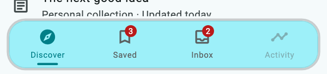](../assets/showcase-v021/bottomNav.scrollDock.png)


**Copy & Use**

```dart
import 'package:flutter/material.dart';
import 'package:flutter_ui_gallery/flutter_ui_gallery.dart';

// Apply this theme to MaterialApp(theme: showBottomNavScrollDockTheme()).
ThemeData showBottomNavScrollDockTheme({
  Brightness brightness = Brightness.light,
}) {
  final base = ThemeData(
    colorScheme: ColorScheme.fromSeed(
      seedColor: Color(0xff007f88),
      brightness: brightness,
    ),
  );
  final recipe = UiGalleryTheme.family(
    UiGalleryDesignFamily.soft,
    theme: base,
    useSignature: true,
  );
  return base.copyWith(
    extensions: [
      recipe.copyWith(
        surfaceStyle: recipe.surfaceStyle!.copyWith(
          accentColor: Color(0xff007f88),
        ),
        motionIntensity: 1,
      ),
    ],
  );
}

Widget showBottomNavScrollDock(int index, ValueChanged<int> onSelected) {
  return Scaffold(
    extendBody: false,
    body: ListView(
      children: List.generate(
        16,
        (i) => ListTile(
          leading: const Icon(Icons.article_outlined),
          title: Text(
            const [
              'Field notes',
              'A weekend by the coast',
              'The next good idea',
              'Spaces worth saving',
            ][i % 4],
          ),
          subtitle: const Text('Personal collection · Updated today'),
        ),
      ),
    ),
    bottomNavigationBar: UiGalleryBottomNav(
      preset: UiGalleryBottomNavPreset.scrollDock,
      selectedIndex: index,
      onDestinationSelected: onSelected,
      items: const [
        UiGalleryBottomNavItem(
          icon: Icon(Icons.explore_outlined),
          selectedIcon: Icon(Icons.explore),
          label: 'Discover',
        ),
        UiGalleryBottomNavItem(
          icon: Icon(Icons.bookmark_border),
          selectedIcon: Icon(Icons.bookmark),
          label: 'Saved',
          badge: Text('3'),
        ),
        UiGalleryBottomNavItem(
          icon: Icon(Icons.inbox_outlined),
          selectedIcon: Icon(Icons.inbox),
          label: 'Inbox',
          badge: Text('2'),
        ),
        UiGalleryBottomNavItem(
          icon: Icon(Icons.timeline),
          label: 'Activity',
          enabled: false,
        ),
      ],
      style: const UiGallerySurfaceStyle(accentColor: Color(0xff007f88)),
    ),
  );
}
```

**Customize:** `items`, `selectedIndex`, `onDestinationSelected`, `centerAction`, `options`, and `style`.

**Interaction:** The included scrollable Scaffold supplies body-scroll notifications for this dock.

[Complete runnable owner](../../example/lib/showcase.dart) · [Dart source](code/bottomNav.scrollDock.dart) · [Back to category](#bottom-navigation)

<a id="fliptiles"></a>

## Flip Tiles

`UiGalleryBottomNavPreset.flipTiles` · `PRESET=bottomNav.flipTiles`

Creative apps with outlined tiles and stable touch targets.

[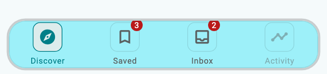](../assets/showcase-v021/bottomNav.flipTiles.png)


**Copy & Use**

```dart
import 'package:flutter/material.dart';
import 'package:flutter_ui_gallery/flutter_ui_gallery.dart';

// Apply this theme to MaterialApp(theme: showBottomNavFlipTilesTheme()).
ThemeData showBottomNavFlipTilesTheme({
  Brightness brightness = Brightness.light,
}) {
  final base = ThemeData(
    colorScheme: ColorScheme.fromSeed(
      seedColor: Color(0xff007f88),
      brightness: brightness,
    ),
  );
  final recipe = UiGalleryTheme.family(
    UiGalleryDesignFamily.soft,
    theme: base,
    useSignature: true,
  );
  return base.copyWith(
    extensions: [
      recipe.copyWith(
        surfaceStyle: recipe.surfaceStyle!.copyWith(
          accentColor: Color(0xff007f88),
        ),
        motionIntensity: 1,
      ),
    ],
  );
}

Widget showBottomNavFlipTiles(int index, ValueChanged<int> onSelected) {
  return UiGalleryBottomNav(
    preset: UiGalleryBottomNavPreset.flipTiles,
    selectedIndex: index,
    onDestinationSelected: onSelected,
    items: const [
      UiGalleryBottomNavItem(
        icon: Icon(Icons.explore_outlined),
        selectedIcon: Icon(Icons.explore),
        label: 'Discover',
      ),
      UiGalleryBottomNavItem(
        icon: Icon(Icons.bookmark_border),
        selectedIcon: Icon(Icons.bookmark),
        label: 'Saved',
        badge: Text('3'),
      ),
      UiGalleryBottomNavItem(
        icon: Icon(Icons.inbox_outlined),
        selectedIcon: Icon(Icons.inbox),
        label: 'Inbox',
        badge: Text('2'),
      ),
      UiGalleryBottomNavItem(
        icon: Icon(Icons.timeline),
        label: 'Activity',
        enabled: false,
      ),
    ],
    style: const UiGallerySurfaceStyle(accentColor: Color(0xff007f88)),
  );
}
```

**Customize:** `items`, `selectedIndex`, `onDestinationSelected`, `centerAction`, `options`, and `style`.

**Interaction:** The caller owns selection and destination content. Disabled items do not navigate. Some labels appear only for the selected destination.

[Complete runnable owner](../../example/lib/showcase.dart) · [Dart source](code/bottomNav.flipTiles.dart) · [Back to category](#bottom-navigation)

<a id="overflowdock"></a>

## Overflow Dock

`UiGalleryBottomNavPreset.overflowDock` · `PRESET=bottomNav.overflowDock`

Responsive primary destinations and a native overflow menu.

[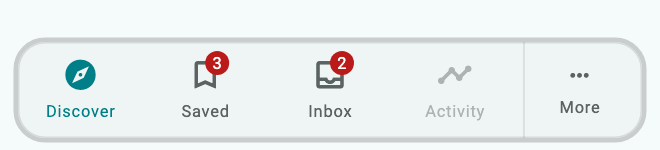](../assets/showcase-v021/bottomNav.overflowDock.png)


**Copy & Use**

```dart
import 'package:flutter/material.dart';
import 'package:flutter_ui_gallery/flutter_ui_gallery.dart';

// Apply this theme to MaterialApp(theme: showBottomNavOverflowDockTheme()).
ThemeData showBottomNavOverflowDockTheme({
  Brightness brightness = Brightness.light,
}) {
  final base = ThemeData(
    colorScheme: ColorScheme.fromSeed(
      seedColor: Color(0xff007f88),
      brightness: brightness,
    ),
  );
  final recipe = UiGalleryTheme.family(
    UiGalleryDesignFamily.soft,
    theme: base,
    useSignature: true,
  );
  return base.copyWith(
    extensions: [
      recipe.copyWith(
        surfaceStyle: recipe.surfaceStyle!.copyWith(
          accentColor: Color(0xff007f88),
        ),
        motionIntensity: 1,
      ),
    ],
  );
}

Widget showBottomNavOverflowDock(int index, ValueChanged<int> onSelected) {
  return UiGalleryBottomNav(
    preset: UiGalleryBottomNavPreset.overflowDock,
    selectedIndex: index,
    onDestinationSelected: onSelected,
    items: const [
      UiGalleryBottomNavItem(
        icon: Icon(Icons.explore_outlined),
        selectedIcon: Icon(Icons.explore),
        label: 'Discover',
      ),
      UiGalleryBottomNavItem(
        icon: Icon(Icons.bookmark_border),
        selectedIcon: Icon(Icons.bookmark),
        label: 'Saved',
        badge: Text('3'),
      ),
      UiGalleryBottomNavItem(
        icon: Icon(Icons.inbox_outlined),
        selectedIcon: Icon(Icons.inbox),
        label: 'Inbox',
        badge: Text('2'),
      ),
      UiGalleryBottomNavItem(
        icon: Icon(Icons.timeline),
        label: 'Activity',
        enabled: false,
      ),
      UiGalleryBottomNavItem(
        icon: Icon(Icons.collections_bookmark_outlined),
        label: 'Collections',
      ),
      UiGalleryBottomNavItem(icon: Icon(Icons.notes), label: 'Notes'),
    ],
    style: const UiGallerySurfaceStyle(accentColor: Color(0xff007f88)),
  );
}
```

**Customize:** `items`, `selectedIndex`, `onDestinationSelected`, `centerAction`, `options`, and `style`.

**Interaction:** Extra destinations appear in the overflow menu. Keep the selected index tied to the complete items list.

[Complete runnable owner](../../example/lib/showcase.dart) · [Dart source](code/bottomNav.overflowDock.dart) · [Back to category](#bottom-navigation)
