<!-- Generated by tool/build_showcase.py. -->
# Bottom Sheets

12 canonical presets. Bring contextual actions, forms, and useful details into reach without leaving the screen.

[All categories](README.md) · [Package introduction](../../README.md) · [Theme and setup](../QUICK_START.md)

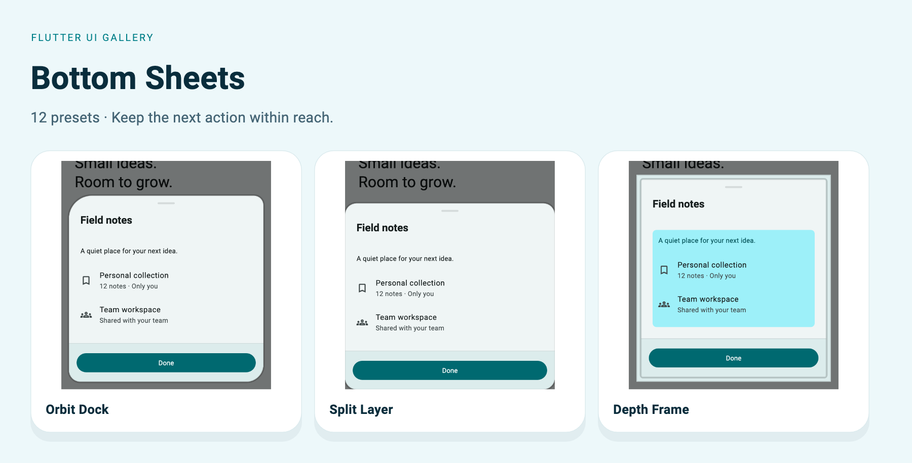

[Orbit Dock](#orbit) · [Fold Motion](#fold) · [Prism Stage](#prism) · [Flow Canvas](#flow) · [Edge Lift](#edgelift) · [Stack Panel](#stackpanel) · [Neo Tray](#neotray) · [Split Layer](#splitlayer) · [Pulse Dock](#pulsedock) · [Horizon Peek](#horizonpeek) · [Depth Frame](#depthframe) · [Task Rail](#taskrail)

The captures below use the included Soft theme with signatures enabled, at a
440 × 560 logical-pixel viewport and 1.5× export resolution. The light preview
matches the example's default theme. Each full example includes its imports and
theme helper. Apply that helper to `MaterialApp.theme` before invoking the widget.

For a complete app with owned state, callbacks, and disposal, use
[`example/lib/showcase.dart`](../../example/lib/showcase.dart):

```sh
cd example
flutter run -t lib/showcase.dart --dart-define=PRESET=sheets.orbit
```

Change `PRESET` to the exact ID beside any entry. Helper parameters are supplied
by your screen; the runnable app shows their ownership. Copy uses ordinary Dart
code fences and your Markdown viewer's native copy control where available.

<a id="orbit"></a>

## Orbit Dock

`UiGallerySheetPreset.orbit` · `PRESET=sheets.orbit`

Quick actions, sharing and contextual tools. Floating asymmetric action zones.

[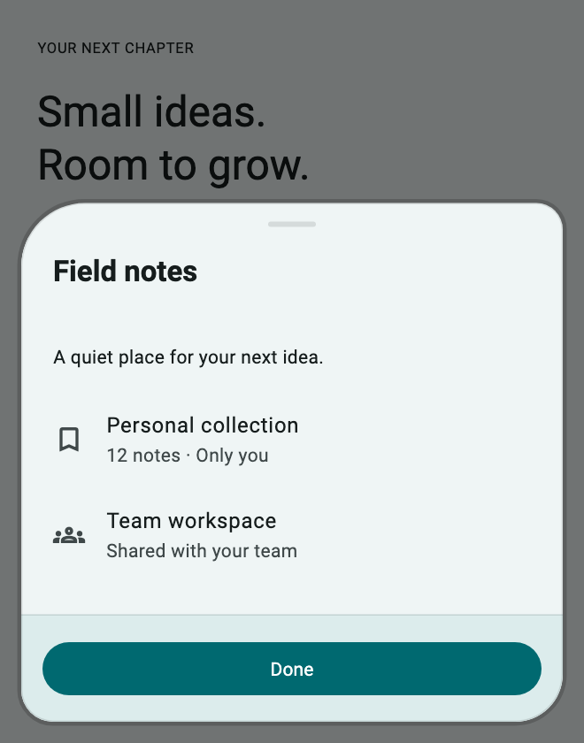](../assets/showcase-v021/sheets.orbit.png)

[Dark theme](../assets/showcase-v021/sheets.orbit-dark.png)

**Copy & Use**

```dart
import 'package:flutter/material.dart';
import 'package:flutter_ui_gallery/flutter_ui_gallery.dart';

// Apply this theme to MaterialApp(theme: showSheetsOrbitTheme()).
ThemeData showSheetsOrbitTheme({Brightness brightness = Brightness.light}) {
  final base = ThemeData(
    colorScheme: ColorScheme.fromSeed(
      seedColor: Color(0xff007f88),
      brightness: brightness,
    ),
  );
  final recipe = UiGalleryTheme.family(
    UiGalleryDesignFamily.soft,
    theme: base,
    useSignature: true,
  );
  return base.copyWith(
    extensions: [
      recipe.copyWith(
        surfaceStyle: recipe.surfaceStyle!.copyWith(
          accentColor: Color(0xff007f88),
        ),
        motionIntensity: 1,
      ),
    ],
  );
}

Future<void> showSheetsOrbit(BuildContext context) async {
  await UiGallerySheet.show<void>(
    context: context,
    preset: UiGallerySheetPreset.orbit,
    header: const Text("Field notes"),
    child: const Column(
      mainAxisSize: MainAxisSize.min,
      crossAxisAlignment: CrossAxisAlignment.start,
      children: [
        Text('A quiet place for your next idea.'),
        SizedBox(height: 16),
        ListTile(
          contentPadding: EdgeInsets.zero,
          leading: Icon(Icons.bookmark_outline),
          title: Text('Personal collection'),
          subtitle: Text('12 notes · Only you'),
        ),
        ListTile(
          contentPadding: EdgeInsets.zero,
          leading: Icon(Icons.groups_outlined),
          title: Text('Team workspace'),
          subtitle: Text('Shared with your team'),
        ),
      ],
    ),
    footer: Builder(
      builder: (sheetContext) => FilledButton(
        onPressed: () => Navigator.of(sheetContext).pop(),
        child: const Text('Done'),
      ),
    ),
    style: const UiGallerySurfaceStyle(accentColor: Color(0xff007f88)),
  );
}
```

**Customize:** `header`, `child`, `footer`, `style`, `appearance`, and `motion`.

**Interaction:** Use the sheet builder context with `Navigator.pop` to close the correct route. Await the typed result; a dismissed route returns `null`.

[Complete runnable owner](../../example/lib/showcase.dart) · [Dart source](code/sheets.orbit.dart) · [Back to category](#bottom-sheets)

<a id="fold"></a>

## Fold Motion

`UiGallerySheetPreset.fold` · `PRESET=sheets.fold`

Descriptions, editable forms and options. Peek state unfolding into one connected surface.

[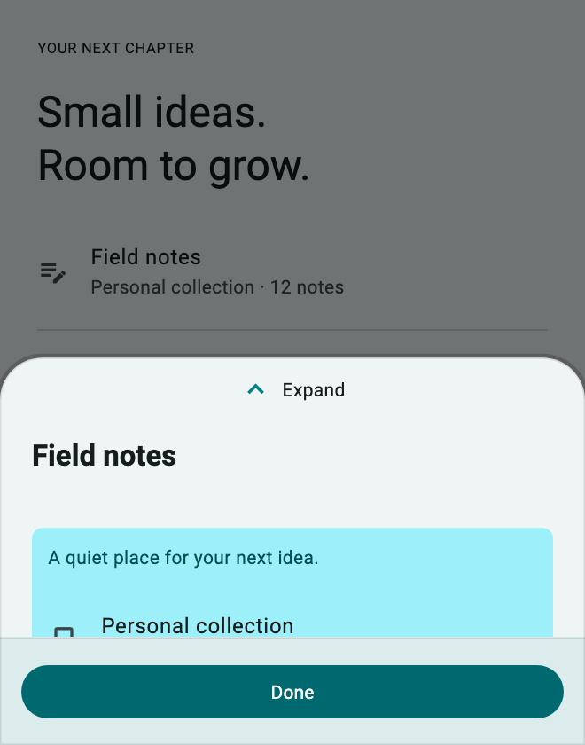](../assets/showcase-v021/sheets.fold.png)

[Expanded](../assets/showcase-v021/sheets.fold-expanded.png)

**Copy & Use**

```dart
import 'package:flutter/material.dart';
import 'package:flutter_ui_gallery/flutter_ui_gallery.dart';

// Apply this theme to MaterialApp(theme: showSheetsFoldTheme()).
ThemeData showSheetsFoldTheme({Brightness brightness = Brightness.light}) {
  final base = ThemeData(
    colorScheme: ColorScheme.fromSeed(
      seedColor: Color(0xff007f88),
      brightness: brightness,
    ),
  );
  final recipe = UiGalleryTheme.family(
    UiGalleryDesignFamily.soft,
    theme: base,
    useSignature: true,
  );
  return base.copyWith(
    extensions: [
      recipe.copyWith(
        surfaceStyle: recipe.surfaceStyle!.copyWith(
          accentColor: Color(0xff007f88),
        ),
        motionIntensity: 1,
      ),
    ],
  );
}

Future<void> showSheetsFold(BuildContext context) async {
  await UiGallerySheet.show<void>(
    context: context,
    preset: UiGallerySheetPreset.fold,
    header: const Text("Field notes"),
    child: const Column(
      mainAxisSize: MainAxisSize.min,
      crossAxisAlignment: CrossAxisAlignment.start,
      children: [
        Text('A quiet place for your next idea.'),
        SizedBox(height: 16),
        ListTile(
          contentPadding: EdgeInsets.zero,
          leading: Icon(Icons.bookmark_outline),
          title: Text('Personal collection'),
          subtitle: Text('12 notes · Only you'),
        ),
        ListTile(
          contentPadding: EdgeInsets.zero,
          leading: Icon(Icons.groups_outlined),
          title: Text('Team workspace'),
          subtitle: Text('Shared with your team'),
        ),
      ],
    ),
    footer: Builder(
      builder: (sheetContext) => FilledButton(
        onPressed: () => Navigator.of(sheetContext).pop(),
        child: const Text('Done'),
      ),
    ),
    style: const UiGallerySurfaceStyle(accentColor: Color(0xff007f88)),
  );
}
```

**Customize:** `header`, `child`, `footer`, `style`, `appearance`, and `motion`.

**Interaction:** Tap the expand handle to reveal more content. The expanded screenshot shows the same retained child.

[Complete runnable owner](../../example/lib/showcase.dart) · [Dart source](code/sheets.fold.dart) · [Back to category](#bottom-sheets)

<a id="prism"></a>

## Prism Stage

`UiGallerySheetPreset.prism` · `PRESET=sheets.prism`

Product previews and booking details. Showcase plane with a separate action deck.

[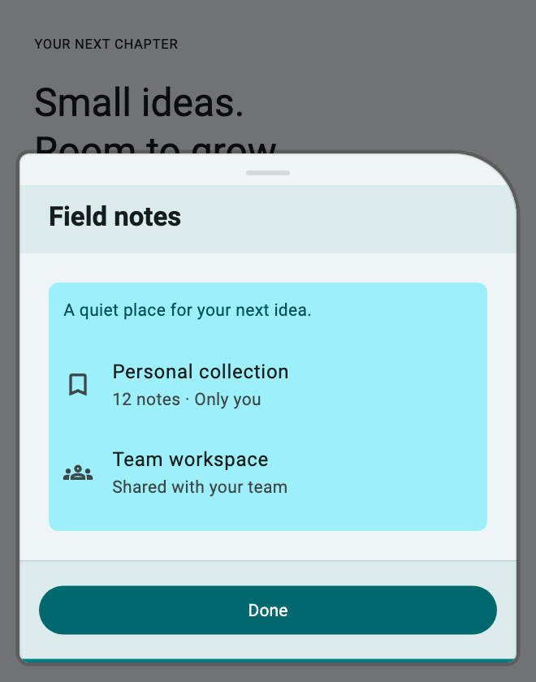](../assets/showcase-v021/sheets.prism.png)


**Copy & Use**

```dart
import 'package:flutter/material.dart';
import 'package:flutter_ui_gallery/flutter_ui_gallery.dart';

// Apply this theme to MaterialApp(theme: showSheetsPrismTheme()).
ThemeData showSheetsPrismTheme({Brightness brightness = Brightness.light}) {
  final base = ThemeData(
    colorScheme: ColorScheme.fromSeed(
      seedColor: Color(0xff007f88),
      brightness: brightness,
    ),
  );
  final recipe = UiGalleryTheme.family(
    UiGalleryDesignFamily.soft,
    theme: base,
    useSignature: true,
  );
  return base.copyWith(
    extensions: [
      recipe.copyWith(
        surfaceStyle: recipe.surfaceStyle!.copyWith(
          accentColor: Color(0xff007f88),
        ),
        motionIntensity: 1,
      ),
    ],
  );
}

Future<void> showSheetsPrism(BuildContext context) async {
  await UiGallerySheet.show<void>(
    context: context,
    preset: UiGallerySheetPreset.prism,
    header: const Text("Field notes"),
    child: const Column(
      mainAxisSize: MainAxisSize.min,
      crossAxisAlignment: CrossAxisAlignment.start,
      children: [
        Text('A quiet place for your next idea.'),
        SizedBox(height: 16),
        ListTile(
          contentPadding: EdgeInsets.zero,
          leading: Icon(Icons.bookmark_outline),
          title: Text('Personal collection'),
          subtitle: Text('12 notes · Only you'),
        ),
        ListTile(
          contentPadding: EdgeInsets.zero,
          leading: Icon(Icons.groups_outlined),
          title: Text('Team workspace'),
          subtitle: Text('Shared with your team'),
        ),
      ],
    ),
    footer: Builder(
      builder: (sheetContext) => FilledButton(
        onPressed: () => Navigator.of(sheetContext).pop(),
        child: const Text('Done'),
      ),
    ),
    style: const UiGallerySurfaceStyle(accentColor: Color(0xff007f88)),
  );
}
```

**Customize:** `header`, `child`, `footer`, `style`, `appearance`, and `motion`.

**Interaction:** Use the sheet builder context with `Navigator.pop` to close the correct route. Await the typed result; a dismissed route returns `null`.

[Complete runnable owner](../../example/lib/showcase.dart) · [Dart source](code/sheets.prism.dart) · [Back to category](#bottom-sheets)

<a id="flow"></a>

## Flow Canvas

`UiGallerySheetPreset.flow` · `PRESET=sheets.flow`

Checkout selections and onboarding. Task canvas with a spatial step track.

[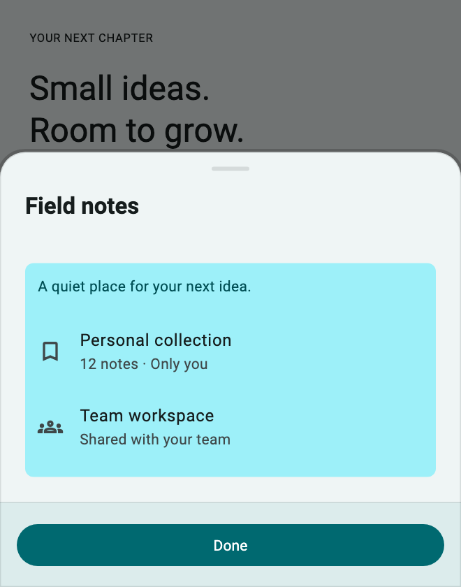](../assets/showcase-v021/sheets.flow.png)


**Copy & Use**

```dart
import 'package:flutter/material.dart';
import 'package:flutter_ui_gallery/flutter_ui_gallery.dart';

// Apply this theme to MaterialApp(theme: showSheetsFlowTheme()).
ThemeData showSheetsFlowTheme({Brightness brightness = Brightness.light}) {
  final base = ThemeData(
    colorScheme: ColorScheme.fromSeed(
      seedColor: Color(0xff007f88),
      brightness: brightness,
    ),
  );
  final recipe = UiGalleryTheme.family(
    UiGalleryDesignFamily.soft,
    theme: base,
    useSignature: true,
  );
  return base.copyWith(
    extensions: [
      recipe.copyWith(
        surfaceStyle: recipe.surfaceStyle!.copyWith(
          accentColor: Color(0xff007f88),
        ),
        motionIntensity: 1,
      ),
    ],
  );
}

Future<void> showSheetsFlow(BuildContext context) async {
  await UiGallerySheet.show<void>(
    context: context,
    preset: UiGallerySheetPreset.flow,
    header: const Text("Field notes"),
    child: const Column(
      mainAxisSize: MainAxisSize.min,
      crossAxisAlignment: CrossAxisAlignment.start,
      children: [
        Text('A quiet place for your next idea.'),
        SizedBox(height: 16),
        ListTile(
          contentPadding: EdgeInsets.zero,
          leading: Icon(Icons.bookmark_outline),
          title: Text('Personal collection'),
          subtitle: Text('12 notes · Only you'),
        ),
        ListTile(
          contentPadding: EdgeInsets.zero,
          leading: Icon(Icons.groups_outlined),
          title: Text('Team workspace'),
          subtitle: Text('Shared with your team'),
        ),
      ],
    ),
    footer: Builder(
      builder: (sheetContext) => FilledButton(
        onPressed: () => Navigator.of(sheetContext).pop(),
        child: const Text('Done'),
      ),
    ),
    style: const UiGallerySurfaceStyle(accentColor: Color(0xff007f88)),
  );
}
```

**Customize:** `header`, `child`, `footer`, `style`, `appearance`, and `motion`.

**Interaction:** Use the sheet builder context with `Navigator.pop` to close the correct route. Await the typed result; a dismissed route returns `null`.

[Complete runnable owner](../../example/lib/showcase.dart) · [Dart source](code/sheets.flow.dart) · [Back to category](#bottom-sheets)

<a id="edgelift"></a>

## Edge Lift

`UiGallerySheetPreset.edgeLift` · `PRESET=sheets.edgeLift`

Fast decisions and quick controls. Flush, shallow edge shelf with a slim action region.

[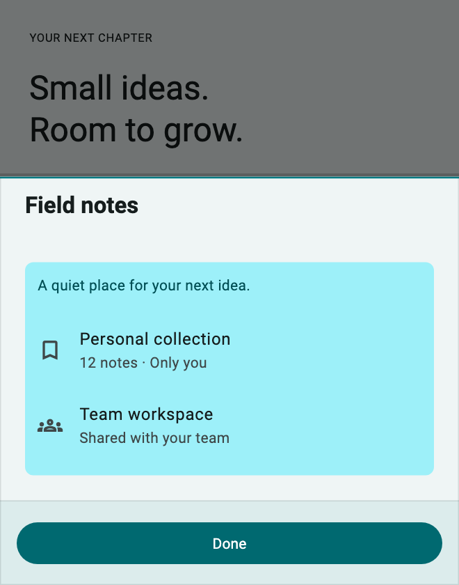](../assets/showcase-v021/sheets.edgeLift.png)


**Copy & Use**

```dart
import 'package:flutter/material.dart';
import 'package:flutter_ui_gallery/flutter_ui_gallery.dart';

// Apply this theme to MaterialApp(theme: showSheetsEdgeLiftTheme()).
ThemeData showSheetsEdgeLiftTheme({Brightness brightness = Brightness.light}) {
  final base = ThemeData(
    colorScheme: ColorScheme.fromSeed(
      seedColor: Color(0xff007f88),
      brightness: brightness,
    ),
  );
  final recipe = UiGalleryTheme.family(
    UiGalleryDesignFamily.soft,
    theme: base,
    useSignature: true,
  );
  return base.copyWith(
    extensions: [
      recipe.copyWith(
        surfaceStyle: recipe.surfaceStyle!.copyWith(
          accentColor: Color(0xff007f88),
        ),
        motionIntensity: 1,
      ),
    ],
  );
}

Future<void> showSheetsEdgeLift(BuildContext context) async {
  await UiGallerySheet.show<void>(
    context: context,
    preset: UiGallerySheetPreset.edgeLift,
    header: const Text("Field notes"),
    child: const Column(
      mainAxisSize: MainAxisSize.min,
      crossAxisAlignment: CrossAxisAlignment.start,
      children: [
        Text('A quiet place for your next idea.'),
        SizedBox(height: 16),
        ListTile(
          contentPadding: EdgeInsets.zero,
          leading: Icon(Icons.bookmark_outline),
          title: Text('Personal collection'),
          subtitle: Text('12 notes · Only you'),
        ),
        ListTile(
          contentPadding: EdgeInsets.zero,
          leading: Icon(Icons.groups_outlined),
          title: Text('Team workspace'),
          subtitle: Text('Shared with your team'),
        ),
      ],
    ),
    footer: Builder(
      builder: (sheetContext) => FilledButton(
        onPressed: () => Navigator.of(sheetContext).pop(),
        child: const Text('Done'),
      ),
    ),
    style: const UiGallerySurfaceStyle(accentColor: Color(0xff007f88)),
  );
}
```

**Customize:** `header`, `child`, `footer`, `style`, `appearance`, and `motion`.

**Interaction:** Use the sheet builder context with `Navigator.pop` to close the correct route. Await the typed result; a dismissed route returns `null`.

[Complete runnable owner](../../example/lib/showcase.dart) · [Dart source](code/sheets.edgeLift.dart) · [Back to category](#bottom-sheets)

<a id="stackpanel"></a>

## Stack Panel

`UiGallerySheetPreset.stackPanel` · `PRESET=sheets.stackPanel`

Collections and grouped options. Three offset planes behind an active panel.

[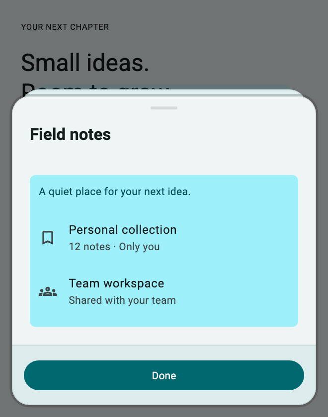](../assets/showcase-v021/sheets.stackPanel.png)


**Copy & Use**

```dart
import 'package:flutter/material.dart';
import 'package:flutter_ui_gallery/flutter_ui_gallery.dart';

// Apply this theme to MaterialApp(theme: showSheetsStackPanelTheme()).
ThemeData showSheetsStackPanelTheme({
  Brightness brightness = Brightness.light,
}) {
  final base = ThemeData(
    colorScheme: ColorScheme.fromSeed(
      seedColor: Color(0xff007f88),
      brightness: brightness,
    ),
  );
  final recipe = UiGalleryTheme.family(
    UiGalleryDesignFamily.soft,
    theme: base,
    useSignature: true,
  );
  return base.copyWith(
    extensions: [
      recipe.copyWith(
        surfaceStyle: recipe.surfaceStyle!.copyWith(
          accentColor: Color(0xff007f88),
        ),
        motionIntensity: 1,
      ),
    ],
  );
}

Future<void> showSheetsStackPanel(BuildContext context) async {
  await UiGallerySheet.show<void>(
    context: context,
    preset: UiGallerySheetPreset.stackPanel,
    header: const Text("Field notes"),
    child: const Column(
      mainAxisSize: MainAxisSize.min,
      crossAxisAlignment: CrossAxisAlignment.start,
      children: [
        Text('A quiet place for your next idea.'),
        SizedBox(height: 16),
        ListTile(
          contentPadding: EdgeInsets.zero,
          leading: Icon(Icons.bookmark_outline),
          title: Text('Personal collection'),
          subtitle: Text('12 notes · Only you'),
        ),
        ListTile(
          contentPadding: EdgeInsets.zero,
          leading: Icon(Icons.groups_outlined),
          title: Text('Team workspace'),
          subtitle: Text('Shared with your team'),
        ),
      ],
    ),
    footer: Builder(
      builder: (sheetContext) => FilledButton(
        onPressed: () => Navigator.of(sheetContext).pop(),
        child: const Text('Done'),
      ),
    ),
    style: const UiGallerySurfaceStyle(accentColor: Color(0xff007f88)),
  );
}
```

**Customize:** `header`, `child`, `footer`, `style`, `appearance`, and `motion`.

**Interaction:** Use the sheet builder context with `Navigator.pop` to close the correct route. Await the typed result; a dismissed route returns `null`.

[Complete runnable owner](../../example/lib/showcase.dart) · [Dart source](code/sheets.stackPanel.dart) · [Back to category](#bottom-sheets)

<a id="neotray"></a>

## Neo Tray

`UiGallerySheetPreset.neoTray` · `PRESET=sheets.neoTray`

Device settings and utilities. Toolbar, framed utility well and segmented footer.

[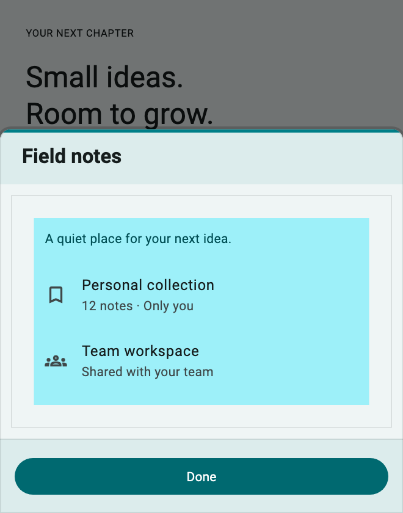](../assets/showcase-v021/sheets.neoTray.png)


**Copy & Use**

```dart
import 'package:flutter/material.dart';
import 'package:flutter_ui_gallery/flutter_ui_gallery.dart';

// Apply this theme to MaterialApp(theme: showSheetsNeoTrayTheme()).
ThemeData showSheetsNeoTrayTheme({Brightness brightness = Brightness.light}) {
  final base = ThemeData(
    colorScheme: ColorScheme.fromSeed(
      seedColor: Color(0xff007f88),
      brightness: brightness,
    ),
  );
  final recipe = UiGalleryTheme.family(
    UiGalleryDesignFamily.soft,
    theme: base,
    useSignature: true,
  );
  return base.copyWith(
    extensions: [
      recipe.copyWith(
        surfaceStyle: recipe.surfaceStyle!.copyWith(
          accentColor: Color(0xff007f88),
        ),
        motionIntensity: 1,
      ),
    ],
  );
}

Future<void> showSheetsNeoTray(BuildContext context) async {
  await UiGallerySheet.show<void>(
    context: context,
    preset: UiGallerySheetPreset.neoTray,
    header: const Text("Field notes"),
    child: const Column(
      mainAxisSize: MainAxisSize.min,
      crossAxisAlignment: CrossAxisAlignment.start,
      children: [
        Text('A quiet place for your next idea.'),
        SizedBox(height: 16),
        ListTile(
          contentPadding: EdgeInsets.zero,
          leading: Icon(Icons.bookmark_outline),
          title: Text('Personal collection'),
          subtitle: Text('12 notes · Only you'),
        ),
        ListTile(
          contentPadding: EdgeInsets.zero,
          leading: Icon(Icons.groups_outlined),
          title: Text('Team workspace'),
          subtitle: Text('Shared with your team'),
        ),
      ],
    ),
    footer: Builder(
      builder: (sheetContext) => FilledButton(
        onPressed: () => Navigator.of(sheetContext).pop(),
        child: const Text('Done'),
      ),
    ),
    style: const UiGallerySurfaceStyle(accentColor: Color(0xff007f88)),
  );
}
```

**Customize:** `header`, `child`, `footer`, `style`, `appearance`, and `motion`.

**Interaction:** Use the sheet builder context with `Navigator.pop` to close the correct route. Await the typed result; a dismissed route returns `null`.

[Complete runnable owner](../../example/lib/showcase.dart) · [Dart source](code/sheets.neoTray.dart) · [Back to category](#bottom-sheets)

<a id="splitlayer"></a>

## Split Layer

`UiGallerySheetPreset.splitLayer` · `PRESET=sheets.splitLayer`

Comparisons and checkout summaries. Parallel content and secondary/action zones.

[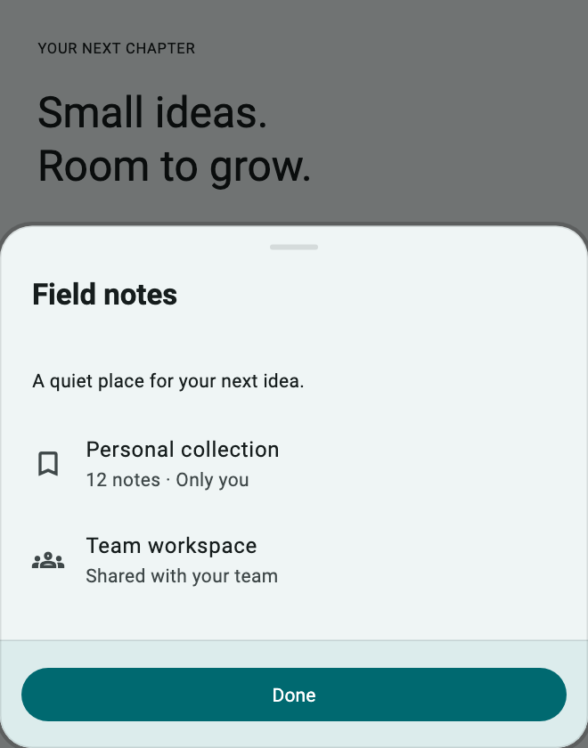](../assets/showcase-v021/sheets.splitLayer.png)


**Copy & Use**

```dart
import 'package:flutter/material.dart';
import 'package:flutter_ui_gallery/flutter_ui_gallery.dart';

// Apply this theme to MaterialApp(theme: showSheetsSplitLayerTheme()).
ThemeData showSheetsSplitLayerTheme({
  Brightness brightness = Brightness.light,
}) {
  final base = ThemeData(
    colorScheme: ColorScheme.fromSeed(
      seedColor: Color(0xff007f88),
      brightness: brightness,
    ),
  );
  final recipe = UiGalleryTheme.family(
    UiGalleryDesignFamily.soft,
    theme: base,
    useSignature: true,
  );
  return base.copyWith(
    extensions: [
      recipe.copyWith(
        surfaceStyle: recipe.surfaceStyle!.copyWith(
          accentColor: Color(0xff007f88),
        ),
        motionIntensity: 1,
      ),
    ],
  );
}

Future<void> showSheetsSplitLayer(BuildContext context) async {
  await UiGallerySheet.show<void>(
    context: context,
    preset: UiGallerySheetPreset.splitLayer,
    header: const Text("Field notes"),
    child: const Column(
      mainAxisSize: MainAxisSize.min,
      crossAxisAlignment: CrossAxisAlignment.start,
      children: [
        Text('A quiet place for your next idea.'),
        SizedBox(height: 16),
        ListTile(
          contentPadding: EdgeInsets.zero,
          leading: Icon(Icons.bookmark_outline),
          title: Text('Personal collection'),
          subtitle: Text('12 notes · Only you'),
        ),
        ListTile(
          contentPadding: EdgeInsets.zero,
          leading: Icon(Icons.groups_outlined),
          title: Text('Team workspace'),
          subtitle: Text('Shared with your team'),
        ),
      ],
    ),
    footer: Builder(
      builder: (sheetContext) => FilledButton(
        onPressed: () => Navigator.of(sheetContext).pop(),
        child: const Text('Done'),
      ),
    ),
    style: const UiGallerySurfaceStyle(accentColor: Color(0xff007f88)),
  );
}
```

**Customize:** `header`, `child`, `footer`, `style`, `appearance`, and `motion`.

**Interaction:** Use the sheet builder context with `Navigator.pop` to close the correct route. Await the typed result; a dismissed route returns `null`.

[Complete runnable owner](../../example/lib/showcase.dart) · [Dart source](code/sheets.splitLayer.dart) · [Back to category](#bottom-sheets)

<a id="pulsedock"></a>

## Pulse Dock

`UiGallerySheetPreset.pulseDock` · `PRESET=sheets.pulseDock`

Urgent but deliberate primary actions. Emphasis crest above a focused primary task.

[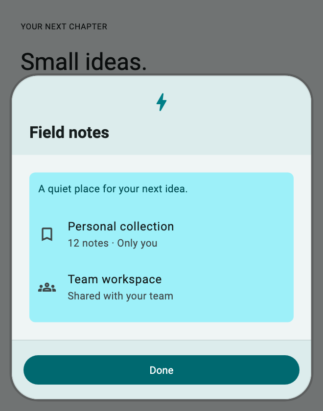](../assets/showcase-v021/sheets.pulseDock.png)


**Copy & Use**

```dart
import 'package:flutter/material.dart';
import 'package:flutter_ui_gallery/flutter_ui_gallery.dart';

// Apply this theme to MaterialApp(theme: showSheetsPulseDockTheme()).
ThemeData showSheetsPulseDockTheme({Brightness brightness = Brightness.light}) {
  final base = ThemeData(
    colorScheme: ColorScheme.fromSeed(
      seedColor: Color(0xff007f88),
      brightness: brightness,
    ),
  );
  final recipe = UiGalleryTheme.family(
    UiGalleryDesignFamily.soft,
    theme: base,
    useSignature: true,
  );
  return base.copyWith(
    extensions: [
      recipe.copyWith(
        surfaceStyle: recipe.surfaceStyle!.copyWith(
          accentColor: Color(0xff007f88),
        ),
        motionIntensity: 1,
      ),
    ],
  );
}

Future<void> showSheetsPulseDock(BuildContext context) async {
  await UiGallerySheet.show<void>(
    context: context,
    preset: UiGallerySheetPreset.pulseDock,
    header: const Text("Field notes"),
    child: const Column(
      mainAxisSize: MainAxisSize.min,
      crossAxisAlignment: CrossAxisAlignment.start,
      children: [
        Text('A quiet place for your next idea.'),
        SizedBox(height: 16),
        ListTile(
          contentPadding: EdgeInsets.zero,
          leading: Icon(Icons.bookmark_outline),
          title: Text('Personal collection'),
          subtitle: Text('12 notes · Only you'),
        ),
        ListTile(
          contentPadding: EdgeInsets.zero,
          leading: Icon(Icons.groups_outlined),
          title: Text('Team workspace'),
          subtitle: Text('Shared with your team'),
        ),
      ],
    ),
    footer: Builder(
      builder: (sheetContext) => FilledButton(
        onPressed: () => Navigator.of(sheetContext).pop(),
        child: const Text('Done'),
      ),
    ),
    style: const UiGallerySurfaceStyle(accentColor: Color(0xff007f88)),
  );
}
```

**Customize:** `header`, `child`, `footer`, `style`, `appearance`, and `motion`.

**Interaction:** Use the sheet builder context with `Navigator.pop` to close the correct route. Await the typed result; a dismissed route returns `null`.

[Complete runnable owner](../../example/lib/showcase.dart) · [Dart source](code/sheets.pulseDock.dart) · [Back to category](#bottom-sheets)

<a id="horizonpeek"></a>

## Horizon Peek

`UiGallerySheetPreset.horizonPeek` · `PRESET=sheets.horizonPeek`

Media previews and location details. Large preview plane above compact details.

[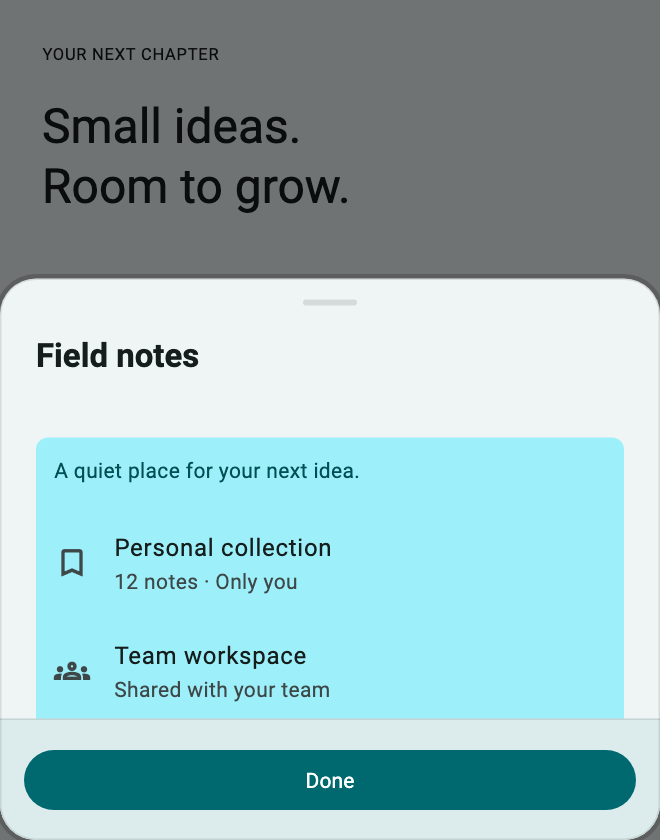](../assets/showcase-v021/sheets.horizonPeek.png)


**Copy & Use**

```dart
import 'package:flutter/material.dart';
import 'package:flutter_ui_gallery/flutter_ui_gallery.dart';

// Apply this theme to MaterialApp(theme: showSheetsHorizonPeekTheme()).
ThemeData showSheetsHorizonPeekTheme({
  Brightness brightness = Brightness.light,
}) {
  final base = ThemeData(
    colorScheme: ColorScheme.fromSeed(
      seedColor: Color(0xff007f88),
      brightness: brightness,
    ),
  );
  final recipe = UiGalleryTheme.family(
    UiGalleryDesignFamily.soft,
    theme: base,
    useSignature: true,
  );
  return base.copyWith(
    extensions: [
      recipe.copyWith(
        surfaceStyle: recipe.surfaceStyle!.copyWith(
          accentColor: Color(0xff007f88),
        ),
        motionIntensity: 1,
      ),
    ],
  );
}

Future<void> showSheetsHorizonPeek(BuildContext context) async {
  await UiGallerySheet.show<void>(
    context: context,
    preset: UiGallerySheetPreset.horizonPeek,
    header: const Text("Field notes"),
    child: const Column(
      mainAxisSize: MainAxisSize.min,
      crossAxisAlignment: CrossAxisAlignment.start,
      children: [
        Text('A quiet place for your next idea.'),
        SizedBox(height: 16),
        ListTile(
          contentPadding: EdgeInsets.zero,
          leading: Icon(Icons.bookmark_outline),
          title: Text('Personal collection'),
          subtitle: Text('12 notes · Only you'),
        ),
        ListTile(
          contentPadding: EdgeInsets.zero,
          leading: Icon(Icons.groups_outlined),
          title: Text('Team workspace'),
          subtitle: Text('Shared with your team'),
        ),
      ],
    ),
    footer: Builder(
      builder: (sheetContext) => FilledButton(
        onPressed: () => Navigator.of(sheetContext).pop(),
        child: const Text('Done'),
      ),
    ),
    style: const UiGallerySurfaceStyle(accentColor: Color(0xff007f88)),
  );
}
```

**Customize:** `header`, `child`, `footer`, `style`, `appearance`, and `motion`.

**Interaction:** Use the sheet builder context with `Navigator.pop` to close the correct route. Await the typed result; a dismissed route returns `null`.

[Complete runnable owner](../../example/lib/showcase.dart) · [Dart source](code/sheets.horizonPeek.dart) · [Back to category](#bottom-sheets)

<a id="depthframe"></a>

## Depth Frame

`UiGallerySheetPreset.depthFrame` · `PRESET=sheets.depthFrame`

Premium previews and approvals. Nested structural frame and inset content plane.

[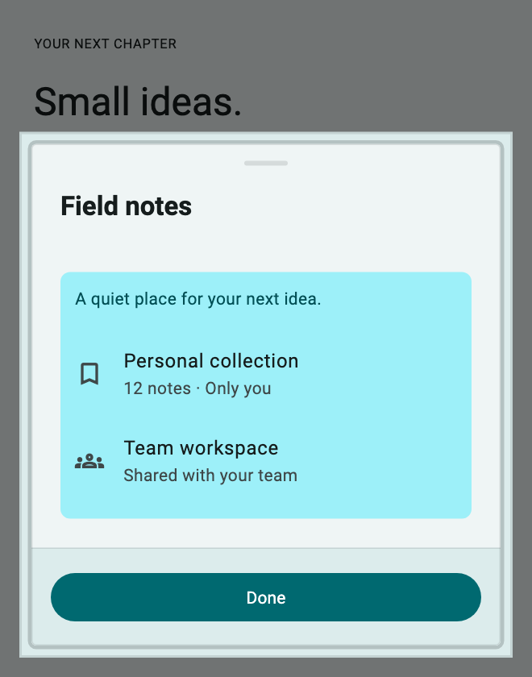](../assets/showcase-v021/sheets.depthFrame.png)


**Copy & Use**

```dart
import 'package:flutter/material.dart';
import 'package:flutter_ui_gallery/flutter_ui_gallery.dart';

// Apply this theme to MaterialApp(theme: showSheetsDepthFrameTheme()).
ThemeData showSheetsDepthFrameTheme({
  Brightness brightness = Brightness.light,
}) {
  final base = ThemeData(
    colorScheme: ColorScheme.fromSeed(
      seedColor: Color(0xff007f88),
      brightness: brightness,
    ),
  );
  final recipe = UiGalleryTheme.family(
    UiGalleryDesignFamily.soft,
    theme: base,
    useSignature: true,
  );
  return base.copyWith(
    extensions: [
      recipe.copyWith(
        surfaceStyle: recipe.surfaceStyle!.copyWith(
          accentColor: Color(0xff007f88),
        ),
        motionIntensity: 1,
      ),
    ],
  );
}

Future<void> showSheetsDepthFrame(BuildContext context) async {
  await UiGallerySheet.show<void>(
    context: context,
    preset: UiGallerySheetPreset.depthFrame,
    header: const Text("Field notes"),
    child: const Column(
      mainAxisSize: MainAxisSize.min,
      crossAxisAlignment: CrossAxisAlignment.start,
      children: [
        Text('A quiet place for your next idea.'),
        SizedBox(height: 16),
        ListTile(
          contentPadding: EdgeInsets.zero,
          leading: Icon(Icons.bookmark_outline),
          title: Text('Personal collection'),
          subtitle: Text('12 notes · Only you'),
        ),
        ListTile(
          contentPadding: EdgeInsets.zero,
          leading: Icon(Icons.groups_outlined),
          title: Text('Team workspace'),
          subtitle: Text('Shared with your team'),
        ),
      ],
    ),
    footer: Builder(
      builder: (sheetContext) => FilledButton(
        onPressed: () => Navigator.of(sheetContext).pop(),
        child: const Text('Done'),
      ),
    ),
    style: const UiGallerySurfaceStyle(accentColor: Color(0xff007f88)),
  );
}
```

**Customize:** `header`, `child`, `footer`, `style`, `appearance`, and `motion`.

**Interaction:** Use the sheet builder context with `Navigator.pop` to close the correct route. Await the typed result; a dismissed route returns `null`.

[Complete runnable owner](../../example/lib/showcase.dart) · [Dart source](code/sheets.depthFrame.dart) · [Back to category](#bottom-sheets)

<a id="taskrail"></a>

## Task Rail

`UiGallerySheetPreset.taskRail` · `PRESET=sheets.taskRail`

Contextual tools and adjustments. Context rail beside a compact utility canvas.

[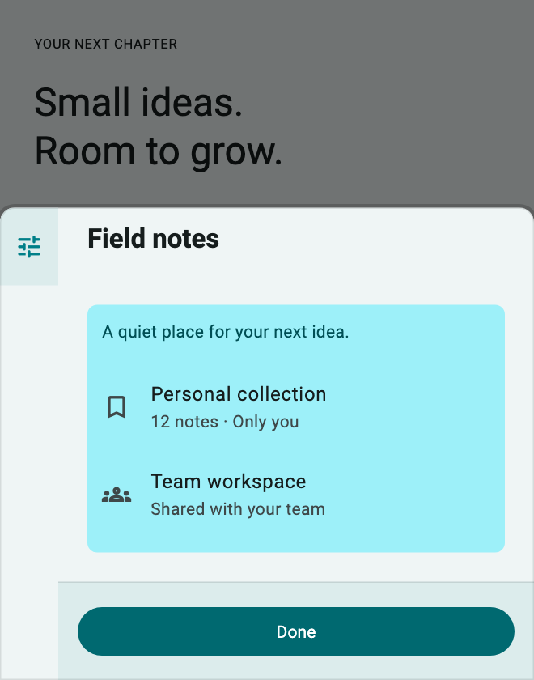](../assets/showcase-v021/sheets.taskRail.png)


**Copy & Use**

```dart
import 'package:flutter/material.dart';
import 'package:flutter_ui_gallery/flutter_ui_gallery.dart';

// Apply this theme to MaterialApp(theme: showSheetsTaskRailTheme()).
ThemeData showSheetsTaskRailTheme({Brightness brightness = Brightness.light}) {
  final base = ThemeData(
    colorScheme: ColorScheme.fromSeed(
      seedColor: Color(0xff007f88),
      brightness: brightness,
    ),
  );
  final recipe = UiGalleryTheme.family(
    UiGalleryDesignFamily.soft,
    theme: base,
    useSignature: true,
  );
  return base.copyWith(
    extensions: [
      recipe.copyWith(
        surfaceStyle: recipe.surfaceStyle!.copyWith(
          accentColor: Color(0xff007f88),
        ),
        motionIntensity: 1,
      ),
    ],
  );
}

Future<void> showSheetsTaskRail(BuildContext context) async {
  await UiGallerySheet.show<void>(
    context: context,
    preset: UiGallerySheetPreset.taskRail,
    header: const Text("Field notes"),
    child: const Column(
      mainAxisSize: MainAxisSize.min,
      crossAxisAlignment: CrossAxisAlignment.start,
      children: [
        Text('A quiet place for your next idea.'),
        SizedBox(height: 16),
        ListTile(
          contentPadding: EdgeInsets.zero,
          leading: Icon(Icons.bookmark_outline),
          title: Text('Personal collection'),
          subtitle: Text('12 notes · Only you'),
        ),
        ListTile(
          contentPadding: EdgeInsets.zero,
          leading: Icon(Icons.groups_outlined),
          title: Text('Team workspace'),
          subtitle: Text('Shared with your team'),
        ),
      ],
    ),
    footer: Builder(
      builder: (sheetContext) => FilledButton(
        onPressed: () => Navigator.of(sheetContext).pop(),
        child: const Text('Done'),
      ),
    ),
    style: const UiGallerySurfaceStyle(accentColor: Color(0xff007f88)),
  );
}
```

**Customize:** `header`, `child`, `footer`, `style`, `appearance`, and `motion`.

**Interaction:** Use the sheet builder context with `Navigator.pop` to close the correct route. Await the typed result; a dismissed route returns `null`.

[Complete runnable owner](../../example/lib/showcase.dart) · [Dart source](code/sheets.taskRail.dart) · [Back to category](#bottom-sheets)
