<!-- Generated by tool/build_showcase.py. -->
# Dialogs

11 canonical presets. Make decisions easier with clear choices, searchable commands, and focused results.

[All categories](README.md) · [Package introduction](../../README.md) · [Theme and setup](../QUICK_START.md)

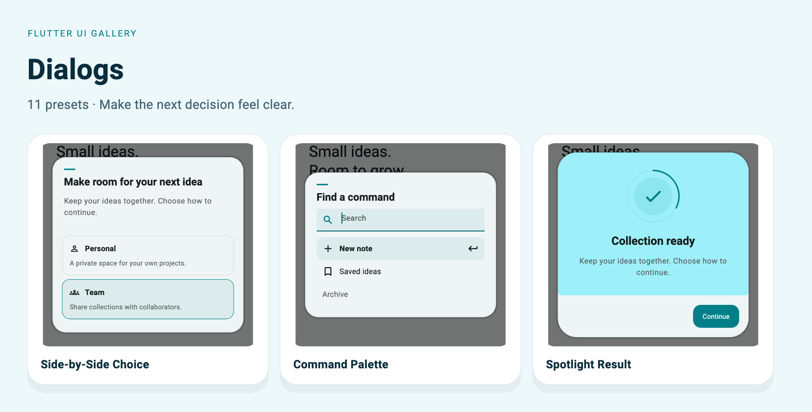

[Halo Focus](#halo) · [Split Decision](#split) · [Timeline Dialog](#timeline) · [Spotlight Result](#spotlight) · [Orbit Confirm](#orbitconfirm) · [Side-by-Side Choice](#sidebysidechoice) · [Compact Alert Capsule](#alertcapsule) · [Milestone Dialog](#milestone) · [Panel Decision](#paneldecision) · [Status Beacon](#statusbeacon) · [Command Palette](#commandpalette)

The captures below use the included Soft theme with signatures enabled, at a
440 × 560 logical-pixel viewport and 1.5× export resolution. The light preview
matches the example's default theme. Each full example includes its imports and
theme helper. Apply that helper to `MaterialApp.theme` before invoking the widget.

For a complete app with owned state, callbacks, and disposal, use
[`example/lib/showcase.dart`](../../example/lib/showcase.dart):

```sh
cd example
flutter run -t lib/showcase.dart --dart-define=PRESET=dialogs.sideBySideChoice
```

Change `PRESET` to the exact ID beside any entry. Helper parameters are supplied
by your screen; the runnable app shows their ownership. Copy uses ordinary Dart
code fences and your Markdown viewer's native copy control where available.

<a id="halo"></a>

## Halo Focus

`UiGalleryDialogPreset.halo` · `PRESET=dialogs.halo`

Important confirmations. Central narrative and emphasized primary action.

[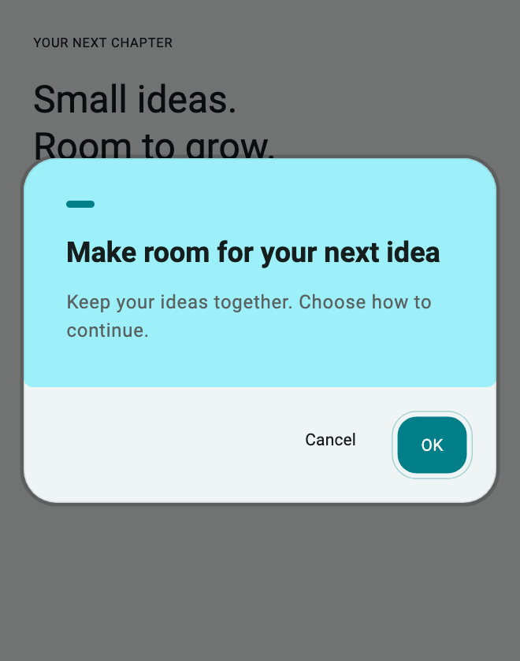](../assets/showcase-v021/dialogs.halo.png)


**Copy & Use**

```dart
import 'package:flutter/material.dart';
import 'package:flutter_ui_gallery/flutter_ui_gallery.dart';

// Apply this theme to MaterialApp(theme: showDialogsHaloTheme()).
ThemeData showDialogsHaloTheme({Brightness brightness = Brightness.light}) {
  final base = ThemeData(
    colorScheme: ColorScheme.fromSeed(
      seedColor: Color(0xff007f88),
      brightness: brightness,
    ),
  );
  final recipe = UiGalleryTheme.family(
    UiGalleryDesignFamily.soft,
    theme: base,
    useSignature: true,
  );
  return base.copyWith(
    extensions: [
      recipe.copyWith(
        surfaceStyle: recipe.surfaceStyle!.copyWith(
          accentColor: Color(0xff007f88),
        ),
        motionIntensity: 1,
      ),
    ],
  );
}

Future<bool?> showDialogsHalo(BuildContext context) {
  return UiGalleryDialog.confirm(
    context: context,
    useRootNavigator: false,
    preset: UiGalleryDialogPreset.halo,
    title: "Make room for your next idea",
    message: "Keep your ideas together. Choose how to continue.",
    style: const UiGallerySurfaceStyle(accentColor: Color(0xff007f88)),
  );
}
```

**Customize:** `title`, `message`, `actions`, `child`, `result`, `style`, and `motion`.

**Interaction:** Handle dismissal as `null`. Choice and command helpers return `String?`; confirmation helpers return `bool?`. Check `mounted` before updating state after awaiting.

[Complete runnable owner](../../example/lib/showcase.dart) · [Dart source](code/dialogs.halo.dart) · [Back to category](#dialogs)

<a id="split"></a>

## Split Decision

`UiGalleryDialogPreset.split` · `PRESET=dialogs.split`

Destructive and safe decisions. Narrative panel beside a decision region.

[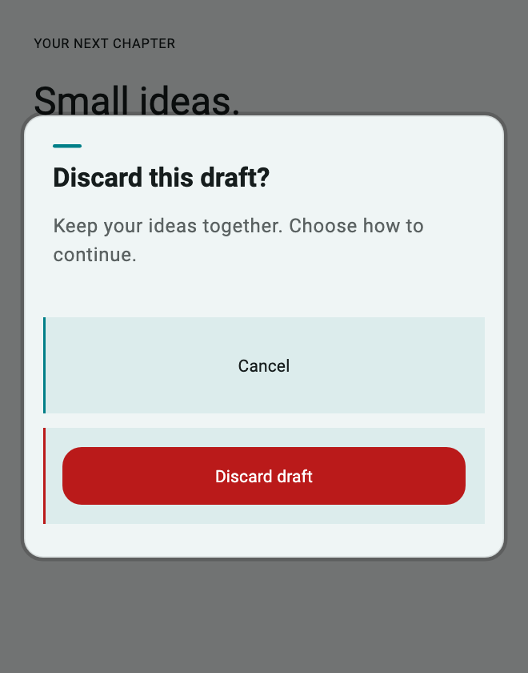](../assets/showcase-v021/dialogs.split.png)


**Copy & Use**

```dart
import 'package:flutter/material.dart';
import 'package:flutter_ui_gallery/flutter_ui_gallery.dart';

// Apply this theme to MaterialApp(theme: showDialogsSplitTheme()).
ThemeData showDialogsSplitTheme({Brightness brightness = Brightness.light}) {
  final base = ThemeData(
    colorScheme: ColorScheme.fromSeed(
      seedColor: Color(0xff007f88),
      brightness: brightness,
    ),
  );
  final recipe = UiGalleryTheme.family(
    UiGalleryDesignFamily.soft,
    theme: base,
    useSignature: true,
  );
  return base.copyWith(
    extensions: [
      recipe.copyWith(
        surfaceStyle: recipe.surfaceStyle!.copyWith(
          accentColor: Color(0xff007f88),
        ),
        motionIntensity: 1,
      ),
    ],
  );
}

Future<bool?> showDialogsSplit(BuildContext context) {
  return UiGalleryDialog.confirm(
    context: context,
    useRootNavigator: false,
    preset: UiGalleryDialogPreset.split,
    title: "Discard this draft?",
    message: "Keep your ideas together. Choose how to continue.",
    destructive: true,
    confirmLabel: 'Discard draft',
    style: const UiGallerySurfaceStyle(accentColor: Color(0xff007f88)),
  );
}
```

**Customize:** `title`, `message`, `actions`, `child`, `result`, `style`, and `motion`.

**Interaction:** This example is a destructive confirmation. Treat only `true` as confirmation; both `false` and `null` leave the draft intact.

[Complete runnable owner](../../example/lib/showcase.dart) · [Dart source](code/dialogs.split.dart) · [Back to category](#dialogs)

<a id="timeline"></a>

## Timeline Dialog

`UiGalleryDialogPreset.timeline` · `PRESET=dialogs.timeline`

Verification and processing. Connected sequence driven by real external state.

[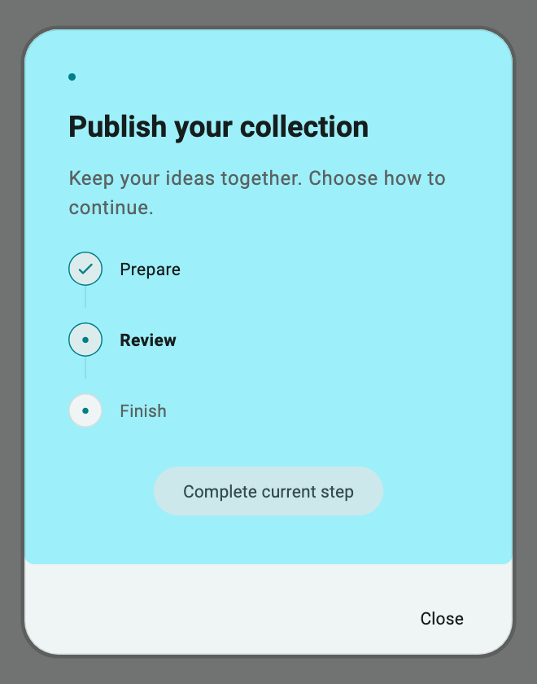](../assets/showcase-v021/dialogs.timeline.png)

[Completed](../assets/showcase-v021/dialogs.timeline-completed.png)

**Copy & Use**

```dart
import 'package:flutter/foundation.dart';
import 'package:flutter/material.dart';
import 'package:flutter_ui_gallery/flutter_ui_gallery.dart';

// Apply this theme to MaterialApp(theme: showDialogsTimelineTheme()).
ThemeData showDialogsTimelineTheme({Brightness brightness = Brightness.light}) {
  final base = ThemeData(
    colorScheme: ColorScheme.fromSeed(
      seedColor: Color(0xff007f88),
      brightness: brightness,
    ),
  );
  final recipe = UiGalleryTheme.family(
    UiGalleryDesignFamily.soft,
    theme: base,
    useSignature: true,
  );
  return base.copyWith(
    extensions: [
      recipe.copyWith(
        surfaceStyle: recipe.surfaceStyle!.copyWith(
          accentColor: Color(0xff007f88),
        ),
        motionIntensity: 1,
      ),
    ],
  );
}

Future<String?> showDialogsTimeline(
  BuildContext context,
  ValueListenable<UiGalleryTimelineState> progress,
  VoidCallback onCompleteStep,
) {
  return UiGalleryDialog.show<String>(
    context: context,
    useRootNavigator: false,
    preset: UiGalleryDialogPreset.timeline,
    title: "Publish your collection",
    message: "Keep your ideas together. Choose how to continue.",
    child: ValueListenableBuilder<UiGalleryTimelineState>(
      valueListenable: progress,
      builder: (context, value, _) => Column(
        mainAxisSize: MainAxisSize.min,
        children: [
          UiGalleryTimeline(state: value),
          const SizedBox(height: 16),
          FilledButton.tonal(
            onPressed: value.completed ? null : onCompleteStep,
            child: Text(value.completed ? 'Verified' : 'Complete current step'),
          ),
        ],
      ),
    ),
    actions: const [UiGalleryDialogAction(label: 'Close', value: 'Closed')],
    style: const UiGallerySurfaceStyle(accentColor: Color(0xff007f88)),
  );
}
```

**Customize:** `title`, `message`, `actions`, `child`, `result`, `style`, and `motion`.

**Interaction:** Own and dispose the `ValueNotifier<UiGalleryTimelineState>`. Keep currentStep within the steps list. The complete app advances real caller-owned state.

[Complete runnable owner](../../example/lib/showcase.dart) · [Dart source](code/dialogs.timeline.dart) · [Back to category](#dialogs)

<a id="spotlight"></a>

## Spotlight Result

`UiGalleryDialogPreset.spotlight` · `PRESET=dialogs.spotlight`

Success, warning and failure results. Orbital result mark with generous negative space.

[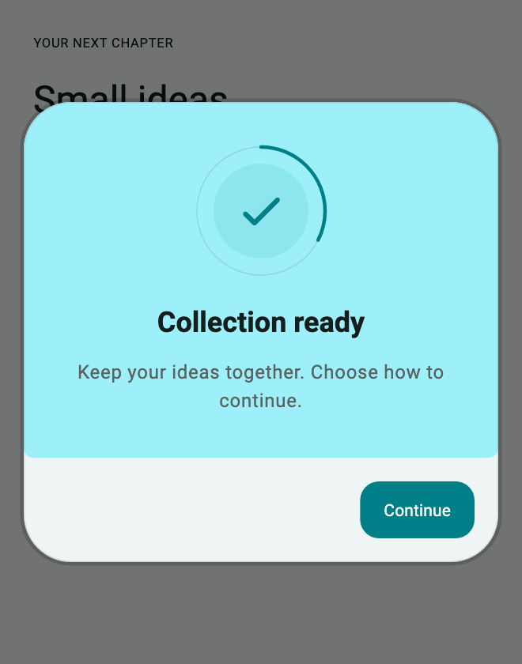](../assets/showcase-v021/dialogs.spotlight.png)


**Copy & Use**

```dart
import 'package:flutter/material.dart';
import 'package:flutter_ui_gallery/flutter_ui_gallery.dart';

// Apply this theme to MaterialApp(theme: showDialogsSpotlightTheme()).
ThemeData showDialogsSpotlightTheme({
  Brightness brightness = Brightness.light,
}) {
  final base = ThemeData(
    colorScheme: ColorScheme.fromSeed(
      seedColor: Color(0xff007f88),
      brightness: brightness,
    ),
  );
  final recipe = UiGalleryTheme.family(
    UiGalleryDesignFamily.soft,
    theme: base,
    useSignature: true,
  );
  return base.copyWith(
    extensions: [
      recipe.copyWith(
        surfaceStyle: recipe.surfaceStyle!.copyWith(
          accentColor: Color(0xff007f88),
        ),
        motionIntensity: 1,
      ),
    ],
  );
}

Future<String?> showDialogsSpotlight(
  BuildContext context,
  UiGalleryResult result,
) {
  return UiGalleryDialog.show<String>(
    context: context,
    useRootNavigator: false,
    preset: UiGalleryDialogPreset.spotlight,
    title: "Collection ready",
    message: "Keep your ideas together. Choose how to continue.",
    result: result,
    actions: const [
      UiGalleryDialogAction(
        label: 'Continue',
        value: 'Continued',
        primary: true,
      ),
    ],
    style: const UiGallerySurfaceStyle(accentColor: Color(0xff007f88)),
  );
}
```

**Customize:** `title`, `message`, `actions`, `child`, `result`, `style`, and `motion`.

**Interaction:** Pass the real operation result as `UiGalleryResult`; the preview uses `success`.

[Complete runnable owner](../../example/lib/showcase.dart) · [Dart source](code/dialogs.spotlight.dart) · [Back to category](#dialogs)

<a id="orbitconfirm"></a>

## Orbit Confirm

`UiGalleryDialogPreset.orbitConfirm` · `PRESET=dialogs.orbitConfirm`

Single-object confirmations. Offset confirmation medallion and action orbit.

[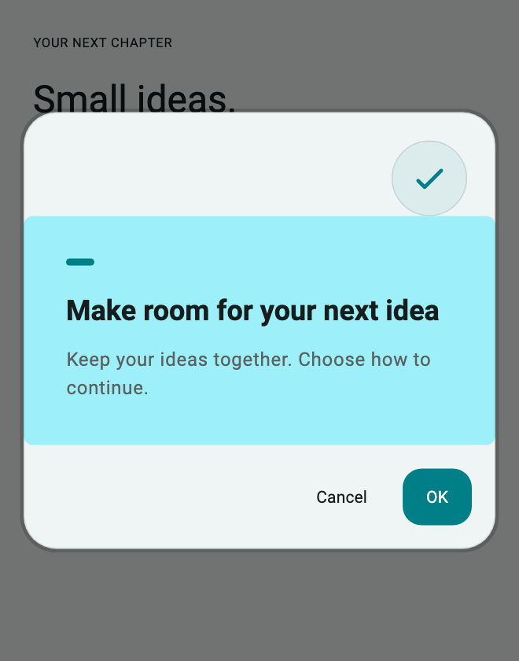](../assets/showcase-v021/dialogs.orbitConfirm.png)


**Copy & Use**

```dart
import 'package:flutter/material.dart';
import 'package:flutter_ui_gallery/flutter_ui_gallery.dart';

// Apply this theme to MaterialApp(theme: showDialogsOrbitConfirmTheme()).
ThemeData showDialogsOrbitConfirmTheme({
  Brightness brightness = Brightness.light,
}) {
  final base = ThemeData(
    colorScheme: ColorScheme.fromSeed(
      seedColor: Color(0xff007f88),
      brightness: brightness,
    ),
  );
  final recipe = UiGalleryTheme.family(
    UiGalleryDesignFamily.soft,
    theme: base,
    useSignature: true,
  );
  return base.copyWith(
    extensions: [
      recipe.copyWith(
        surfaceStyle: recipe.surfaceStyle!.copyWith(
          accentColor: Color(0xff007f88),
        ),
        motionIntensity: 1,
      ),
    ],
  );
}

Future<bool?> showDialogsOrbitConfirm(BuildContext context) {
  return UiGalleryDialog.confirm(
    context: context,
    useRootNavigator: false,
    preset: UiGalleryDialogPreset.orbitConfirm,
    title: "Make room for your next idea",
    message: "Keep your ideas together. Choose how to continue.",
    style: const UiGallerySurfaceStyle(accentColor: Color(0xff007f88)),
  );
}
```

**Customize:** `title`, `message`, `actions`, `child`, `result`, `style`, and `motion`.

**Interaction:** Handle dismissal as `null`. Choice and command helpers return `String?`; confirmation helpers return `bool?`. Check `mounted` before updating state after awaiting.

[Complete runnable owner](../../example/lib/showcase.dart) · [Dart source](code/dialogs.orbitConfirm.dart) · [Back to category](#dialogs)

<a id="sidebysidechoice"></a>

## Side-by-Side Choice

`UiGalleryDialogPreset.sideBySideChoice` · `PRESET=dialogs.sideBySideChoice`

Plan and workflow choices. Equally legible choice cards with descriptions.

[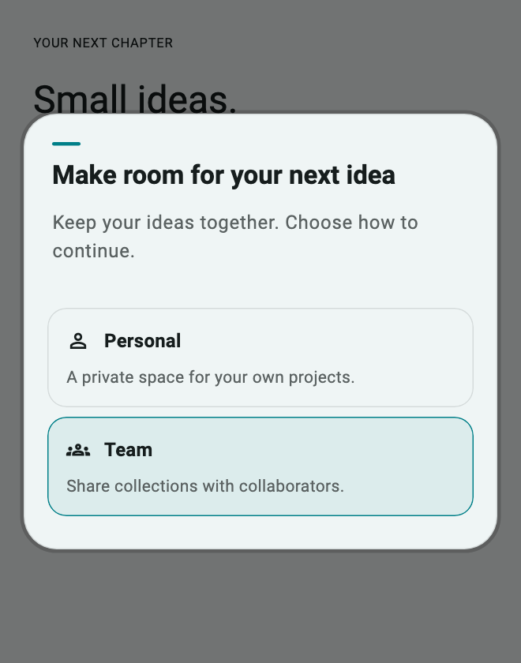](../assets/showcase-v021/dialogs.sideBySideChoice.png)

[Dark theme](../assets/showcase-v021/dialogs.sideBySideChoice-dark.png)

**Copy & Use**

```dart
import 'package:flutter/material.dart';
import 'package:flutter_ui_gallery/flutter_ui_gallery.dart';

// Apply this theme to MaterialApp(theme: showDialogsSideBySideChoiceTheme()).
ThemeData showDialogsSideBySideChoiceTheme({
  Brightness brightness = Brightness.light,
}) {
  final base = ThemeData(
    colorScheme: ColorScheme.fromSeed(
      seedColor: Color(0xff007f88),
      brightness: brightness,
    ),
  );
  final recipe = UiGalleryTheme.family(
    UiGalleryDesignFamily.soft,
    theme: base,
    useSignature: true,
  );
  return base.copyWith(
    extensions: [
      recipe.copyWith(
        surfaceStyle: recipe.surfaceStyle!.copyWith(
          accentColor: Color(0xff007f88),
        ),
        motionIntensity: 1,
      ),
    ],
  );
}

Future<String?> showDialogsSideBySideChoice(BuildContext context) {
  return UiGalleryDialog.show<String>(
    context: context,
    useRootNavigator: false,
    preset: UiGalleryDialogPreset.sideBySideChoice,
    title: "Make room for your next idea",
    message: "Keep your ideas together. Choose how to continue.",
    actions: const [
      UiGalleryDialogAction(
        label: 'Personal',
        value: 'Personal',
        description: 'A private space for your own projects.',
        icon: Icon(Icons.person_outline),
      ),
      UiGalleryDialogAction(
        label: 'Team',
        value: 'Team',
        primary: true,
        description: 'Share collections with collaborators.',
        icon: Icon(Icons.groups_outlined),
      ),
    ],
    style: const UiGallerySurfaceStyle(accentColor: Color(0xff007f88)),
  );
}
```

**Customize:** `title`, `message`, `actions`, `child`, `result`, `style`, and `motion`.

**Interaction:** Handle dismissal as `null`. Choice and command helpers return `String?`; confirmation helpers return `bool?`. Check `mounted` before updating state after awaiting.

[Complete runnable owner](../../example/lib/showcase.dart) · [Dart source](code/dialogs.sideBySideChoice.dart) · [Back to category](#dialogs)

<a id="alertcapsule"></a>

## Compact Alert Capsule

`UiGalleryDialogPreset.alertCapsule` · `PRESET=dialogs.alertCapsule`

Brief utility alerts. Icon and short narrative in a compact horizontal unit.

[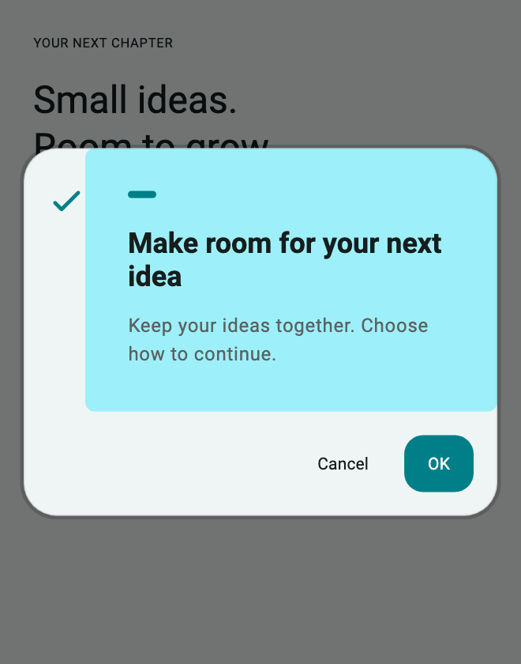](../assets/showcase-v021/dialogs.alertCapsule.png)


**Copy & Use**

```dart
import 'package:flutter/material.dart';
import 'package:flutter_ui_gallery/flutter_ui_gallery.dart';

// Apply this theme to MaterialApp(theme: showDialogsAlertCapsuleTheme()).
ThemeData showDialogsAlertCapsuleTheme({
  Brightness brightness = Brightness.light,
}) {
  final base = ThemeData(
    colorScheme: ColorScheme.fromSeed(
      seedColor: Color(0xff007f88),
      brightness: brightness,
    ),
  );
  final recipe = UiGalleryTheme.family(
    UiGalleryDesignFamily.soft,
    theme: base,
    useSignature: true,
  );
  return base.copyWith(
    extensions: [
      recipe.copyWith(
        surfaceStyle: recipe.surfaceStyle!.copyWith(
          accentColor: Color(0xff007f88),
        ),
        motionIntensity: 1,
      ),
    ],
  );
}

Future<bool?> showDialogsAlertCapsule(BuildContext context) {
  return UiGalleryDialog.confirm(
    context: context,
    useRootNavigator: false,
    preset: UiGalleryDialogPreset.alertCapsule,
    title: "Make room for your next idea",
    message: "Keep your ideas together. Choose how to continue.",
    style: const UiGallerySurfaceStyle(accentColor: Color(0xff007f88)),
  );
}
```

**Customize:** `title`, `message`, `actions`, `child`, `result`, `style`, and `motion`.

**Interaction:** Handle dismissal as `null`. Choice and command helpers return `String?`; confirmation helpers return `bool?`. Check `mounted` before updating state after awaiting.

[Complete runnable owner](../../example/lib/showcase.dart) · [Dart source](code/dialogs.alertCapsule.dart) · [Back to category](#dialogs)

<a id="milestone"></a>

## Milestone Dialog

`UiGalleryDialogPreset.milestone` · `PRESET=dialogs.milestone`

Actual workflow achievements and sequence checkpoints. Milestone banner with connected content below.

[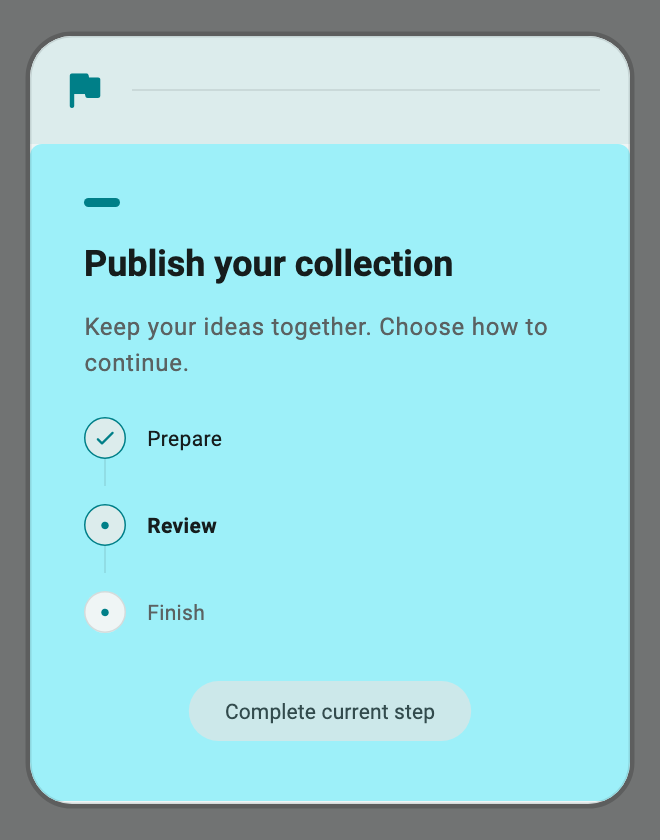](../assets/showcase-v021/dialogs.milestone.png)

[Completed](../assets/showcase-v021/dialogs.milestone-completed.png)

**Copy & Use**

```dart
import 'package:flutter/foundation.dart';
import 'package:flutter/material.dart';
import 'package:flutter_ui_gallery/flutter_ui_gallery.dart';

// Apply this theme to MaterialApp(theme: showDialogsMilestoneTheme()).
ThemeData showDialogsMilestoneTheme({
  Brightness brightness = Brightness.light,
}) {
  final base = ThemeData(
    colorScheme: ColorScheme.fromSeed(
      seedColor: Color(0xff007f88),
      brightness: brightness,
    ),
  );
  final recipe = UiGalleryTheme.family(
    UiGalleryDesignFamily.soft,
    theme: base,
    useSignature: true,
  );
  return base.copyWith(
    extensions: [
      recipe.copyWith(
        surfaceStyle: recipe.surfaceStyle!.copyWith(
          accentColor: Color(0xff007f88),
        ),
        motionIntensity: 1,
      ),
    ],
  );
}

Future<String?> showDialogsMilestone(
  BuildContext context,
  ValueListenable<UiGalleryTimelineState> progress,
  VoidCallback onCompleteStep,
) {
  return UiGalleryDialog.show<String>(
    context: context,
    useRootNavigator: false,
    preset: UiGalleryDialogPreset.milestone,
    title: "Publish your collection",
    message: "Keep your ideas together. Choose how to continue.",
    child: ValueListenableBuilder<UiGalleryTimelineState>(
      valueListenable: progress,
      builder: (context, value, _) => Column(
        mainAxisSize: MainAxisSize.min,
        children: [
          UiGalleryTimeline(state: value),
          const SizedBox(height: 16),
          FilledButton.tonal(
            onPressed: value.completed ? null : onCompleteStep,
            child: Text(value.completed ? 'Verified' : 'Complete current step'),
          ),
        ],
      ),
    ),
    actions: const [UiGalleryDialogAction(label: 'Close', value: 'Closed')],
    style: const UiGallerySurfaceStyle(accentColor: Color(0xff007f88)),
  );
}
```

**Customize:** `title`, `message`, `actions`, `child`, `result`, `style`, and `motion`.

**Interaction:** Own and dispose the `ValueNotifier<UiGalleryTimelineState>`. Completion is an explicit state change; the dialog does not perform a background task.

[Complete runnable owner](../../example/lib/showcase.dart) · [Dart source](code/dialogs.milestone.dart) · [Back to category](#dialogs)

<a id="paneldecision"></a>

## Panel Decision

`UiGalleryDialogPreset.panelDecision` · `PRESET=dialogs.panelDecision`

High-value approvals and settings. Structured narrative panel with a stacked decision column.

[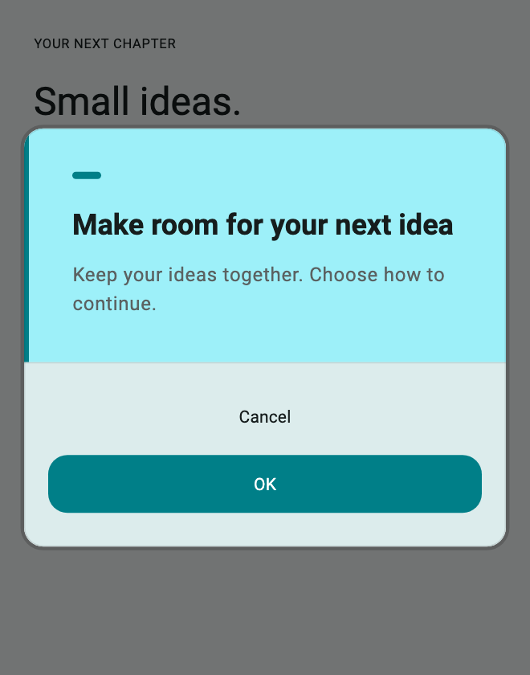](../assets/showcase-v021/dialogs.panelDecision.png)


**Copy & Use**

```dart
import 'package:flutter/material.dart';
import 'package:flutter_ui_gallery/flutter_ui_gallery.dart';

// Apply this theme to MaterialApp(theme: showDialogsPanelDecisionTheme()).
ThemeData showDialogsPanelDecisionTheme({
  Brightness brightness = Brightness.light,
}) {
  final base = ThemeData(
    colorScheme: ColorScheme.fromSeed(
      seedColor: Color(0xff007f88),
      brightness: brightness,
    ),
  );
  final recipe = UiGalleryTheme.family(
    UiGalleryDesignFamily.soft,
    theme: base,
    useSignature: true,
  );
  return base.copyWith(
    extensions: [
      recipe.copyWith(
        surfaceStyle: recipe.surfaceStyle!.copyWith(
          accentColor: Color(0xff007f88),
        ),
        motionIntensity: 1,
      ),
    ],
  );
}

Future<bool?> showDialogsPanelDecision(BuildContext context) {
  return UiGalleryDialog.confirm(
    context: context,
    useRootNavigator: false,
    preset: UiGalleryDialogPreset.panelDecision,
    title: "Make room for your next idea",
    message: "Keep your ideas together. Choose how to continue.",
    style: const UiGallerySurfaceStyle(accentColor: Color(0xff007f88)),
  );
}
```

**Customize:** `title`, `message`, `actions`, `child`, `result`, `style`, and `motion`.

**Interaction:** Handle dismissal as `null`. Choice and command helpers return `String?`; confirmation helpers return `bool?`. Check `mounted` before updating state after awaiting.

[Complete runnable owner](../../example/lib/showcase.dart) · [Dart source](code/dialogs.panelDecision.dart) · [Back to category](#dialogs)

<a id="statusbeacon"></a>

## Status Beacon

`UiGalleryDialogPreset.statusBeacon` · `PRESET=dialogs.statusBeacon`

System notices and operational states. Status rail, information region and full action row.

[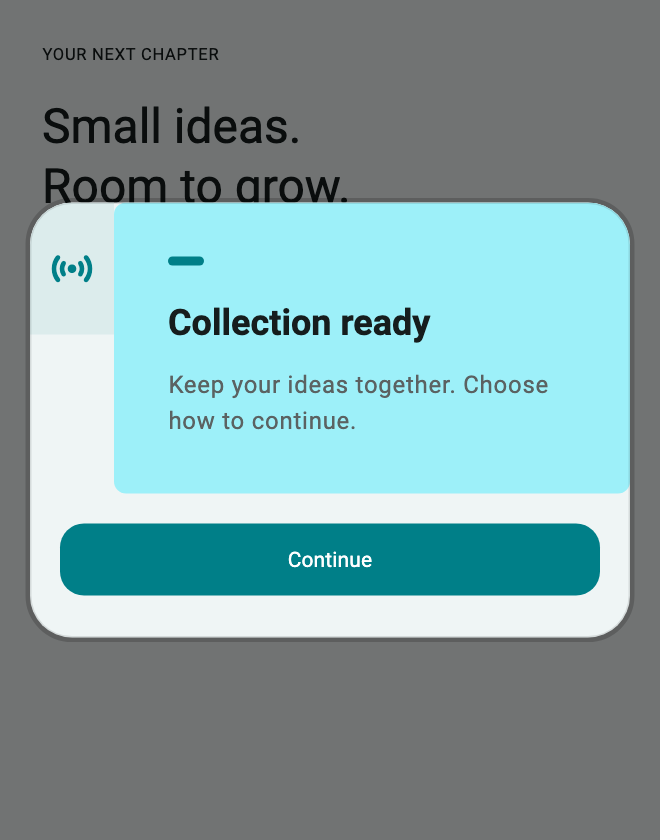](../assets/showcase-v021/dialogs.statusBeacon.png)


**Copy & Use**

```dart
import 'package:flutter/material.dart';
import 'package:flutter_ui_gallery/flutter_ui_gallery.dart';

// Apply this theme to MaterialApp(theme: showDialogsStatusBeaconTheme()).
ThemeData showDialogsStatusBeaconTheme({
  Brightness brightness = Brightness.light,
}) {
  final base = ThemeData(
    colorScheme: ColorScheme.fromSeed(
      seedColor: Color(0xff007f88),
      brightness: brightness,
    ),
  );
  final recipe = UiGalleryTheme.family(
    UiGalleryDesignFamily.soft,
    theme: base,
    useSignature: true,
  );
  return base.copyWith(
    extensions: [
      recipe.copyWith(
        surfaceStyle: recipe.surfaceStyle!.copyWith(
          accentColor: Color(0xff007f88),
        ),
        motionIntensity: 1,
      ),
    ],
  );
}

Future<String?> showDialogsStatusBeacon(
  BuildContext context,
  UiGalleryResult result,
) {
  return UiGalleryDialog.show<String>(
    context: context,
    useRootNavigator: false,
    preset: UiGalleryDialogPreset.statusBeacon,
    title: "Collection ready",
    message: "Keep your ideas together. Choose how to continue.",
    result: result,
    actions: const [
      UiGalleryDialogAction(
        label: 'Continue',
        value: 'Continued',
        primary: true,
      ),
    ],
    style: const UiGallerySurfaceStyle(accentColor: Color(0xff007f88)),
  );
}
```

**Customize:** `title`, `message`, `actions`, `child`, `result`, `style`, and `motion`.

**Interaction:** Pass the real operation result as `UiGalleryResult`; the preview uses `success`.

[Complete runnable owner](../../example/lib/showcase.dart) · [Dart source](code/dialogs.statusBeacon.dart) · [Back to category](#dialogs)

<a id="commandpalette"></a>

## Command Palette

`UiGalleryDialogPreset.commandPalette` · `PRESET=dialogs.commandPalette`

Searchable typed commands with keyboard navigation.

[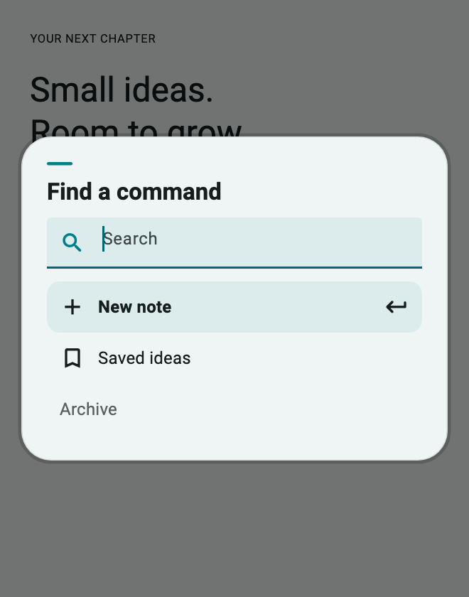](../assets/showcase-v021/dialogs.commandPalette.png)

[Filtered commands](../assets/showcase-v021/dialogs.commandPalette-filtered.png)

**Copy & Use**

```dart
import 'package:flutter/material.dart';
import 'package:flutter_ui_gallery/flutter_ui_gallery.dart';

// Apply this theme to MaterialApp(theme: showDialogsCommandPaletteTheme()).
ThemeData showDialogsCommandPaletteTheme({
  Brightness brightness = Brightness.light,
}) {
  final base = ThemeData(
    colorScheme: ColorScheme.fromSeed(
      seedColor: Color(0xff007f88),
      brightness: brightness,
    ),
  );
  final recipe = UiGalleryTheme.family(
    UiGalleryDesignFamily.soft,
    theme: base,
    useSignature: true,
  );
  return base.copyWith(
    extensions: [
      recipe.copyWith(
        surfaceStyle: recipe.surfaceStyle!.copyWith(
          accentColor: Color(0xff007f88),
        ),
        motionIntensity: 1,
      ),
    ],
  );
}

Future<String?> showDialogsCommandPalette(BuildContext context) {
  return UiGalleryDialog.commands<String>(
    context: context,
    title: "Find a command",
    useRootNavigator: false,
    emptyLabel: 'No matching commands',
    commands: const [
      UiGalleryDialogAction(
        label: 'New note',
        value: 'create',
        icon: Icon(Icons.add),
      ),
      UiGalleryDialogAction(
        label: 'Saved ideas',
        value: 'saved',
        icon: Icon(Icons.bookmark_outline),
      ),
      UiGalleryDialogAction(label: 'Archive', value: 'archive', enabled: false),
    ],
    style: const UiGallerySurfaceStyle(accentColor: Color(0xff007f88)),
  );
}
```

**Customize:** `title`, `message`, `actions`, `child`, `result`, `style`, and `motion`.

**Interaction:** Typing filters commands. Disabled commands stay unavailable; Enter selects the highlighted enabled command.

[Complete runnable owner](../../example/lib/showcase.dart) · [Dart source](code/dialogs.commandPalette.dart) · [Back to category](#dialogs)
