<!-- Generated by tool/build_showcase.py. -->
# Toasts

11 canonical presets. Keep people informed with compact feedback, recovery actions, and live progress.

[All categories](README.md) · [Package introduction](../../README.md) · [Theme and setup](../QUICK_START.md)

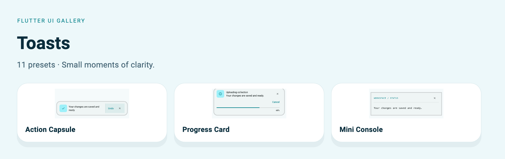

[Signal Pill](#signal) · [Edge Ribbon](#ribbon) · [Action Capsule](#action) · [Stack Tag](#stacktag) · [Inline Pulse](#inlinepulse) · [Beacon Toast](#beacon) · [Ribbon Action Bar](#ribbonactionbar) · [Dock Toast](#dock) · [Snap Notice](#snapnotice) · [Mini Console](#miniconsole) · [Progress Card](#progresscard)

The captures below use the included Soft theme with signatures enabled, at a
440 × 560 logical-pixel viewport and 1.5× export resolution. The light preview
matches the example's default theme. Each full example includes its imports and
theme helper. Apply that helper to `MaterialApp.theme` before invoking the widget.

For a complete app with owned state, callbacks, and disposal, use
[`example/lib/showcase.dart`](../../example/lib/showcase.dart):

```sh
cd example
flutter run -t lib/showcase.dart --dart-define=PRESET=toasts.action
```

Change `PRESET` to the exact ID beside any entry. Helper parameters are supplied
by your screen; the runnable app shows their ownership. Copy uses ordinary Dart
code fences and your Markdown viewer's native copy control where available.

<a id="signal"></a>

## Signal Pill

`UiGalleryToastPreset.signal` · `PRESET=toasts.signal`

Saved changes and short updates. Message-sized capsule with status and dismissal.

[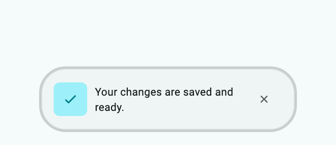](../assets/showcase-v021/toasts.signal.png)


**Copy & Use**

```dart
import 'package:flutter/material.dart';
import 'package:flutter_ui_gallery/flutter_ui_gallery.dart';

// Apply this theme to MaterialApp(theme: showToastsSignalTheme()).
ThemeData showToastsSignalTheme({Brightness brightness = Brightness.light}) {
  final base = ThemeData(
    colorScheme: ColorScheme.fromSeed(
      seedColor: Color(0xff007f88),
      brightness: brightness,
    ),
  );
  final recipe = UiGalleryTheme.family(
    UiGalleryDesignFamily.soft,
    theme: base,
    useSignature: true,
  );
  return base.copyWith(
    extensions: [
      recipe.copyWith(
        surfaceStyle: recipe.surfaceStyle!.copyWith(
          accentColor: Color(0xff007f88),
        ),
        motionIntensity: 1,
      ),
    ],
  );
}

void showToastsSignal(BuildContext context) {
  UiGalleryToast.show(
    context,
    preset: UiGalleryToastPreset.signal,
    message: "Your changes are saved and ready.",
    kind: UiGalleryToastKind.success,
    style: const UiGallerySurfaceStyle(accentColor: Color(0xff007f88)),
  );
}
```

**Customize:** `kind`, `position`, `duration`, `actionLabel` / `onAction`, `style`, and `motion`.

**Interaction:** Call from a mounted route below a `MaterialApp`. Supply both action label and callback. Route-scoped toasts are cleared when the route closes.

[Complete runnable owner](../../example/lib/showcase.dart) · [Dart source](code/toasts.signal.dart) · [Back to category](#toasts)

<a id="ribbon"></a>

## Edge Ribbon

`UiGalleryToastPreset.ribbon` · `PRESET=toasts.ribbon`

Warnings and connection errors. Edge-aligned directional accent strip.

[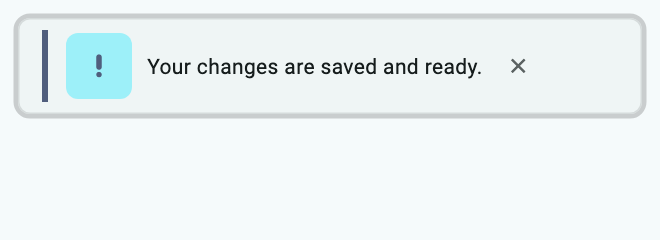](../assets/showcase-v021/toasts.ribbon.png)


**Copy & Use**

```dart
import 'package:flutter/material.dart';
import 'package:flutter_ui_gallery/flutter_ui_gallery.dart';

// Apply this theme to MaterialApp(theme: showToastsRibbonTheme()).
ThemeData showToastsRibbonTheme({Brightness brightness = Brightness.light}) {
  final base = ThemeData(
    colorScheme: ColorScheme.fromSeed(
      seedColor: Color(0xff007f88),
      brightness: brightness,
    ),
  );
  final recipe = UiGalleryTheme.family(
    UiGalleryDesignFamily.soft,
    theme: base,
    useSignature: true,
  );
  return base.copyWith(
    extensions: [
      recipe.copyWith(
        surfaceStyle: recipe.surfaceStyle!.copyWith(
          accentColor: Color(0xff007f88),
        ),
        motionIntensity: 1,
      ),
    ],
  );
}

void showToastsRibbon(BuildContext context) {
  UiGalleryToast.show(
    context,
    preset: UiGalleryToastPreset.ribbon,
    message: "Your changes are saved and ready.",
    kind: UiGalleryToastKind.warning,
    position: UiGalleryToastPosition.top,
    style: const UiGallerySurfaceStyle(accentColor: Color(0xff007f88)),
  );
}
```

**Customize:** `kind`, `position`, `duration`, `actionLabel` / `onAction`, `style`, and `motion`.

**Interaction:** Call from a mounted route below a `MaterialApp`. Supply both action label and callback. Route-scoped toasts are cleared when the route closes.

[Complete runnable owner](../../example/lib/showcase.dart) · [Dart source](code/toasts.ribbon.dart) · [Back to category](#toasts)

<a id="action"></a>

## Action Capsule

`UiGalleryToastPreset.action` · `PRESET=toasts.action`

Undo and retry. Coordinated message and action with timeout track.

[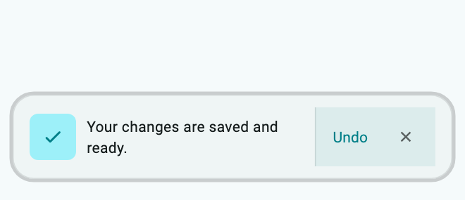](../assets/showcase-v021/toasts.action.png)

[Dark theme](../assets/showcase-v021/toasts.action-dark.png)

**Copy & Use**

```dart
import 'package:flutter/material.dart';
import 'package:flutter_ui_gallery/flutter_ui_gallery.dart';

// Apply this theme to MaterialApp(theme: showToastsActionTheme()).
ThemeData showToastsActionTheme({Brightness brightness = Brightness.light}) {
  final base = ThemeData(
    colorScheme: ColorScheme.fromSeed(
      seedColor: Color(0xff007f88),
      brightness: brightness,
    ),
  );
  final recipe = UiGalleryTheme.family(
    UiGalleryDesignFamily.soft,
    theme: base,
    useSignature: true,
  );
  return base.copyWith(
    extensions: [
      recipe.copyWith(
        surfaceStyle: recipe.surfaceStyle!.copyWith(
          accentColor: Color(0xff007f88),
        ),
        motionIntensity: 1,
      ),
    ],
  );
}

void showToastsAction(BuildContext context, VoidCallback onUndo) {
  UiGalleryToast.show(
    context,
    preset: UiGalleryToastPreset.action,
    message: "Your changes are saved and ready.",
    kind: UiGalleryToastKind.success,
    actionLabel: 'Undo',
    onAction: onUndo,
    showProgress: true,
    style: const UiGallerySurfaceStyle(accentColor: Color(0xff007f88)),
  );
}
```

**Customize:** `kind`, `position`, `duration`, `actionLabel` / `onAction`, `style`, and `motion`.

**Interaction:** Call from a mounted route below a `MaterialApp`. Supply both action label and callback. Route-scoped toasts are cleared when the route closes.

[Complete runnable owner](../../example/lib/showcase.dart) · [Dart source](code/toasts.action.dart) · [Back to category](#toasts)

<a id="stacktag"></a>

## Stack Tag

`UiGalleryToastPreset.stackTag` · `PRESET=toasts.stackTag`

Stackable compact event notices. Labeled clipped-corner tag for grouped events.

[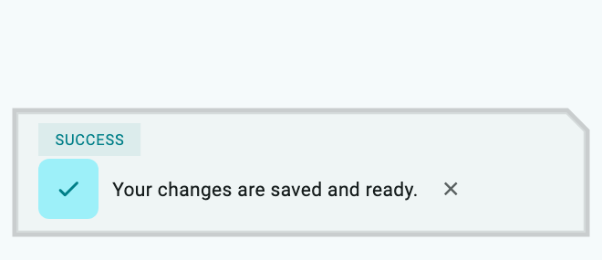](../assets/showcase-v021/toasts.stackTag.png)


**Copy & Use**

```dart
import 'package:flutter/material.dart';
import 'package:flutter_ui_gallery/flutter_ui_gallery.dart';

// Apply this theme to MaterialApp(theme: showToastsStackTagTheme()).
ThemeData showToastsStackTagTheme({Brightness brightness = Brightness.light}) {
  final base = ThemeData(
    colorScheme: ColorScheme.fromSeed(
      seedColor: Color(0xff007f88),
      brightness: brightness,
    ),
  );
  final recipe = UiGalleryTheme.family(
    UiGalleryDesignFamily.soft,
    theme: base,
    useSignature: true,
  );
  return base.copyWith(
    extensions: [
      recipe.copyWith(
        surfaceStyle: recipe.surfaceStyle!.copyWith(
          accentColor: Color(0xff007f88),
        ),
        motionIntensity: 1,
      ),
    ],
  );
}

void showToastsStackTag(BuildContext context) {
  UiGalleryToast.show(
    context,
    preset: UiGalleryToastPreset.stackTag,
    message: "Your changes are saved and ready.",
    kind: UiGalleryToastKind.success,
    style: const UiGallerySurfaceStyle(accentColor: Color(0xff007f88)),
  );
}
```

**Customize:** `kind`, `position`, `duration`, `actionLabel` / `onAction`, `style`, and `motion`.

**Interaction:** Call from a mounted route below a `MaterialApp`. Supply both action label and callback. Route-scoped toasts are cleared when the route closes.

[Complete runnable owner](../../example/lib/showcase.dart) · [Dart source](code/toasts.stackTag.dart) · [Back to category](#toasts)

<a id="inlinepulse"></a>

## Inline Pulse

`UiGalleryToastPreset.inlinePulse` · `PRESET=toasts.inlinePulse`

Passive synchronization updates. Flat information strip with a precise baseline.

[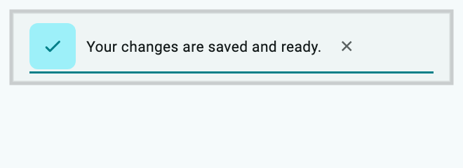](../assets/showcase-v021/toasts.inlinePulse.png)


**Copy & Use**

```dart
import 'package:flutter/material.dart';
import 'package:flutter_ui_gallery/flutter_ui_gallery.dart';

// Apply this theme to MaterialApp(theme: showToastsInlinePulseTheme()).
ThemeData showToastsInlinePulseTheme({
  Brightness brightness = Brightness.light,
}) {
  final base = ThemeData(
    colorScheme: ColorScheme.fromSeed(
      seedColor: Color(0xff007f88),
      brightness: brightness,
    ),
  );
  final recipe = UiGalleryTheme.family(
    UiGalleryDesignFamily.soft,
    theme: base,
    useSignature: true,
  );
  return base.copyWith(
    extensions: [
      recipe.copyWith(
        surfaceStyle: recipe.surfaceStyle!.copyWith(
          accentColor: Color(0xff007f88),
        ),
        motionIntensity: 1,
      ),
    ],
  );
}

void showToastsInlinePulse(BuildContext context) {
  UiGalleryToast.show(
    context,
    preset: UiGalleryToastPreset.inlinePulse,
    message: "Your changes are saved and ready.",
    kind: UiGalleryToastKind.success,
    position: UiGalleryToastPosition.top,
    style: const UiGallerySurfaceStyle(accentColor: Color(0xff007f88)),
  );
}
```

**Customize:** `kind`, `position`, `duration`, `actionLabel` / `onAction`, `style`, and `motion`.

**Interaction:** Call from a mounted route below a `MaterialApp`. Supply both action label and callback. Route-scoped toasts are cleared when the route closes.

[Complete runnable owner](../../example/lib/showcase.dart) · [Dart source](code/toasts.inlinePulse.dart) · [Back to category](#toasts)

<a id="beacon"></a>

## Beacon Toast

`UiGalleryToastPreset.beacon` · `PRESET=toasts.beacon`

Status notices with extra context. Separate circular status well and message region.

[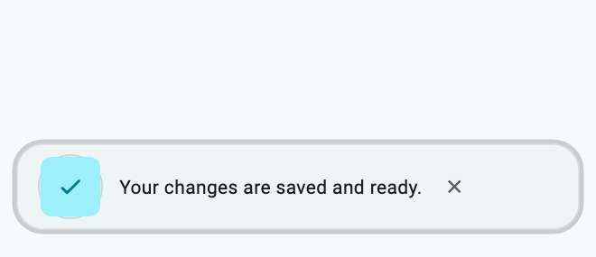](../assets/showcase-v021/toasts.beacon.png)


**Copy & Use**

```dart
import 'package:flutter/material.dart';
import 'package:flutter_ui_gallery/flutter_ui_gallery.dart';

// Apply this theme to MaterialApp(theme: showToastsBeaconTheme()).
ThemeData showToastsBeaconTheme({Brightness brightness = Brightness.light}) {
  final base = ThemeData(
    colorScheme: ColorScheme.fromSeed(
      seedColor: Color(0xff007f88),
      brightness: brightness,
    ),
  );
  final recipe = UiGalleryTheme.family(
    UiGalleryDesignFamily.soft,
    theme: base,
    useSignature: true,
  );
  return base.copyWith(
    extensions: [
      recipe.copyWith(
        surfaceStyle: recipe.surfaceStyle!.copyWith(
          accentColor: Color(0xff007f88),
        ),
        motionIntensity: 1,
      ),
    ],
  );
}

void showToastsBeacon(BuildContext context) {
  UiGalleryToast.show(
    context,
    preset: UiGalleryToastPreset.beacon,
    message: "Your changes are saved and ready.",
    kind: UiGalleryToastKind.success,
    style: const UiGallerySurfaceStyle(accentColor: Color(0xff007f88)),
  );
}
```

**Customize:** `kind`, `position`, `duration`, `actionLabel` / `onAction`, `style`, and `motion`.

**Interaction:** Call from a mounted route below a `MaterialApp`. Supply both action label and callback. Route-scoped toasts are cleared when the route closes.

[Complete runnable owner](../../example/lib/showcase.dart) · [Dart source](code/toasts.beacon.dart) · [Back to category](#toasts)

<a id="ribbonactionbar"></a>

## Ribbon Action Bar

`UiGalleryToastPreset.ribbonActionBar` · `PRESET=toasts.ribbonActionBar`

Action-first retry notifications. Action precedes the message on a directional strip.

[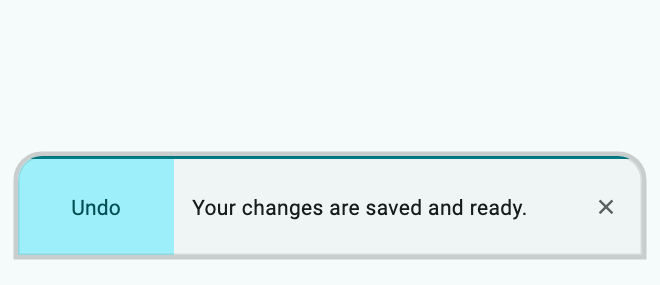](../assets/showcase-v021/toasts.ribbonActionBar.png)


**Copy & Use**

```dart
import 'package:flutter/material.dart';
import 'package:flutter_ui_gallery/flutter_ui_gallery.dart';

// Apply this theme to MaterialApp(theme: showToastsRibbonActionBarTheme()).
ThemeData showToastsRibbonActionBarTheme({
  Brightness brightness = Brightness.light,
}) {
  final base = ThemeData(
    colorScheme: ColorScheme.fromSeed(
      seedColor: Color(0xff007f88),
      brightness: brightness,
    ),
  );
  final recipe = UiGalleryTheme.family(
    UiGalleryDesignFamily.soft,
    theme: base,
    useSignature: true,
  );
  return base.copyWith(
    extensions: [
      recipe.copyWith(
        surfaceStyle: recipe.surfaceStyle!.copyWith(
          accentColor: Color(0xff007f88),
        ),
        motionIntensity: 1,
      ),
    ],
  );
}

void showToastsRibbonActionBar(BuildContext context, VoidCallback onUndo) {
  UiGalleryToast.show(
    context,
    preset: UiGalleryToastPreset.ribbonActionBar,
    message: "Your changes are saved and ready.",
    kind: UiGalleryToastKind.success,
    actionLabel: 'Undo',
    onAction: onUndo,
    showProgress: true,
    style: const UiGallerySurfaceStyle(accentColor: Color(0xff007f88)),
  );
}
```

**Customize:** `kind`, `position`, `duration`, `actionLabel` / `onAction`, `style`, and `motion`.

**Interaction:** Call from a mounted route below a `MaterialApp`. Supply both action label and callback. Route-scoped toasts are cleared when the route closes.

[Complete runnable owner](../../example/lib/showcase.dart) · [Dart source](code/toasts.ribbonActionBar.dart) · [Back to category](#toasts)

<a id="dock"></a>

## Dock Toast

`UiGalleryToastPreset.dock` · `PRESET=toasts.dock`

Persistent session and download status. Wide docked status deck and divider.

[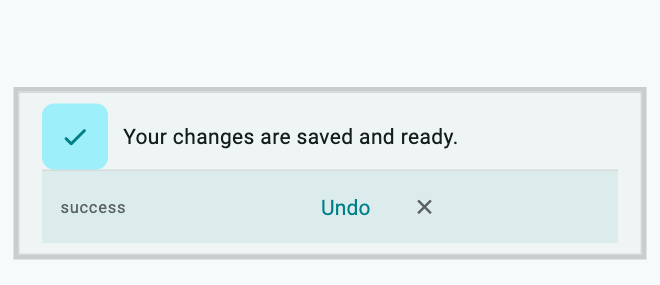](../assets/showcase-v021/toasts.dock.png)


**Copy & Use**

```dart
import 'package:flutter/material.dart';
import 'package:flutter_ui_gallery/flutter_ui_gallery.dart';

// Apply this theme to MaterialApp(theme: showToastsDockTheme()).
ThemeData showToastsDockTheme({Brightness brightness = Brightness.light}) {
  final base = ThemeData(
    colorScheme: ColorScheme.fromSeed(
      seedColor: Color(0xff007f88),
      brightness: brightness,
    ),
  );
  final recipe = UiGalleryTheme.family(
    UiGalleryDesignFamily.soft,
    theme: base,
    useSignature: true,
  );
  return base.copyWith(
    extensions: [
      recipe.copyWith(
        surfaceStyle: recipe.surfaceStyle!.copyWith(
          accentColor: Color(0xff007f88),
        ),
        motionIntensity: 1,
      ),
    ],
  );
}

void showToastsDock(BuildContext context, VoidCallback onUndo) {
  UiGalleryToast.show(
    context,
    preset: UiGalleryToastPreset.dock,
    message: "Your changes are saved and ready.",
    kind: UiGalleryToastKind.success,
    actionLabel: 'Undo',
    onAction: onUndo,
    showProgress: true,
    style: const UiGallerySurfaceStyle(accentColor: Color(0xff007f88)),
  );
}
```

**Customize:** `kind`, `position`, `duration`, `actionLabel` / `onAction`, `style`, and `motion`.

**Interaction:** Call from a mounted route below a `MaterialApp`. Supply both action label and callback. Route-scoped toasts are cleared when the route closes.

[Complete runnable owner](../../example/lib/showcase.dart) · [Dart source](code/toasts.dock.dart) · [Back to category](#toasts)

<a id="snapnotice"></a>

## Snap Notice

`UiGalleryToastPreset.snapNotice` · `PRESET=toasts.snapNotice`

Short context-specific feedback. Small side-anchored vertical notice.

[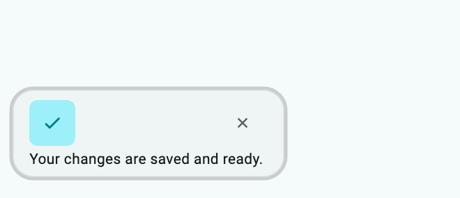](../assets/showcase-v021/toasts.snapNotice.png)


**Copy & Use**

```dart
import 'package:flutter/material.dart';
import 'package:flutter_ui_gallery/flutter_ui_gallery.dart';

// Apply this theme to MaterialApp(theme: showToastsSnapNoticeTheme()).
ThemeData showToastsSnapNoticeTheme({
  Brightness brightness = Brightness.light,
}) {
  final base = ThemeData(
    colorScheme: ColorScheme.fromSeed(
      seedColor: Color(0xff007f88),
      brightness: brightness,
    ),
  );
  final recipe = UiGalleryTheme.family(
    UiGalleryDesignFamily.soft,
    theme: base,
    useSignature: true,
  );
  return base.copyWith(
    extensions: [
      recipe.copyWith(
        surfaceStyle: recipe.surfaceStyle!.copyWith(
          accentColor: Color(0xff007f88),
        ),
        motionIntensity: 1,
      ),
    ],
  );
}

void showToastsSnapNotice(BuildContext context) {
  UiGalleryToast.show(
    context,
    preset: UiGalleryToastPreset.snapNotice,
    message: "Your changes are saved and ready.",
    kind: UiGalleryToastKind.success,
    style: const UiGallerySurfaceStyle(accentColor: Color(0xff007f88)),
  );
}
```

**Customize:** `kind`, `position`, `duration`, `actionLabel` / `onAction`, `style`, and `motion`.

**Interaction:** Call from a mounted route below a `MaterialApp`. Supply both action label and callback. Route-scoped toasts are cleared when the route closes.

[Complete runnable owner](../../example/lib/showcase.dart) · [Dart source](code/toasts.snapNotice.dart) · [Back to category](#toasts)

<a id="miniconsole"></a>

## Mini Console

`UiGalleryToastPreset.miniConsole` · `PRESET=toasts.miniConsole`

Developer and system information. Monospace status header and message log region.

[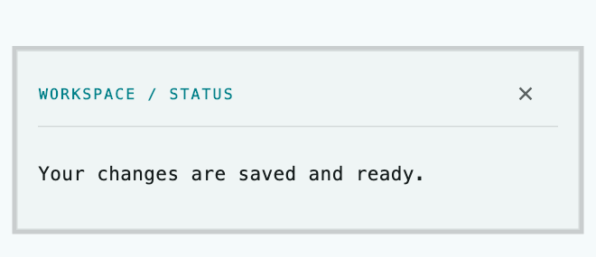](../assets/showcase-v021/toasts.miniConsole.png)


**Copy & Use**

```dart
import 'package:flutter/material.dart';
import 'package:flutter_ui_gallery/flutter_ui_gallery.dart';

// Apply this theme to MaterialApp(theme: showToastsMiniConsoleTheme()).
ThemeData showToastsMiniConsoleTheme({
  Brightness brightness = Brightness.light,
}) {
  final base = ThemeData(
    colorScheme: ColorScheme.fromSeed(
      seedColor: Color(0xff007f88),
      brightness: brightness,
    ),
  );
  final recipe = UiGalleryTheme.family(
    UiGalleryDesignFamily.soft,
    theme: base,
    useSignature: true,
  );
  return base.copyWith(
    extensions: [
      recipe.copyWith(
        surfaceStyle: recipe.surfaceStyle!.copyWith(
          accentColor: Color(0xff007f88),
        ),
        motionIntensity: 1,
      ),
    ],
  );
}

void showToastsMiniConsole(BuildContext context) {
  UiGalleryToast.show(
    context,
    preset: UiGalleryToastPreset.miniConsole,
    message: "Your changes are saved and ready.",
    kind: UiGalleryToastKind.success,
    title: 'WORKSPACE / STATUS',
    style: const UiGallerySurfaceStyle(accentColor: Color(0xff007f88)),
  );
}
```

**Customize:** `kind`, `position`, `duration`, `actionLabel` / `onAction`, `style`, and `motion`.

**Interaction:** Call from a mounted route below a `MaterialApp`. Supply both action label and callback. Route-scoped toasts are cleared when the route closes.

[Complete runnable owner](../../example/lib/showcase.dart) · [Dart source](code/toasts.miniConsole.dart) · [Back to category](#toasts)

<a id="progresscard"></a>

## Progress Card

`UiGalleryToastPreset.progressCard` · `PRESET=toasts.progressCard`

Caller-owned task progress, cancellation and explicit completion.

[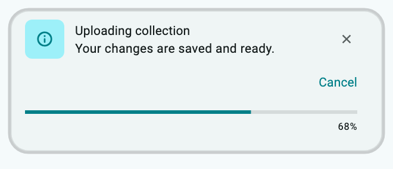](../assets/showcase-v021/toasts.progressCard.png)


**Copy & Use**

```dart
import 'package:flutter/foundation.dart';
import 'package:flutter/material.dart';
import 'package:flutter_ui_gallery/flutter_ui_gallery.dart';

// Apply this theme to MaterialApp(theme: showToastsProgressCardTheme()).
ThemeData showToastsProgressCardTheme({
  Brightness brightness = Brightness.light,
}) {
  final base = ThemeData(
    colorScheme: ColorScheme.fromSeed(
      seedColor: Color(0xff007f88),
      brightness: brightness,
    ),
  );
  final recipe = UiGalleryTheme.family(
    UiGalleryDesignFamily.soft,
    theme: base,
    useSignature: true,
  );
  return base.copyWith(
    extensions: [
      recipe.copyWith(
        surfaceStyle: recipe.surfaceStyle!.copyWith(
          accentColor: Color(0xff007f88),
        ),
        motionIntensity: 1,
      ),
    ],
  );
}

UiGalleryToastHandle showToastsProgressCard(
  BuildContext context,
  ValueListenable<double> progress,
  VoidCallback onCancel,
) {
  return UiGalleryToast.progress(
    context,
    title: "Uploading collection",
    message: "Your changes are saved and ready.",
    progress: progress,
    actionLabel: 'Cancel',
    onAction: onCancel,
    style: const UiGallerySurfaceStyle(accentColor: Color(0xff007f88)),
  );
}
```

**Customize:** `kind`, `position`, `duration`, `actionLabel` / `onAction`, `style`, and `motion`.

**Interaction:** Own and dispose a `ValueNotifier<double>` with values from 0 to 1. Dismiss the returned toast handle before disposing the notifier. Progress does not imply an actual upload.

[Complete runnable owner](../../example/lib/showcase.dart) · [Dart source](code/toasts.progressCard.dart) · [Back to category](#toasts)
